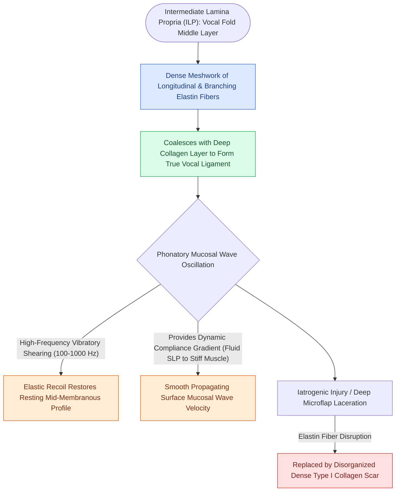

# The intermediate lamina propria provides elastic recoil via elastin fibers

## Active Recall

> [!question]- What is the primary extracellular matrix protein within the intermediate lamina propria, and what is its biomechanical role?
> *Answer / Clinical Rationale*: **Elastin** is the primary constituent, providing elastic recoil and restorative tension along the anterior-posterior axis during vocal fold vibration and pitch modulation.

> [!question]- Which two histological layers combine to form the vocal ligament?
> *Answer / Clinical Rationale*: The intermediate lamina propria and the deep lamina propria.

## Core Clinical & Mechanistic Principles
The **Intermediate Lamina Propria (ILP)** is the middle layer of the vocal fold lamina propria, situated between the [[The superficial lamina propria acts as a pliable shearing fluid bed|superficial lamina propria]] and the [[The deep lamina propria provides tensile stiffness via crosslinked collagen|deep lamina propria]].

### Histological & Biomechanical Composition
- **Dense Elastin Network**: The ILP is predominantly composed of branching, longitudinally oriented **elastin fibers** intertwined with scaffolding microfibrils (fibrillin-1, fibulin-1, fibulin-5).
- **Elastic Recoil**: It acts like a rubber band along the anterior-posterior phonatory axis, providing rapid elastic recoil during cyclic vocal fold elongation and relaxation.
- **Superficial Boundary of Vocal Ligament**: Together with the collagen-dense deep lamina propria, the ILP constitutes the true vocal ligament.

## Surgical Anatomy, Step-by-Step Technique & Nuances
- **Avoid Disruption in Benign Resections**: The ILP defines the superficial boundary of the vocal ligament. In [[Phonomicrosurgery requires suspension laryngoscopy and stereoscopic magnification|phonomicrosurgery]] for benign lesions (such as [[Vocal fold polyps arise from phonotraumatic microvascular injury in Reinke's space|polyps]] or [[Mucous retention cysts arise from obstructed glands in superficial lamina propria|mucous retention cysts]]), dissection must stay strictly superficial to the ILP.
- **Epidermoid Cyst Adhesion**: Unlike mucous retention cysts, epidermoid cysts frequently adhere directly to the ILP elastin fibers, requiring meticulous sharp micro-dissection.

## Critical Failure Modes & Error Traps
- **Elastin Matrix Destruction**: Thermal damage from laser or deep micro-scissor cordotomy disrupts the longitudinal elastin scaffolding. Regenerating tissue replaces elastin with stiff, inelastic [[Vocal fold scar results from disorganized Type I collagen deposition|Type I collagen]], leading to permanent loss of pitch range and dynamic pitch modulation.

## Connected Concepts & Graph Traversal
- **Overlying Shearing Bed**: [[The superficial lamina propria acts as a pliable shearing fluid bed|Superficial Lamina Propria (Reinke's Space)]]
- **Underlying Collagen Layer**: [[The deep lamina propria provides tensile stiffness via crosslinked collagen|Deep Lamina Propria (DLP)]]
- **Combined Structure**: [[The vocal ligament comprises intermediate and deep lamina propria|The Vocal Ligament]]
- **Surgical Nuance**: [[Epidermoid cysts adhere to the vocal ligament and require sharp dissection|Epidermoid Cyst Microdissection]]
- **Surgical Technique**: [[The epithelial-sparing microflap preserves native mucosa and prevents glottic webbing|Phonomicrosurgical Microflap Technique]]
