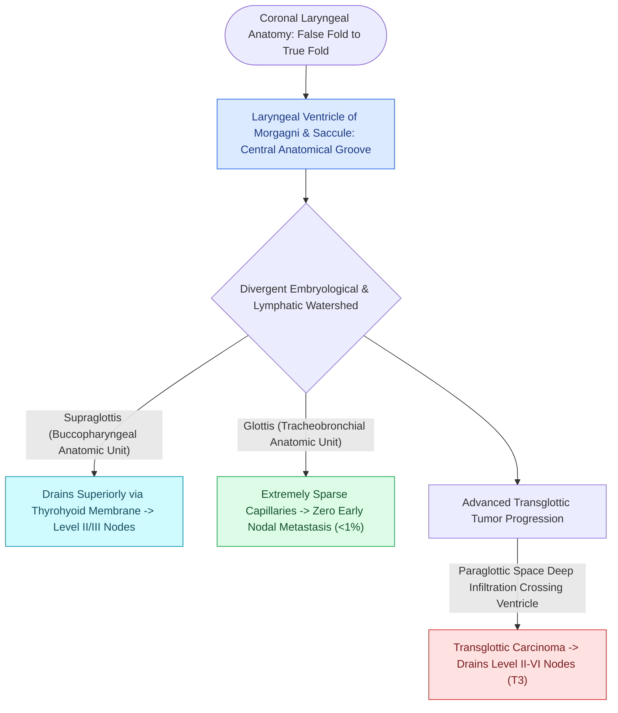

# The laryngeal ventricle separates supraglottic and glottic lymphatic pathways

## Active Recall

> [!question]- Why do early T1 glottic carcinomas have a <2% risk of nodal metastasis while early supraglottic carcinomas have a 30–50% risk?
> *Answer / Clinical Rationale*: The glottis (6th arch) has **virtually no capillary lymphatic channels** in the true vocal fold cover, whereas the supraglottis (3rd/4th arches) possesses an **extensive, rich capillary lymphatic plexus** that drains directly through the thyrohyoid membrane into Level II and III cervical lymph nodes.

> [!question]- What anatomical structure represents the embryologic watershed dividing the 3rd/4th arch supraglottis from the 6th arch glottis?
> *Answer / Clinical Rationale*: The **floor of the laryngeal ventricle of Morgagni**.

## Core Clinical & Mechanistic Principles
The anatomical dividing line at the floor of the **laryngeal ventricle of Morgagni** represents a profound **embryologic, vascular, and lymphatic boundary** established during early branchial apparatus development.

### Dual Branchial Arch Origin
1. **Supraglottis (Buccopharyngeal Anlage)**:
   - Originates from the **3rd and 4th branchial arches** (hypobranchial eminence).
   - Innervated by the [[The superior laryngeal nerve provides supraglottic sensation and cricothyroid motor control|Superior Laryngeal Nerve (SLN)]].
   - Vascular supply: Superior laryngeal artery (branch of superior thyroid artery).
   - **Rich Lymphatic Network**: Drains superiorly through the thyrohyoid membrane into **Level II and Level III deep cervical lymph nodes**. High rate of bilateral early cervical nodal metastasis ($30\text{–}50\%$).
2. **Glottis & Subglottis (Tracheopulmonary Anlage)**:
   - Originates from the **6th branchial arch** (laryngotracheal groove).
   - Innervated by the [[The recurrent laryngeal nerve innervates all intrinsic muscles except cricothyroid|Recurrent Laryngeal Nerve (RLN)]].
   - Vascular supply: Inferior laryngeal artery (branch of inferior thyroid artery).
   - **Sparse / Absent True Glottic Lymphatics**: The true vocal fold free edge is virtually devoid of capillary lymphatic channels. Early T1/T2 glottic cancers have a nodal metastasis rate of **$<1\text{–}2\%$**.

## Oncologic & Conservation Surgery Significance
- **Basis for Partial Laryngectomy**: Because supraglottic and glottic compartments have distinct embryologic linings and lymphatic drainage pathways that do not readily communicate across the ventricle, supraglottic carcinomas can be safely resected via [[Horizontal supraglottic laryngectomy resects supraglottic cancer while preserving vocal folds|horizontal supraglottic laryngectomy (HSL)]] without resecting the glottis.
- **Elective Neck Dissection Strategy**:
  - *Supraglottic SCC*: Mandatory bilateral elective Level II–IV neck dissections (even in cN0 necks).
  - *Early Glottic SCC (T1/T2)*: Neck dissection is **not indicated** in cN0 disease due to the absence of glottic lymphatics.

## Connected Concepts & Graph Traversal
- **Pre-Epiglottic Space**: [[The pre-epiglottic space enables rapid supraglottic cancer spread|Pre-Epiglottic Space]]
- **Paraglottic Space Compartment**: [[The paraglottic space facilitates transglottic tumor spread|Paraglottic Space]]
- **Broyles' Ligament Anchor**: [[Broyles' ligament anchors the vocal ligament to thyroid cartilage|Broyles' Ligament]]
- **Supraglottic Resection Boundaries**: [[Horizontal supraglottic laryngectomy resects supraglottic cancer while preserving vocal folds|Horizontal Supraglottic Laryngectomy]]
- **Total Laryngectomy en bloc**: [[Total laryngectomy achieves en bloc laryngeal resection with permanent end-stoma|Total Laryngectomy]]
