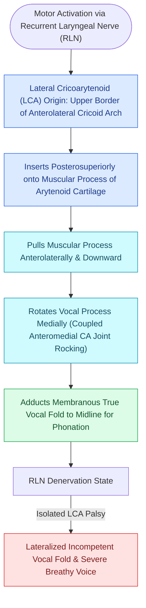

# The lateral cricoarytenoid is the primary membranous fold adductor

## Active Recall

> [!question]- Which intrinsic muscle is the primary driver of membranous vocal fold adduction?
> *Answer / Clinical Rationale*: The **Lateral Cricoarytenoid (LCA) Muscle**, which pulls the muscular process forward to swing the vocal process to the midline.

> [!question]- What surgical procedure uses nonabsorbable sutures to recreate the physical vector of the LCA muscle?
> *Answer / Clinical Rationale*: Arytenoid adduction, which anchors the muscular process to the anterior thyroid lamina.

## Core Clinical & Mechanistic Principles
The **Lateral Cricoarytenoid (LCA) Muscle** is the primary intrinsic laryngeal muscle responsible for **adducting the membranous portion of the vocal fold** to initiate and sustain phonation.

### Anatomical Attachments & Kinematics
- **Origin**: Superior border and lateral arch of the [[Cricotracheal resection removes subglottic stenosis while sparing posterior cricoid and RLNs|cricoid cartilage]].
- **Insertion**: Muscular process of the [[The cricoarytenoid joint moves via coupled rocking and sliding|arytenoid cartilage]] (anterior surface).
- **Innervation**: Supplied by the anterior branch of the [[The recurrent laryngeal nerve innervates all intrinsic muscles except cricothyroid|recurrent laryngeal nerve (RLN)]].
- **Kinematic Vector**: Pulls the muscular process **anteromedially and downward**, which causes the vocal process to rotate **medially and downward** toward the glottic midline.

## Biomechanical Action in Phonation & Glottal Configuration
- **Membranous vs Cartilaginous Closure**: LCA contraction firmly apposes the anterior two-thirds (membranous vocal fold) but may leave a small triangular posterior gap unless the [[The interarytenoid muscle closes the posterior glottic chink|interarytenoid (IA) muscle]] co-contracts.
- **Synergistic Action with TA**: Operates synergistically with the [[The thyroarytenoid muscle modulates glottal stiffness and adduction|thyroarytenoid (TA) muscle]] to provide tight medial compression and establish optimal phonation threshold pressure.

## Clinical & Surgical Significance
- **Paralysis Manifestation**: In isolated LCA/TA denervation, the vocal fold remains abducted in the paramedian or lateral position, leading to severe glottic air escape, breathiness, and elevated phonation threshold pressure.
- **Arytenoid Adduction Vector**: The suture vector placed in arytenoid adduction surgery precisely mimics the anatomical pull of the LCA muscle.

## Critical Failure Modes & Error Traps
- **Persistent Posterior Chink**: Failure of LCA activation or isolated IA weakness results in a persistent posterior glottic gap, causing vocal fatigue and reduced maximum phonation time (MPT).

## Connected Concepts & Graph Traversal
- **Sole Abductor Muscle**: [[The posterior cricoarytenoid is the sole vocal fold abductor|Posterior Cricoarytenoid]]
- **Posterior Chink Adductor**: [[The interarytenoid muscle closes the posterior glottic chink|Interarytenoid Muscle]]
- **Body Modulator & Adductor**: [[The thyroarytenoid muscle modulates glottal stiffness and adduction|Thyroarytenoid Muscle]]
- **Pitch Tensor Antagonist**: [[The cricothyroid muscle elongates vocal folds to elevate pitch|Cricothyroid Muscle]]
- **RLN Motor Supply**: [[The recurrent laryngeal nerve innervates all intrinsic muscles except cricothyroid|Recurrent Laryngeal Nerve]]
