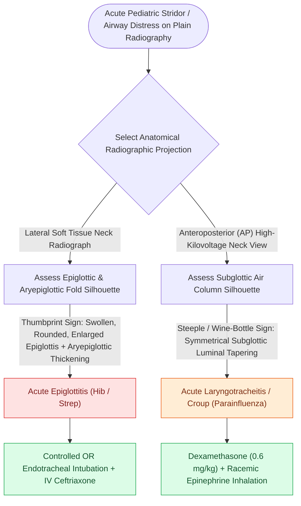

# The lateral neck thumb sign and steeple sign differentiate epiglottitis from croup on plain radiography

## Active Recall

> [!question]- What radiographic projection and anatomical landmark define the "Thumb Sign" versus the "Steeple Sign"?
> *Answer / Clinical Rationale*: The **Thumb Sign** is observed on the **lateral neck radiograph** and represents a bulbous, edematous **epiglottis and aryepiglottic folds**; the **Steeple Sign** is observed on the **AP neck radiograph** and represents symmetric tapering of the **subglottic tracheal air column**.

> [!question]- Why can placing an adult with acute epiglottitis flat in a CT scanner precipitate acute respiratory arrest?
> *Answer / Clinical Rationale*: In the upright posture, gravity and negative intrathoracic pull help maintain a patent pharyngeal aperture; **supine positioning causes the heavy, edematous epiglottis to fall posteriorly against the posterior pharyngeal wall**, producing complete mechanical airway obstruction.

## Core Clinical & Mechanistic Principles
In pediatric and adult patients presenting with acute stridor or upper airway obstruction, **plain radiographs of the soft tissues of the neck** serve as rapid, non-invasive screening modalities. However, imaging is strictly reserved for hemodynamically and respiratory-stable patients; an unstable patient must be taken directly to the operating room for definitive endoscopic evaluation. Two classic pathognomonic radiologic signs reliably differentiate supraglottic from subglottic inflammatory emergencies:

- **The "Thumb Sign" (Lateral Soft Tissue Neck Radiograph)**:
  - **Pathology**: Diagnostic of **acute epiglottitis (supraglottitis)**.
  - **Morphology**: The normal epiglottis appears as a slender, thin, leaf-like curved radiopaque structure projecting posterosuperiorly from the base of the tongue into the hypopharynx (resembling a "little finger"). In acute epiglottitis, profound submucosal cellulitis and edema cause the free margin of the epiglottis to expand into a bulbous, rounded silhouette resembling the **distal phalanx of an adult thumb**.
  - **Associated Lateral Signs**:
    - *Thickened Aryepiglottic Folds*: Pathologic widening (>7 mm) reflecting generalized supraglottic edema.
    - *Vallecula Sign*: Complete obliteration of the normal air column in the lingual vallecula.
    - *Hypopharyngeal Distension*: Secondary aerophagia and upstream pharyngeal ballooning during inspiratory effort against the supraglottic obstruction.

- **The "Steeple Sign" (Anteroposterior [AP] Neck Radiograph)**:
  - **Pathology**: Diagnostic of **viral [[Viral laryngotracheobronchitis croup presents with a barking cough and subglottic steeple sign on radiography|croup]] (laryngotracheobronchitis)**.
  - **Morphology**: The normal subglottic airway has square, convex lateral "shoulders" formed by the inferior borders of the true vocal cords and cricoid ring. In croup, circumferential inflammatory mucosal edema of the loose subglottic submucosa narrows the lumen symmetrically, creating an **inverted V-shaped tapering (steeple sign, pencil-point sign, or inverted wine-bottle sign)** 1–2 cm below the glottis.

### Safety Rules & Computed Tomography (CT) Cautions
1. **Never Send an Unstable Child Unaccompanied**: If plain films are ordered in a child with stridor, a physician trained in surgical airway management and equipped with an emergency airway bag (bag-valve-mask, endotracheal tubes, cricothyrotomy kit) must accompany the patient at all times.
2. **The Supine Decompensation Danger of CT**: While contrast-enhanced CT neck is highly sensitive for detecting epiglottic abscesses in adults, forcing an adult or child with acute supraglottitis into a **flat supine position in the CT gantry** can cause sudden gravitational posterior displacement of the swollen epiglottis, triggering immediate catastrophic asphyxiation. CT should only be obtained in patients with proven airway stability or after intubation.

## Connected Concepts & Graph Traversal
- **Clinical Presentation**: [[Acute epiglottitis presents with rapid-onset odynophagia, fever, and the tripod sign requiring immediate airway protection|Clinical Epiglottitis]]
- **Epidemiologic Context**: [[Haemophilus influenzae type b vaccination dramatically reduced pediatric epiglottitis incidence|Epiglottitis Microbiology & Hib Vaccine]]
- **🔗 Differential Subglottic Disease (Pediatrics)**: [[Nebulized racemic epinephrine and oral dexamethasone provide rapid treatment for acute croup|Croup Pathophysiology & Management]]
- **🔗 Retropharyngeal Imaging (Head and Neck)**: [[The retropharyngeal space extends from skull base to tracheal bifurcation and contains lymph nodes draining the nasopharynx|Retropharyngeal Space Widening]]
- **Emergency Surgical Airway**: [[Standard open tracheotomy utilizes horizontal intersinusoidal or Bjork flap entry|Emergency Open Tracheotomy]]
