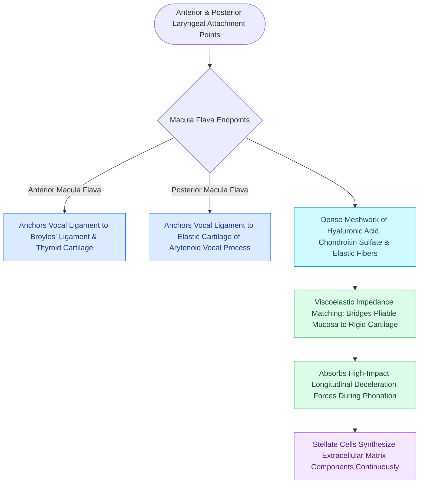

# The macula flava cushions the vocal fold to cartilage transition

## Active Recall

> [!question]- What is the cellular function of stellate cells residing in the maculae flavae?
> *Answer / Clinical Rationale*: Macula flava stellate cells act as active ECM-synthesizing and regenerative progenitor cells that produce [[Hyaluronic acid regulates lamina propria hydration and shock absorption|hyaluronic acid]], elastin, and collagen to maintain and repair the vocal fold lamina propria.

> [!question]- Why are the maculae flavae biomechanically necessary at the anterior and posterior ends of the vocal folds?
> *Answer / Clinical Rationale*: They provide a gradual stiffness gradient (impedance matching) that prevents stress concentration and mechanical failure at the junction between the soft membranous vocal fold and the rigid cartilaginous framework.

## Core Clinical & Mechanistic Principles
The **maculae flavae** (anterior and posterior) are specialized oval fibroelastic structures situated at both terminal ends of the membranous vocal fold. They serve as essential biomechanical transition zones that cushion the abrupt interface between the pliable vibratory tissue of the vocal fold and the rigid laryngeal cartilages.

### Anatomical Locations & Structure
- **Anterior Macula Flava (AMF)**: Located at the anterior commissure, where the [[The vocal ligament comprises intermediate and deep lamina propria|vocal ligament]] inserts into [[Broyles' ligament anchors the vocal ligament to thyroid cartilage|Broyles' ligament]] and the [[Thyroplasty cartilage window dimensions differ between males and females|thyroid cartilage]].
- **Posterior Macula Flava (PMF)**: Located posteriorly, where the vocal ligament inserts into the vocal process of the [[The cricoarytenoid joint moves via coupled rocking and sliding|arytenoid cartilage]].
- **Histological Composition**: Composed of a dense network of elastic and collagen fibers, stellate fibroblasts (macula flava stellate cells), glycosaminoglycans, and lipid droplets.
- **Stem/Progenitor Cell Niche**: Stellate cells within the maculae flavae are active synthesizers of extracellular matrix (ECM) proteins, acting as a regenerative progenitor niche for the [[The superficial lamina propria acts as a pliable shearing fluid bed|superficial lamina propria]] and vocal ligament.

## Surgical Anatomy, Step-by-Step Technique & Nuances
- **Mechanical Cushioning**: Protects the vibrating fold from shearing off its cartilaginous attachments during extreme acoustic stress and high-velocity deceleration collisions.
- **Surgical Preservation**: In phonomicrosurgical excision of lesions near the anterior commissure or vocal process, preserving the macula flava minimizes the risk of cartilage exposure and chronic granuloma formation.

## Critical Failure Modes & Error Traps
- **Contact Granuloma / Ulcer**: Mechanical trauma to the thin mucosa over the posterior macula flava and vocal process leads to peri-chondral exposure, reactive capillary proliferation, and contact granuloma formation.

## Connected Concepts & Graph Traversal
- **Anterior Insertion**: [[Broyles' ligament anchors the vocal ligament to thyroid cartilage|Broyles' Ligament]]
- **Attached Ligament**: [[The vocal ligament comprises intermediate and deep lamina propria|The Vocal Ligament]]
- **Posterior Cartilage**: [[The cricoarytenoid joint moves via coupled rocking and sliding|Cricoarytenoid Joint]]
- **ECM Production**: [[Hyaluronic acid regulates lamina propria hydration and shock absorption|Hyaluronic Acid Dynamics]]
- **Clinical Management**: [[The vocal fold comprises five distinct histological layers|Hirano Layered Microanatomy]]
