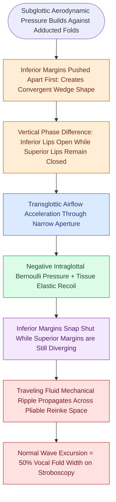

# The mucosal wave travels as a fluid mechanical displacement

## Active Recall

> [!question]- What anatomical layer of the vocal fold serves as the primary fluid shearing bed enabling the mucosal wave?
> *Answer / Clinical Rationale*: The superficial lamina propria (Reinke's space), rich in [[Hyaluronic acid regulates lamina propria hydration and shock absorption|hyaluronic acid]].

> [!question]- How does an invasive glottic squamous cell carcinoma alter the mucosal wave on videostroboscopy?
> *Answer / Clinical Rationale*: Tumor cells invade through the basement membrane into the [[The vocal ligament comprises intermediate and deep lamina propria|vocal ligament]] and [[The thyrovocalis muscle provides isometric pitch and tension control|vocalis muscle]], tethering the cover and producing a localized adynamic non-vibrating zone.

## Core Clinical & Mechanistic Principles
The **mucosal wave** is the visible, fluid-like undulation of the vocal fold cover ([[Stratified squamous epithelium forms the vocal fold protective cover|epithelium]] and [[The superficial lamina propria acts as a pliable shearing fluid bed|superficial lamina propria]]) traveling from the inferior lip to the superior surface and propagating laterally across the vocal fold during phonation.

### Fluid-Mechanical Mechanism
- **Subglottic Pressure & Convergent Glottis**: Subglottic air pressure builds against the adducted vocal folds. As air forces the lower margins apart, the glottis forms a convergent wedge.
- **Vertical Phase Difference**: The inferior margin of the vocal fold opens first, followed by the superior margin, creating a vertical phase lag.
- **Bernoulli Effect & Elastic Recoil**: As high-velocity air rushes through the narrow aperture, intraglottal pressure drops (Bernoulli principle) and mucosal tissue elastic recoil snaps the inferior margin shut while the superior margin is still opening, creating a divergent glottis.
- **Traveling Wave Propagation**: This cyclic vertical and lateral displacement ripples across the pliable Reinke's space, visualized on [[Videostroboscopy visualizes mucosal wave dynamics and glottal closure|videostroboscopy]] as the mucosal wave.

## Normal vs Pathological Variations
- **Normal Amplitude**: Lateral excursion of the wave should equal approximately **50% of the visible width** of the true vocal fold in modal phonation.
- **Increased Amplitude**: Observed in conditions with hyper-hydrated, expanded superficial lamina propria, classically seen in **Reinke's edema**.
- **Decreased / Absent Amplitude**: Occurs when the cover is stiffened, tethered, or dehydrated:
  - Epithelial stiffening: Keratosis, dysplasia, or carcinoma.
  - Lamina propria fibrosis: [[Vocal fold scar results from disorganized Type I collagen deposition|Vocal fold scar]] or [[Sulcus vocalis manifests as mucosal furrowing staged by the Ford classification|sulcus vocalis]].
  - Localized absence: [[Adynamic vocal fold segments indicate mucosal stiffening, malignancy, or scar|Adynamic segment]].

## Critical Failure Modes & Error Traps
- **Stiffness Misinterpretation**: A small or absent mucosal wave can be caused by simple systemic dehydration or vocal fold hyperadduction (muscle tension dysphonia) rather than structural fibrosis. Testing at varied pitches and loudnesses is required.

## Connected Concepts & Graph Traversal
- **Five Histological Layers**: [[The vocal fold comprises five distinct histological layers|Five Histological Layers]]
- **Basement Membrane Anchor**: [[The basement membrane zone anchors epithelium to superficial lamina propria|Basement Membrane Zone]]
- **Vocal Ligament Core**: [[The vocal ligament comprises intermediate and deep lamina propria|Vocal Ligament]]
- **Adynamic Segment Pathology**: [[Adynamic vocal fold segments indicate mucosal stiffening, malignancy, or scar|Adynamic Segments]]
- **Stroboscopic Visualization**: [[Videostroboscopy visualizes mucosal wave dynamics and glottal closure|Videostroboscopy]]
