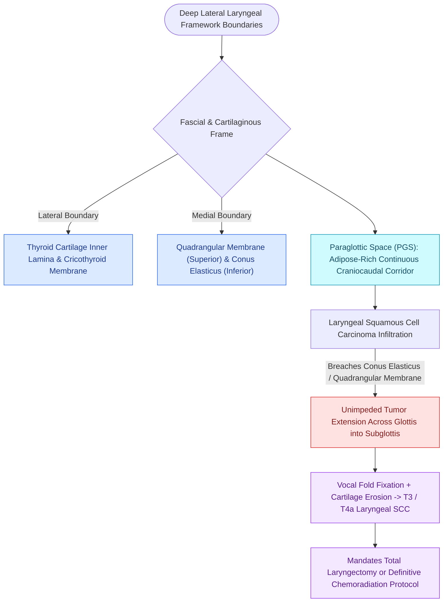

# The paraglottic space facilitates transglottic tumor spread

## Active Recall

> [!question]- What are the medial and lateral anatomical boundaries of the paraglottic space?
> *Answer / Clinical Rationale*: Medially, it is bounded by the quadrangular membrane, laryngeal ventricle, and conus elasticus; laterally, it is bounded by the thyroid cartilage alar lamina.

> [!question]- Why does tumor invasion into the paraglottic space frequently result in a fixed vocal fold (T3 stage)?
> *Answer / Clinical Rationale*: The PGS contains the thyroarytenoid and lateral cricoarytenoid muscles; tumor infiltration directly replaces and immobilizes this muscular and joint mechanism.

## Core Clinical & Mechanistic Principles
The **Paraglottic Space (PGS)** is a paired, deep fibrofatty potential space within the larynx that surrounds the vocal fold musculature and extends vertically across the supraglottic, glottic, and subglottic levels.

### Anatomical Boundaries
- **Anterolateral Boundary**: Inner perichondrium of the [[Thyroplasty cartilage window dimensions differ between males and females|thyroid cartilage alar lamina]].
- **Medial Boundary**: [[The vocal fold comprises five distinct histological layers|Quadrangular membrane]] superiorly (supraglottis), laryngeal ventricle, and **conus elasticus** inferiorly (subglottis).
- **Posterolateral Boundary**: Mucosa of the pyriform sinus.
- **Posterior Boundary**: [[The cricoarytenoid joint moves via coupled rocking and sliding|Cricoarytenoid joint]] and [[The interarytenoid muscle closes the posterior glottic chink|interarytenoid]] region.
- **Anterior Superior Communication**: Connects anteriorly and superiorly with the [[The pre-epiglottic space enables rapid supraglottic cancer spread|pre-epiglottic space (PES)]].

### Contents
- [[The thyroarytenoid muscle modulates glottal stiffness and adduction|Thyroarytenoid muscle]] (both vocalis and muscularis bellies).
- [[The lateral cricoarytenoid is the primary membranous fold adductor|Lateral cricoarytenoid muscle (LCA)]].
- Fibrofatty connective tissue, lymphatic channels, and branches of the superior and inferior laryngeal neurovascular bundles.

## Oncologic & Surgical Significance
- **Transglottic Tumor Spread**: The paraglottic space lacks internal fascial barriers, representing the path of least resistance for transglottic tumor extension. Glottic carcinomas invading through the [[The thyrovocalis muscle provides isometric pitch and tension control|vocalis muscle]] into the PGS can spread unimpeded into the supraglottis, subglottis, and [[Cricotracheal resection removes subglottic stenosis while sparing posterior cricoid and RLNs|cricoid cartilage]].
- **Vocal Fold Fixation**: Massive PGS invasion by carcinoma or inflammatory processes immobilizes the vocal fold (T3 disease).
- **Surgical Target for Medialization**: The lateral paraglottic space is the anatomical recipient bed for [[Injection laryngoplasty requires precise placement into lateral thyroarytenoid muscle|injection laryngoplasty]] materials and the silastic/Gore-Tex wedge in [[Type I thyroplasty medializes the vocal fold with conscious voice tuning|Type I medialization thyroplasty]].

## Critical Failure Modes & Error Traps
- **Under-resection in Conservation Surgery**: Tumor extension into the posterior paraglottic space involving the cricoarytenoid joint or cricoid cartilage contraindicates [[SCPL with CHEP preserves the epiglottis, cricoid, and one mobile arytenoid|supracricoid partial laryngectomy]], necessitating [[Total laryngectomy achieves en bloc laryngeal resection with permanent end-stoma|total laryngectomy]].

## Connected Concepts & Graph Traversal
- **Pre-Epiglottic Space Neighbor**: [[The pre-epiglottic space enables rapid supraglottic cancer spread|Pre-Epiglottic Space]]
- **Laryngeal Ventricle Division**: [[The laryngeal ventricle separates supraglottic and glottic lymphatic pathways|Laryngeal Ventricle]]
- **Broyles' Ligament Anchor**: [[Broyles' ligament anchors the vocal ligament to thyroid cartilage|Broyles' Ligament]]
- **Supracricoid Resection**: [[SCPL with CHP resects the epiglottis and vocal folds for supraglottic cancer|Supracricoid Partial Laryngectomy]]
- **Total Laryngectomy en bloc**: [[Total laryngectomy achieves en bloc laryngeal resection with permanent end-stoma|Total Laryngectomy]]
