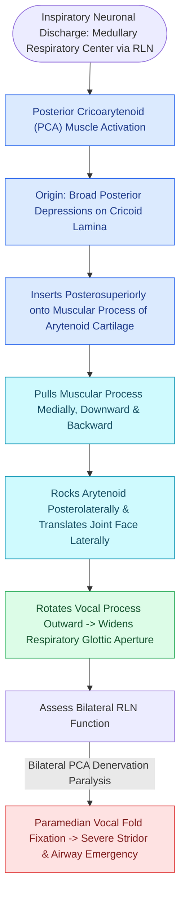

# The posterior cricoarytenoid is the sole vocal fold abductor

## Active Recall

> [!question]- Why does contraction of the PCA pull the muscular process inferomedially yet move the vocal process superolaterally?
> *Answer / Clinical Rationale*: The cricoarytenoid joint acts as a multi-axis pivot; pulling the muscular process down and medially behind the facet causes the opposing anterior-facing vocal process to elevate and swing laterally away from the midline.

> [!question]- What physiological maneuver activates the PCA during diagnostic LEMG?
> *Answer / Clinical Rationale*: A deep, rapid **inspiratory sniff**, which recruits maximal inspiratory abductor motor units.

## Core Clinical & Mechanistic Principles
The **Posterior Cricoarytenoid (PCA) Muscle** is the only intrinsic laryngeal muscle responsible for **abducting the true vocal folds** and maintaining respiratory airway patency.

### Anatomical Attachments & Vectors
- **Origin**: Broad posterior surface of the [[Cricotracheal resection removes subglottic stenosis while sparing posterior cricoid and RLNs|cricoid cartilage]] lamina (divided into vertical and oblique bellies by a median ridge).
- **Insertion**: Muscular process of the ipsilateral [[The cricoarytenoid joint moves via coupled rocking and sliding|arytenoid cartilage]].
- **Innervation**: Supplied by the [[The recurrent laryngeal nerve innervates all intrinsic muscles except cricothyroid|recurrent laryngeal nerve (RLN)]].
- **Kinematic Vector**: Contraction pulls the muscular process **inferomedially and posteriorly**, causing the vocal process to rock **superolaterally and outward**, thereby opening the glottic chink during inspiration.

## Clinical & Surgical Significance
- **Bilateral Vocal Fold Paralysis**: Bilateral loss of PCA function (e.g., following bilateral RLN injury during total thyroidectomy) leaves both vocal folds fixed in the paramedian/median position, resulting in life-threatening inspiratory stridor and airway compromise.
- **Endoscopic Glottic Widening**: When PCA function is permanently lost, procedures such as [[Endoscopic transverse cordotomy widens posterior airway while preserving anterior phonation|endoscopic transverse cordotomy]] or partial arytenoidectomy are performed to restore a posterior airway channel.
- **Abductor Spasmodic Dysphonia (ABSD)**: In ABSD, hyperactive spasms of the PCA produce breathy voice breaks during unvoiced consonants; targeted injection of Botulinum toxin into the PCA muscle relieves symptoms.
- **LEMG Confirmation**: Verification of PCA electrode placement during LEMG is confirmed by having the patient perform a sharp, deep inspiratory sniff.

## Critical Failure Modes & Error Traps
- **Airway Compromise with Bilateral PCA Injections**: Injecting excessive Botulinum toxin bilaterally into the PCA muscles can paralyze glottic abduction, causing severe airway obstruction requiring emergent tracheostomy.

## Connected Concepts & Graph Traversal
- **Membranous Adductor**: [[The lateral cricoarytenoid is the primary membranous fold adductor|Lateral Cricoarytenoid]]
- **Posterior Chink Adductor**: [[The interarytenoid muscle closes the posterior glottic chink|Interarytenoid Muscle]]
- **Joint Pivot Kinematics**: [[The cricoarytenoid joint moves via coupled rocking and sliding|Cricoarytenoid Joint]]
- **RLN Innervation**: [[The recurrent laryngeal nerve innervates all intrinsic muscles except cricothyroid|Recurrent Laryngeal Nerve]]
- **LEMG Confirmation**: [[Laryngeal electromyography differentiates vocal fold paralysis from joint fixation|Laryngeal Electromyography (LEMG)]]
