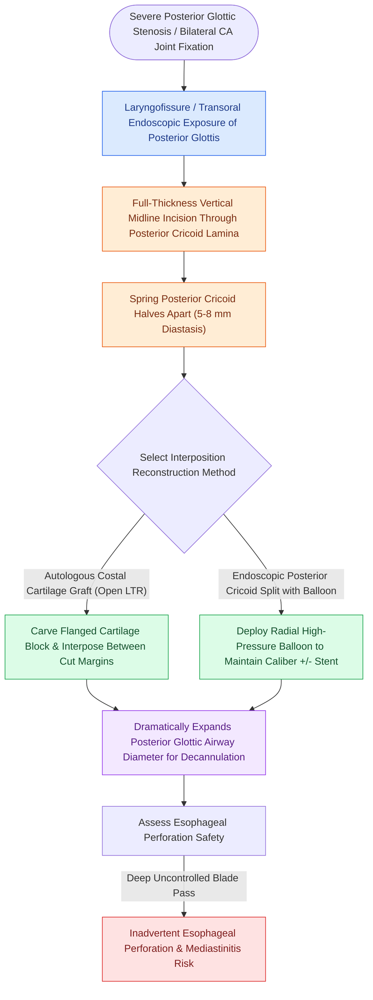

# The posterior cricoid split widens the posterior glottis for high-grade stenosis

## Active Recall

> [!question]- Why must the posterior cricoid split be performed strictly in the exact anatomical midline?
> *Answer / Clinical Rationale*: The cricoarytenoid joints and terminal motor branches of the recurrent laryngeal nerves lie immediately lateral; off-midline division risks joint destruction and bilateral vocal cord denervation.

> [!question]- What anatomical structure lies immediately posterior to the cricoid lamina that must be preserved intact during a posterior split?
> *Answer / Clinical Rationale*: The **anterior hypopharyngeal mucosa**; perforating it introduces saliva and bacterial contamination into the newly placed cartilage graft bed.

> [!question]- Why is surgical reconstruction contraindicated during the active phase of mucous membrane pemphigoid?
> *Answer / Clinical Rationale*: Active autoimmune basement membrane inflammation triggers a hyper-cicatricial response to surgical injury, resulting in rapid, aggressive restenosis and graft loss; patients must achieve **deep immunosuppressive quiescence** first.

## Core Clinical & Mechanistic Principles
The **Posterior Cricoid Split (PCS)** with posterior [[Laryngotracheal reconstruction expands the airway using carved costal cartilage grafts|costal cartilage graft]] interposition is an open airway reconstruction technique indicated for **posterior glottic stenosis ([[The paraglottic space facilitates transglottic tumor spread|PGS]])**, [[The interarytenoid muscle closes the posterior glottic chink|interarytenoid]] fixation, and high-grade [[The Cotton-Myer classification grades subglottic stenosis by luminal reduction|subglottic stenosis]] involving the posterior lamina ([[The McCaffrey classification stages laryngotracheal stenosis by anatomical subsite|McCaffrey Stage IV]]).

### Anatomical Basis & Expansion Mechanism
- **Posterior Cricoid Lamina Division**: The thick posterior cricoid plate is divided vertically strictly in the midline from the interarytenoid incisure down to the first tracheal ring.
- **Interarytenoid Separation**: Dividing the posterior plate widens the distance between both [[The cricoarytenoid joint moves via coupled rocking and sliding|arytenoid bodies]], expanding the posterior glottic airway by $4\text{–}6\text{ mm}$.
- **Graft Interposition**: A carved autologous costal cartilage graft (with lateral stabilizing flanges and intact perichondrium facing intraluminally) is interposed into the split to permanently maintain posterior glottic and subglottic expansion.

### Autoimmune, Genetic & Cicatricial Laryngeal Etiologies
- **Mucous Membrane Pemphigoid (MMP / Cicatricial Pemphigoid)**:
  - *Pathophysiology*: Autoantibodies against hemidesmosomal basement membrane zone proteins (**BP180 and laminin-332 / epiligrin**); **Direct Immunofluorescence (DIF)** demonstrates continuous **linear IgG, C3, and IgA deposition along the basement membrane zone**.
  - *Laryngeal Manifestations*: Progressive, cicatrizing fibrosis causing **interarytenoid adhesions, posterior glottic webs, and circumferential subglottic stenosis**; strongly associated with conjunctival symblepharon and oral erosions.
  - *Surgical Rule*: **Avoid open or endoscopic airway surgery during active inflammation**; achieve deep medical quiescence with systemic immunosuppression (**rituximab, mycophenolate mofetil, cyclophosphamide**) before attempting posterior cricoid split or web lysis, as surgical trauma triggers catastrophic hyper-cicatricial restenosis.
- **Epidermolysis Bullosa (EB)**:
  - *Pathophysiology*: Inherited mutations in anchoring fibrils (**Type VII collagen in dystrophic EB**) or hemidesmosomes (**laminin-332, BP180 in junctional EB**).
  - *Airway Craft*: Extreme mucosal fragility; friction causes full-thickness epithelial denudation. Requires **atraumatic uncuffed endotracheal tubes, avoidance of adhesive tapes**, and gentle cold-steel or micro-scissor dissection.
- **Pemphigus Vulgaris & Stevens-Johnson Syndrome / TEN**:
  - *Pemphigus Vulgaris*: Anti-desmoglein 3 autoantibodies causing intraepithelial suprabasilar acantholysis ("tombstoning") and painful supraglottic/epiglottic erosions.
  - *SJS/TEN*: Cytotoxic T-cell mediated full-thickness epidermal/mucosal necrolysis requiring early airway protection and conservative stenting to avoid confluent cicatrization.

## Step-by-Step Surgical Craft
1. **Laryngofissure / Anterior Split**: Perform anterior vertical laryngotracheal split to access the posterior endolaryngeal wall.
2. **Identification of Midline**: Palpate the median ridge on the posterior cricoid lamina; identify the interarytenoid notch.
3. **Posterior Division**: Using a #15 blade or micro-oscillating saw, divide the posterior cricoid lamina strictly in the midline down to the anterior hypopharyngeal submucosa. **Do not perforate the hypopharyngeal mucosa**.
4. **Graft Carving & Placement**: Carve a block-shaped costal cartilage graft ($3\text{–}5\text{ mm}$ width, $10\text{–}15\text{ mm}$ length) with flanges; secure between the divided cricoid edges using interrupted 4-0 PDS sutures.
5. **Stenting**: Stent with an endotracheal tube ([[Single-stage LTR utilizes an endotracheal tube as a temporary stent avoiding tracheostomy placement|single-stage LTR]]) or an endolaryngeal mold/[[Two-stage LTR maintains a tracheostomy with prolonged endolaryngeal stenting|T-tube]] (two-stage LTR).

## Critical Failure Modes & Error Traps
- **Off-Midline Split / RLN Injury**: Deviating laterally from the midline during posterior cricoid division lacerates the recurrent laryngeal nerves as they enter behind the cricothyroid articulation, or damages the cricoarytenoid joint facets, causing bilateral permanent vocal fold paralysis.
- **Hypopharyngeal Perforation**: Breaching the hypopharyngeal mucosa creates a contaminated fistula communicating with pharyngeal secretions, causing graft infection and chondronecrosis.

## Connected Concepts & Graph Traversal
- **Parent Surgical Procedure**: [[Laryngotracheal reconstruction expands the airway using carved costal cartilage grafts|Laryngotracheal Reconstruction (LTR)]]
- **Adjacent Joint Protected**: [[The cricoarytenoid joint moves via coupled rocking and sliding|Cricoarytenoid Joint Kinematics]]
- **Nerves Protected**: [[The recurrent laryngeal nerve innervates all intrinsic muscles except cricothyroid|Recurrent Laryngeal Nerves]]
- **Staging System**: [[The McCaffrey classification stages laryngotracheal stenosis by anatomical subsite|McCaffrey Stage IV Stenosis]]
- **Alternative Resection Surgery**: [[Cricotracheal resection removes subglottic stenosis while sparing posterior cricoid and RLNs|Cricotracheal Resection (CTR)]]
- **Posterior Glottic Staging System**: [[The Bogdasarian classification categorizes posterior glottic stenosis from Type I interarytenoid scar to Type IV bilateral joint fixation|Bogdasarian Classification]]
