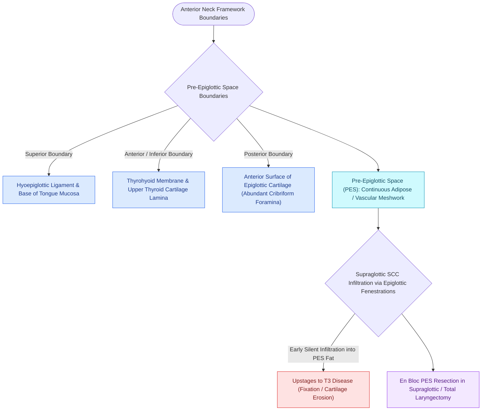

# The pre-epiglottic space enables rapid supraglottic cancer spread

## Active Recall

> [!question]- Why do epiglottic carcinomas rapidly gain access to the pre-epiglottic space?
> *Answer / Clinical Rationale*: The epiglottic cartilage contains natural neurovascular perforations (*foramina cribrosa*) through which tumor cells directly penetrate from the mucosal surface into the fibrofatty PES.

> [!question]- What anatomical structure forms the superior ceiling of the pre-epiglottic space?
> *Answer / Clinical Rationale*: The **hyoepiglottic ligament**, spanning from the anterior epiglottis to the superior-posterior aspect of the hyoid bone.

## Core Clinical & Mechanistic Principles
The **Pre-Epiglottic Space (PES)** is a wedge-shaped midline fibrofatty space situated in the anterior supraglottic larynx.

### Anatomical Boundaries
- **Superior Boundary**: **Hyoepiglottic ligament** (attaching the anterior surface of the epiglottis to the superior rim of the [[Suprahyoid Montgomery release mobilizes the larynx to reduce anastomotic tension|hyoid bone]]).
- **Anterior Boundary**: **Thyrohyoid membrane** and upper third of the [[Thyroplasty cartilage window dimensions differ between males and females|thyroid cartilage alar lamina]].
- **Posterior Boundary**: Epiglottic cartilage (suprahyoid and infrahyoid portions) and **thyroepiglottic ligament** at the [[Horizontal supraglottic laryngectomy resects supraglottic cancer while preserving vocal folds|epiglottic petiole]].
- **Lateral Boundaries**: Communicates bilaterally with the paired [[The paraglottic space facilitates transglottic tumor spread|paraglottic spaces (PGS)]].

## Oncologic & Surgical Significance
- **Perforations in Epiglottic Cartilage**: The cartilage of the epiglottis contains numerous natural neurovascular fenestrations (*foramina cribrosa*). Supraglottic carcinomas arising on the laryngeal (posterior) surface of the epiglottis easily invade through these perforations directly into the PES.
- **Silent Clinical Growth**: Tumor expansion within the PES occurs with minimal early mucosal ulceration or vocal changes, leading to late-stage presentation (T3 supraglottic carcinoma).
- **Resection in Conservation Laryngeal Surgery**:
  - In horizontal supraglottic laryngectomy (HSL) and [[SCPL with CHP resects the epiglottis and vocal folds for supraglottic cancer|supracricoid partial laryngectomy with CHP]], the entire PES, hyoid bone, and epiglottis are resected en bloc.

## Critical Failure Modes & Error Traps
- **PES Recurrence after Radiation**: PES tumor invasion is associated with lower local control rates with definitive radiotherapy compared to superficial mucosal tumors, due to poor vascularity of the dense adipose matrix and cartilage invasion.

## Connected Concepts & Graph Traversal
- **Paraglottic Space Neighbor**: [[The paraglottic space facilitates transglottic tumor spread|Paraglottic Space]]
- **Laryngeal Ventricle Barrier**: [[The laryngeal ventricle separates supraglottic and glottic lymphatic pathways|Laryngeal Ventricle]]
- **Broyles' Ligament Anchor**: [[Broyles' ligament anchors the vocal ligament to thyroid cartilage|Broyles' Ligament]]
- **Supraglottic Laryngectomy**: [[Horizontal supraglottic laryngectomy resects supraglottic cancer while preserving vocal folds|Horizontal Supraglottic Laryngectomy]]
- **Supracricoid Resection**: [[SCPL with CHP resects the epiglottis and vocal folds for supraglottic cancer|Supracricoid Partial Laryngectomy]]
