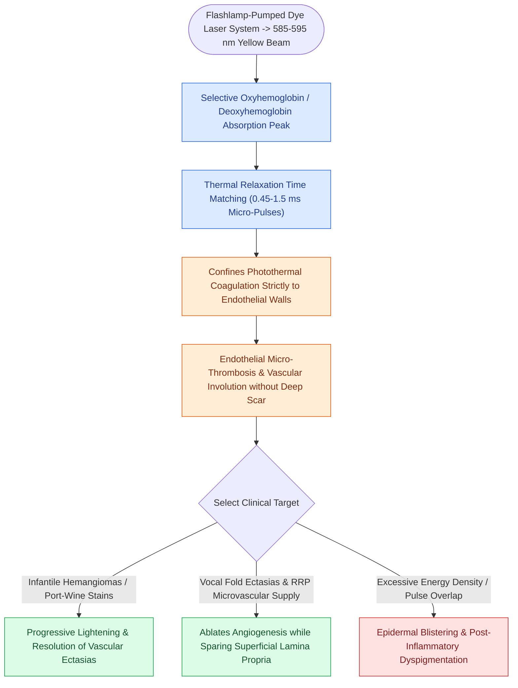

# The pulsed dye laser targets vascular lesions at 585 nm

## Active Recall

> [!question]- What is the target chromophore and wavelength of the Pulsed Dye Laser (PDL)?
> *Answer / Clinical Rationale*: **Oxyhemoglobin** is the target chromophore, with a wavelength of **$585\text{ nm}$ (or $595\text{ nm}$)**.

> [!question]- Why does the PDL avoid thermal scarring of the vocal fold lamina propria?
> *Answer / Clinical Rationale*: Its microsecond pulse duration is shorter than the thermal relaxation time of microvessels, confining heat to the intravascular space before thermal energy can conduct into the [[The superficial lamina propria acts as a pliable shearing fluid bed|superficial lamina propria]].

## Core Clinical & Mechanistic Principles
The **Pulsed Dye Laser (PDL)** operates at a wavelength of **$\lambda = 585\text{ nm}$ (or $595\text{ nm}$)** in the yellow-orange electromagnetic spectrum.

### Biophysical Characteristics & Vascular Specificity
- **Absorption Peak**: The $585\text{ nm}$ wavelength matches the secondary major absorption peak of **oxyhemoglobin** in circulating erythrocytes.
- **Microsecond Pulse Duration**: Delivers energy in short, high-peak-power pulses ($0.45\text{–}1.5\text{ ms}$) shorter than the thermal relaxation time of laryngeal microvessels, confining thermal energy strictly to intravascular erythrocytes without conductive spread to surrounding collagen.
- **Tissue Effect**: Induces intravascular micro-thrombi, endothelial vacuolization, and vessel wall collapse (photoangiolysis).

## Primary Clinical Indications
1. **Vascular Ectasias & Varices**: Highly effective for treating bleeding-prone [[Vocal fold polyps arise from phonotraumatic microvascular injury in Reinke's space|vocal fold varices]] that cause recurrent vocal fold hemorrhage.
2. **Glottic Dysplasia & RRP**: Alternative to the [[The KTP laser targets oxyhemoglobin at 532 nm for photoangiolysis|KTP laser (532 nm)]] for targeting feeding vessels in RRP and leukoplakic dysplasia.
3. **Hypervascular Vocal Fold Polyps**: Pre-excision or in-office photo-coagulation of angiomatous polyps.

## Critical Failure Modes & Error Traps
- **Purpura & Local Edema**: High pulse energies can rupture fragile dilated vessels, producing transient submucosal hematomas.

## Connected Concepts & Graph Traversal
- **KTP Photoangiolytic Laser**: [[The KTP laser targets oxyhemoglobin at 532 nm for photoangiolysis|KTP Laser]]
- **CO2 Vaporizing Laser**: [[The CO2 laser vaporizes tissue via 10600 nm water absorption|CO2 Laser]]
- **Airway Fire Prevention**: [[Airway fire prevention requires FiO2 below 30 percent and laser-safe tubes|Airway Fire Protocols]]
- **Phonomicrosurgical Techniques**: [[Phonomicrosurgery requires suspension laryngoscopy and stereoscopic magnification|Phonomicrosurgery]]
- **Vocal Fold Hemorrhage**: [[Acute vocal fold hemorrhage requires strict voice rest and absolute performance cancellation to prevent permanent fibrovascular scarring|Vocal Fold Hemorrhage]]
