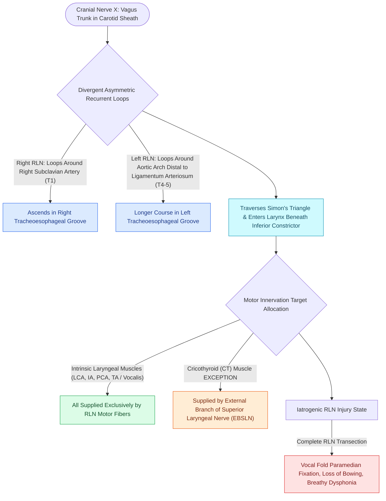

# The recurrent laryngeal nerve innervates all intrinsic muscles except cricothyroid

## Active Recall

> [!question]- Why does the left RLN have a longer intrathoracic course than the right RLN?
> *Answer / Clinical Rationale*: Embryologically, the left 6th branchial arch persists as the ductus arteriosus / ligamentum arteriosum, trapping the left RLN around the aortic arch in the mediastinum, whereas the right 5th and 6th arches regress, allowing the right RLN to loop higher around the 4th arch (right subclavian artery).

> [!question]- What is the clinical consequence of an unrecognized extralaryngeal branch of the RLN during thyroidectomy?
> *Answer / Clinical Rationale*: If the anterior motor branch is transected while only preserving the posterior branch, the patient will develop complete adductor vocal fold paralysis despite the apparent preservation of an intact nerve trunk.

## Core Clinical & Mechanistic Principles
The **Recurrent Laryngeal Nerve (RLN)** is a major branch of the Vagus Nerve (Cranial Nerve X) that provides motor innervation to all ipsilateral intrinsic laryngeal muscles—the [[The posterior cricoarytenoid is the sole vocal fold abductor|posterior cricoarytenoid (PCA)]], [[The lateral cricoarytenoid is the primary membranous fold adductor|lateral cricoarytenoid (LCA)]], [[The thyroarytenoid muscle modulates glottal stiffness and adduction|thyroarytenoid (TA)]], and [[The interarytenoid muscle closes the posterior glottic chink|interarytenoid (IA)]]—with the sole exception of the [[The cricothyroid muscle elongates vocal folds to elevate pitch|cricothyroid (CT) muscle]]. It also supplies subglottic sensation below the true vocal folds.

### Embryology & Asymmetric Anatomy
- **Left RLN**: Loops around the aortic arch immediately distal to the ligamentum arteriosum (derived from the 6th branchial arch). Ascends in the left tracheoesophageal (TE) groove.
- **Right RLN**: Loops around the right subclavian artery (derived from the 4th aortic arch). Ascends more obliquely through the right paratracheal space toward the TE groove.
- **Non-Recurrent Laryngeal Nerve**: Occurs in ~0.5–1% of individuals on the right side, associated with an aberrant retroesophageal right subclavian artery (*arteria lusoria*).

## Extralaryngeal Branching & Surgical Nuances
- **Extralaryngeal Branching**: Occurs in up to **30% of patients** prior to entering the larynx. The **anterior branch** conveys motor fibers to the adductors (LCA, TA); the **posterior branch** carries motor fibers to the abductor (PCA) and sensory branches. Mistaking an anterior motor branch for a non-neural vessel during thyroidectomy causes iatrogenic vocal fold paralysis.
- **Laryngeal Entry**: Enters the larynx immediately posterior to the inferior cornu of the [[Thyroplasty cartilage window dimensions differ between males and females|thyroid cartilage]] and the cricothyroid joint, passing beneath the lower border of the inferior constrictor muscle.
- **Berry's Ligament Relationship**: In the thyroid bed, the RLN passes within or directly deep to the suspensory ligament of Berry.

## Critical Failure Modes & Error Traps
- **Unilateral RLN Paralysis**: Produces breathy dysphonia, vocal fatigue, loss of projection, and aspiration of thin liquids due to glottic gap and [[The cricoarytenoid joint moves via coupled rocking and sliding|arytenoid slump]].
- **Bilateral RLN Paralysis**: Causes bilateral paramedian fixed vocal cords, severe inspiratory stridor, and acute upper airway compromise.

## Connected Concepts & Graph Traversal
- **Pitch Tensor Exception**: [[The cricothyroid muscle elongates vocal folds to elevate pitch|Cricothyroid Muscle (EBSLN)]]
- **Sole Abductor Muscle**: [[The posterior cricoarytenoid is the sole vocal fold abductor|Posterior Cricoarytenoid]]
- **Membranous Adductor**: [[The lateral cricoarytenoid is the primary membranous fold adductor|Lateral Cricoarytenoid]]
- **LEMG Confirmation**: [[Laryngeal electromyography differentiates vocal fold paralysis from joint fixation|Laryngeal Electromyography (LEMG)]]
- **Unilateral Paralysis Deficit**: [[Unilateral vocal fold paralysis causes glottic insufficiency, breathiness, and aspiration|Vocal Fold Paralysis]]
