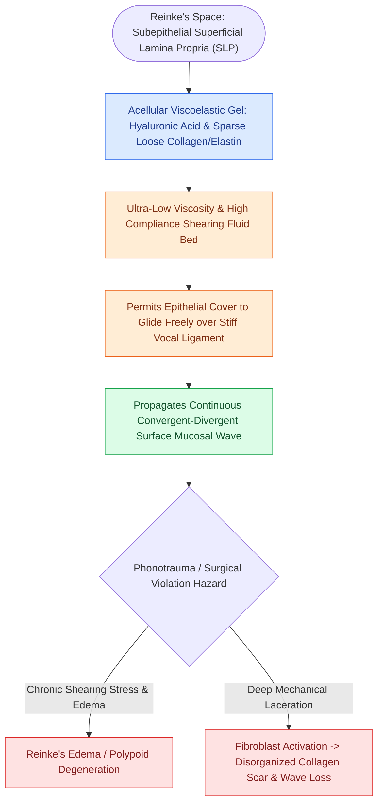

# The superficial lamina propria acts as a pliable shearing fluid bed

## Active Recall

> [!question]- What is the primary biomechanical function of Reinke's space during normal phonation?
> *Answer / Clinical Rationale*: It acts as a low-viscosity, pliable shearing fluid bed that decouples the vibrating epithelial cover from the deeper, stiffer vocal ligament and [[The thyrovocalis muscle provides isometric pitch and tension control|vocalis muscle]], enabling the formation and propagation of the mucosal wave.

> [!question]- Why does deep surgical violation of Reinke's space result in irreversible vocal fold stiffness?
> *Answer / Clinical Rationale*: Injury past the SLP into the ligament activates tissue myofibroblasts that replace the pliable hyaluronic acid ground substance with dense, disorganized Type I collagen bundles, obliterating the shearing plane.

## Core Clinical & Mechanistic Principles
The **Superficial Lamina Propria (SLP)**, historically termed **Reinke's space**, is an amorphous, low-cellularity extracellular matrix compartment situated immediately beneath the [[The basement membrane zone anchors epithelium to superficial lamina propria|basement membrane zone]] and superficial to the [[The intermediate lamina propria provides elastic recoil via elastin fibers|intermediate lamina propria]].

### Extracellular Matrix (ECM) Architecture
- **Amorphous Ground Substance**: Composed of glycosaminoglycans, primarily [[Hyaluronic acid regulates lamina propria hydration and shock absorption|hyaluronic acid (HA)]], decorin, and fibromodulin.
- **Sparse Fibrous Matrix**: Contains loose, randomly organized, non-crosslinked [[Vocal fold scar results from disorganized Type I collagen deposition|Type III collagen]] and delicate elastin microfibrils.
- **Viscoelastic Properties**: Possesses exceptionally low viscosity and high shear-thinning capability. This allows the overlying [[Stratified squamous epithelium forms the vocal fold protective cover|epithelium]] to slide, ripple, and shear freely over the stiffer [[The vocal ligament comprises intermediate and deep lamina propria|vocal ligament]], generating the traveling [[The mucosal wave travels as a fluid mechanical displacement|mucosal wave]].

## Surgical Anatomy, Step-by-Step Technique & Nuances
- **Primary Phonomicrosurgical Dissection Plane**: In [[Phonomicrosurgery requires suspension laryngoscopy and stereoscopic magnification|phonomicrosurgery]], all benign mucosal dissections (e.g., for [[Vocal fold polyps arise from phonotraumatic microvascular injury in Reinke's space|vocal fold polyps]], [[Mucous retention cysts arise from obstructed glands in superficial lamina propria|mucous retention cysts]], or [[Epidermoid cysts adhere to the vocal ligament and require sharp dissection|epidermoid cysts]]) must be contained strictly within the SLP.
- **Hydrodissection**: Epinephrine 1:100,000 hydrodissection expands the loose ground substance of Reinke's space, creating an optical and physical cushion that separates the pathology from the deeper vocal ligament.

## Critical Failure Modes & Error Traps
- **Disorganized Collagen Scarring**: Vocal fold fibroblasts residing in the SLP are quiescent under normal conditions. Deep mechanical violation, thermal laser injury, or excessive micro-forceps traction activates fibroblasts into myofibroblasts, which deposit dense, crosslinked Type I collagen. This produces vocal fold scar and an [[Adynamic vocal fold segments indicate mucosal stiffening, malignancy, or scar|adynamic segment]] on [[Videostroboscopy visualizes mucosal wave dynamics and glottal closure|videostroboscopy]].
- **Over-resection in Reinke's Edema**: Aggressive stripping of Reinke's gelatinous matrix down to the ligament destroys the HA ground substance, causing severe postoperative phonatory stiffness.

## Connected Concepts & Graph Traversal
- **Overlying Tissue**: [[The basement membrane zone anchors epithelium to superficial lamina propria|Basement Membrane Zone]]
- **Key Biochemical Component**: [[Hyaluronic acid regulates lamina propria hydration and shock absorption|Hyaluronic Acid in the SLP]]
- **Underlying Ligament**: [[The intermediate lamina propria provides elastic recoil via elastin fibers|Intermediate Lamina Propria]]
- **Vibratory Correlate**: [[The mucosal wave travels as a fluid mechanical displacement|Mucosal Wave Dynamics]]
- **Anatomical Foundation**: [[Vocal fold polyps arise from phonotraumatic microvascular injury in Reinke's space|Vocal Fold Polyps]]
- **Surgical Craft**: [[Mucous retention cysts arise from obstructed glands in superficial lamina propria|Mucous Retention Cysts]]
- **Diagnostic Assessment**: [[Vocal fold scar results from disorganized Type I collagen deposition|Vocal Fold Scarring]]
- **Differential Diagnosis**: [[The epithelial-sparing microflap preserves native mucosa and prevents glottic webbing|Subepithelial Microflap Elevation]]
