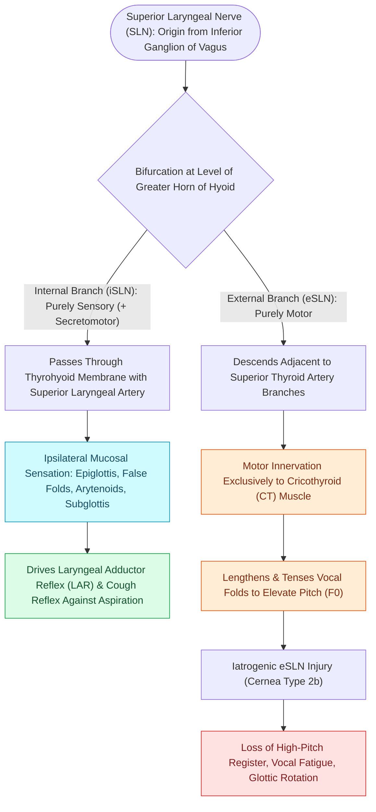

# The superior laryngeal nerve provides supraglottic sensation and cricothyroid motor control

## Active Recall

> [!question]- Which anatomical membrane does the internal branch of the superior laryngeal nerve pierce to enter the larynx?
> *Answer / Clinical Rationale*: The **thyrohyoid membrane**, which it traverses along with the superior laryngeal artery and vein.

> [!question]- What sensory deficit occurs if the iSLN is transected during a lateral neck dissection or anterior cervical spine approach?
> *Answer / Clinical Rationale*: Ipsilateral loss of supraglottic sensation, causing silent penetration/aspiration of secretions and blunting of the protective laryngeal cough reflex.

## Core Clinical & Mechanistic Principles
The **Superior Laryngeal Nerve (SLN)** branches from the inferior ganglion (nodose ganglion) of the Vagus Nerve (CN X) high in the neck and descends adjacent to the internal carotid artery before bifurcating into two functionally distinct branches:

### 1. Internal Branch of the SLN (iSLN)
- **Functional Modality**: Purely sensory (with parasympathetic secretomotor fibers).
- **Anatomical Course**: Pierces the **thyrohyoid membrane** alongside the superior laryngeal artery.
- **Sensory Territory**: Innervates the epiglottis, base of tongue, vallecula, aryepiglottic folds, false vocal cords, pyriform sinuses, and true vocal fold mucosal surface down to the level of the glottis.
- **Protective Laryngeal Reflexes**: Mediates the afferent limb of the laryngeal adductor reflex (LAR) and cough reflex to prevent aspiration during swallowing.

### 2. External Branch of the SLN (EBSLN)
- **Functional Modality**: Purely motor.
- **Anatomical Course**: Descends along the inferior constrictor muscle and runs in close proximity to the superior thyroid artery and vein.
- **Motor Target**: Innervates the [[The cricothyroid muscle elongates vocal folds to elevate pitch|cricothyroid (CT) muscle]].
- **Surgical Classification**: Classified by [[The Cernea classification stages EBSLN risk relative to superior thyroid vessels|Cernea criteria]] based on its crossing point relative to the superior thyroid pole.

## Clinical Significance & Deficits
- **iSLN Injury / De-afferentation**: Causes profound laryngeal anesthesia, [[The Rosenbek Scale standardizes the depth of airway penetration and aspiration|silent aspiration]], and absence of the protective cough reflex during deglutition.
- **EBSLN Injury**: Results in an inability to tense the vocal fold, leading to voice fatigue, diminished vocal projection, loss of upper singing register, and a paretic vocal fold that appears lower and canted on [[Videostroboscopy visualizes mucosal wave dynamics and glottal closure|stroboscopy]].

## Critical Failure Modes & Error Traps
- **Combined RLN and SLN Injury**: Results in a completely paralyzed, excavated, and lateralized vocal fold with extensive glottic incompetence and intractable aspiration.

## Connected Concepts & Graph Traversal
- **Innervated Muscle**: [[The cricothyroid muscle elongates vocal folds to elevate pitch|Cricothyroid (CT) Muscle]]
- **Surgical Classification**: [[The Cernea classification stages EBSLN risk relative to superior thyroid vessels|Cernea Classification of EBSLN]]
- **Complementary Motor Nerve**: [[The recurrent laryngeal nerve innervates all intrinsic muscles except cricothyroid|Recurrent Laryngeal Nerve (RLN)]]
- **Deglutition Evaluation**: [[FEES assesses pharyngeal secretions and aspiration under direct vision|FEES Swallow Evaluation]]
- **Clinical Management**: [[Videostroboscopy visualizes mucosal wave dynamics and glottal closure|Laryngeal Videostroboscopy]]
