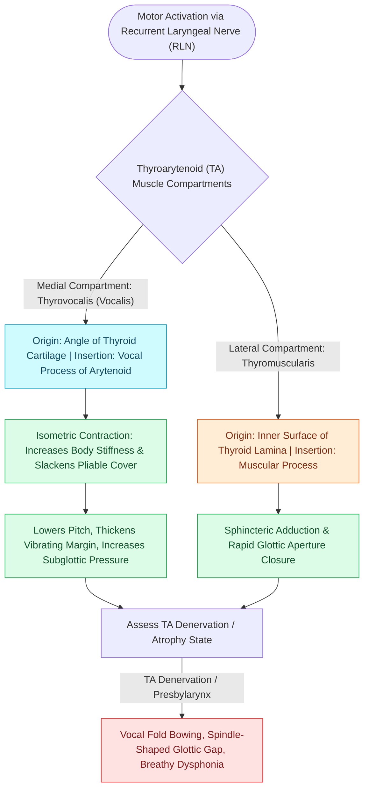

# The thyroarytenoid muscle modulates glottal stiffness and adduction

## Active Recall

> [!question]- How do the two bellies of the thyroarytenoid muscle differ in fiber composition and function?
> *Answer / Clinical Rationale*: The medial thyrovocalis contains slow-twitch (Type I) oxidative fibers for fine isometric tension and pitch control, whereas the lateral thyromuscularis contains fast-twitch (Type II) fibers for rapid glottic closure.

> [!question]- What motor nerve innervates the thyroarytenoid muscle?
> *Answer / Clinical Rationale*: The recurrent laryngeal nerve (RLN).

## Core Clinical & Mechanistic Principles
The **Thyroarytenoid (TA) Muscle** is the broad, striated intrinsic laryngeal muscle that forms the primary contractile bulk ("body") of the vocal fold. It originates anteriorly from the inner perichondrium of the [[Thyroplasty cartilage window dimensions differ between males and females|thyroid cartilage alar lamina]] and inserts posteriorly into the muscular process and vocal process of the [[The cricoarytenoid joint moves via coupled rocking and sliding|arytenoid cartilage]].

### Functional Sub-compartments
The TA muscle is divided into two distinct anatomical and physiological compartments:
1. **Medial Thyroarytenoid (Thyrovocalis)**: Runs parallel and adjacent to the [[The deep lamina propria provides tensile stiffness via crosslinked collagen|deep lamina propria]]. Composed predominantly of slow-twitch, fatigue-resistant (Type I) oxidative fibers specialized for fine isometric tension tuning.
2. **Lateral Thyroarytenoid (Thyromuscularis)**: Lies lateral within the [[The paraglottic space facilitates transglottic tumor spread|paraglottic space]]. Composed of fast-twitch (Type II) glycolytic fibers specialized for rapid, powerful vocal fold adduction, shortening, and sphincter closure.

### Innervation & Biomechanics
- **Innervation**: Supplied by the [[The recurrent laryngeal nerve innervates all intrinsic muscles except cricothyroid|recurrent laryngeal nerve (RLN)]].
- **Biomechanical Action**: Contraction shortens and thickens the vocal fold, bulks the medial edge, lowers fundamental frequency ($F_0$) in low registers, and actively alters the [[The vocal fold comprises five distinct histological layers|body-cover]] stiffness ratio.

## Surgical Anatomy, Step-by-Step Technique & Nuances
- **Target for Medialization Injections**: In [[Injection laryngoplasty requires precise placement into lateral thyroarytenoid muscle|injection laryngoplasty]], the needle is placed into the lateral TA muscle / paraglottic space to medialize the fold without violating the superficial shearing bed.
- **Type I Medialization Thyroplasty**: The carved silastic or Gore-Tex implant compresses the TA muscle medially across a fenestrated cartilage window.
- **Target for Botulinum Toxin in ADSD**: In adductor spasmodic dysphonia, Botulinum toxin A ($1.0\text{–}2.5\text{ units}$) is injected into the TA muscle under [[Laryngeal electromyography differentiates vocal fold paralysis from joint fixation|LEMG]] guidance.

## Critical Failure Modes & Error Traps
- **Atrophy in Denervation**: In RLN injury, the TA undergoes progressive denervation atrophy, causing [[Unilateral vocal fold paralysis causes glottic insufficiency, breathiness, and aspiration|vocal fold bowing]], vertical discrepancy, and a spindle-shaped [[Glottal closure patterns identify specific laryngeal biomechanical deficits|glottal gap]].

## Connected Concepts & Graph Traversal
- **Membranous Adductor Partner**: [[The lateral cricoarytenoid is the primary membranous fold adductor|Lateral Cricoarytenoid]]
- **Sole Abductor Antagonist**: [[The posterior cricoarytenoid is the sole vocal fold abductor|Posterior Cricoarytenoid]]
- **Pitch Tensor Antagonist**: [[The cricothyroid muscle elongates vocal folds to elevate pitch|Cricothyroid Muscle]]
- **Injection Placement Target**: [[Injection laryngoplasty requires precise placement into lateral thyroarytenoid muscle|Injection Laryngoplasty]]
- **Botulinum Toxin Target**: [[Adductor spasmodic dysphonia causes strained voice breaks treated with thyroarytenoid Botox|Spasmodic Dysphonia Botox]]
