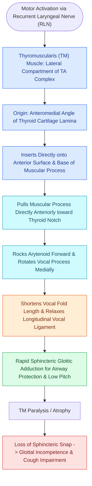

# The thyromuscularis muscle provides rapid vocal fold adduction and shortening

## Active Recall

> [!question]- How does the thyromuscularis assist in lowering vocal pitch?
> *Answer / Clinical Rationale*: By pulling the arytenoid cartilage forward toward the thyroid angle, the thyromuscularis shortens and relaxes the vocal fold cover and ligament, decreasing longitudinal tension and lowering the fundamental frequency ($F_0$).

> [!question]- Why is the lateral thyromuscularis the preferred target for injection medialization over the medial vocalis?
> *Answer / Clinical Rationale*: Injecting laterally into the thyromuscularis provides mechanical medialization of the entire cord while avoiding disruption to the delicate micro-architecture of the medial [[The superficial lamina propria acts as a pliable shearing fluid bed|superficial lamina propria]] and thyrovocalis.

## Core Clinical & Mechanistic Principles
The **Thyromuscularis Muscle** is the lateral belly of the [[The thyroarytenoid muscle modulates glottal stiffness and adduction|thyroarytenoid muscle complex]]. It occupies the lateral compartment of the [[The paraglottic space facilitates transglottic tumor spread|paraglottic space]], situated between the medial [[The thyrovocalis muscle provides isometric pitch and tension control|thyrovocalis]] and the [[Thyroplasty cartilage window dimensions differ between males and females|thyroid cartilage alar lamina]].

### Histochemical & Functional Profile
- **Fast-Twitch Glycolytic Fibers**: Composed predominantly of Type II (fast-twitch) skeletal muscle fibers that exhibit rapid contraction kinetics and high force generation, optimized for rapid glottic protective closure (cough, swallow, Valsalva).
- **Arytenoid Rotation**: Originates from the internal thyroid lamina and inserts into the base and muscular process of the [[The cricoarytenoid joint moves via coupled rocking and sliding|arytenoid cartilage]].
- **Biomechanical Action**: Contraction draws the arytenoid cartilage anteriorly, relaxing and shortening the vocal fold, while pivoting the muscular process anteriorly to assist the [[The lateral cricoarytenoid is the primary membranous fold adductor|lateral cricoarytenoid muscle (LCA)]] in rapid adduction.

## Surgical Anatomy, Step-by-Step Technique & Nuances
- **Injection Laryngoplasty Target**: In injection laryngoplasty, the needle is directed into the lateral thyromuscularis / paraglottic plane to push the medial vibrating edge toward the midline without risking superficial extravasation.
- **Type I Thyroplasty**: In medialization thyroplasty, the implant directly displaces the thyromuscularis medially.

## Critical Failure Modes & Error Traps
- **Paraglottic Tumor Invasion**: Because the thyromuscularis is located directly within the paraglottic space, malignant cells traversing the thyroarytenoid muscle easily gain access to the deep fibrofatty plane, facilitating rapid transglottic spread.

## Connected Concepts & Graph Traversal
- **Parent Complex**: [[The thyroarytenoid muscle modulates glottal stiffness and adduction|Thyroarytenoid Muscle]]
- **Medial Muscle Partner**: [[The thyrovocalis muscle provides isometric pitch and tension control|Thyrovocalis Muscle]]
- **Adductor Synergist**: [[The lateral cricoarytenoid is the primary membranous fold adductor|Lateral Cricoarytenoid Muscle (LCA)]]
- **Surrounding Space**: [[The paraglottic space facilitates transglottic tumor spread|Paraglottic Space]]
- **Anatomical Foundation**: [[Injection laryngoplasty requires precise placement into lateral thyroarytenoid muscle|Injection Laryngoplasty]]
- **Surgical Craft**: [[Type I thyroplasty medializes the vocal fold with conscious voice tuning|Type I Medialization Thyroplasty]]
