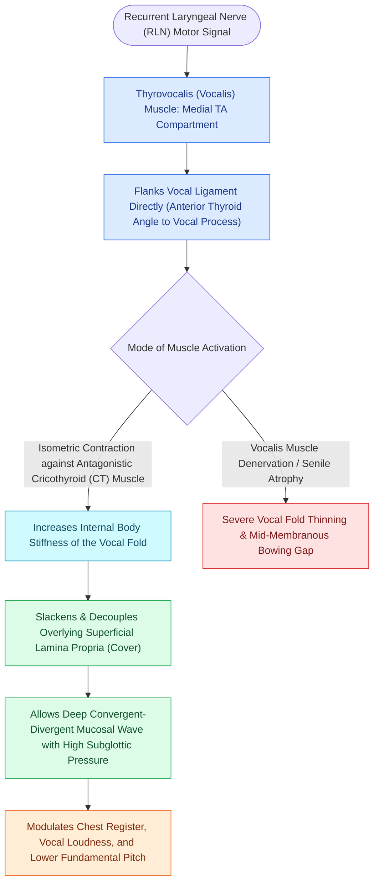

# The thyrovocalis muscle provides isometric pitch and tension control

## Active Recall

> [!question]- Why is the thyrovocalis muscle fiber type uniquely suited for sustained speech and singing?
> *Answer / Clinical Rationale*: It is rich in slow-twitch (Type I) oxidative fibers with high fatigue resistance, allowing sustained isometric contraction and precise fine-tuning of vocal fold internal tension.

> [!question]- Which surgical resection level corresponds to an ELS Type III cordectomy?
> *Answer / Clinical Rationale*: An ELS Type III cordectomy involves resection extending into the **transmuscular plane** through the vocalis muscle belly.

## Core Clinical & Mechanistic Principles
The **Thyrovocalis Muscle** (frequently referred to simply as the **vocalis**) is the medial division of the [[The thyroarytenoid muscle modulates glottal stiffness and adduction|thyroarytenoid muscle complex]]. It lies directly adjacent to the [[The deep lamina propria provides tensile stiffness via crosslinked collagen|deep lamina propria (DLP)]] of the vocal fold.

### Histochemical & Functional Profile
- **Slow-Twitch Oxidative Fibers**: Composed predominantly of Type I (slow-twitch) skeletal muscle fibers characterized by high capillary density, abundant mitochondria, and resistance to fatigue.
- **Isometric Tensioning**: When the vocalis contracts isometrically against the antagonistic pull of the [[The cricothyroid muscle elongates vocal folds to elevate pitch|cricothyroid muscle]], it increases internal body stiffness while allowing the overlying [[The superficial lamina propria acts as a pliable shearing fluid bed|superficial lamina propria]] to remain pliable.
- **Vocal Process Insertion**: Originates from the inner angle of the [[Thyroplasty cartilage window dimensions differ between males and females|thyroid cartilage]] and inserts directly into the vocal process and oblong fovea of the [[The cricoarytenoid joint moves via coupled rocking and sliding|arytenoid cartilage]].

## Surgical Anatomy, Step-by-Step Technique & Nuances
- **Transmuscular Cordectomy Margin**: In oncologic surgery, an [[The ELS classification categorizes endoscopic cordectomies from Types I to VI|ELS Type III (transmuscular) cordectomy]] resects directly through the belly of the vocalis muscle to achieve clear oncologic margins for invasive T1a glottic carcinoma.
- **LEMG Confirmation**: During laryngeal electromyography (LEMG), needle placement into the vocalis is verified by asking the patient to phonate at low pitch or perform a sharp glottal stop.

## Critical Failure Modes & Error Traps
- **Atrophy in High Vagal or RLN Lesions**: Denervation leads to progressive vocalis myofibrillar atrophy, resulting in vocal fold thinning, lateral concavity (bowing), and glottic incompetence.

## Connected Concepts & Graph Traversal
- **Parent Complex**: [[The thyroarytenoid muscle modulates glottal stiffness and adduction|Thyroarytenoid Muscle]]
- **Lateral Muscle Partner**: [[The thyromuscularis muscle provides rapid vocal fold adduction and shortening|Thyromuscularis Muscle]]
- **Superficial Border**: [[The deep lamina propria provides tensile stiffness via crosslinked collagen|Deep Lamina Propria (DLP)]]
- **Electrophysiology**: [[Laryngeal electromyography differentiates vocal fold paralysis from joint fixation|Laryngeal Electromyography (LEMG)]]
- **Surgical Cordectomy**: [[The ELS classification categorizes endoscopic cordectomies from Types I to VI|ELS Cordectomy Classification]]
