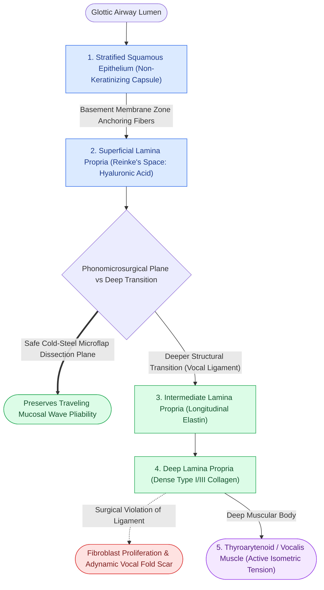

# The vocal fold comprises five distinct histological layers

## Active Recall

> [!question]- Why does surgical violation of the intermediate and deep lamina propria lead to severe, irreversible dysphonia?
> *Answer / Clinical Rationale*: The intermediate and deep lamina propria form the vocal ligament. Disrupting this fibrous framework stimulates vocal fold fibroblasts to synthesize dense, disorganized Type I collagen, permanently obliterating Reinke's space and tethering the pliable cover to the stiff muscle body.

> [!question]- Which histological layers constitute the 'cover' in Hirano's Body-Cover theory of phonation?
> *Answer / Clinical Rationale*: The cover consists of the non-keratinizing stratified squamous epithelium and the superficial lamina propria.

## Core Clinical & Mechanistic Principles
The biomechanical behavior of the human phonatory source depends on the micro-architecture first systematically characterized by **Minoru Hirano**. The vocal fold is organized into five structural layers that transition continuously from a compliant, fluid-like outer surface to a stiff, muscular core:

1. **Stratified Squamous Epithelium**: Outer capsule (5–8 cell layers) that maintains hydration and shape.
2. **Superficial Lamina Propria (SLP / Reinke's Space)**: Low-cellularity amorphous ground substance rich in [[Hyaluronic acid regulates lamina propria hydration and shock absorption|hyaluronic acid]], acting as the main shearing plane.
3. **Intermediate Lamina Propria (ILP)**: Elastin-rich layer providing longitudinal elasticity.
4. **Deep Lamina Propria (DLP)**: Densely crosslinked Type I/III collagen layer resisting longitudinal strain. (The ILP and DLP together constitute the [[The vocal ligament comprises intermediate and deep lamina propria|vocal ligament]]).
5. **Thyroarytenoid Muscle**: Striated skeletal muscle divided into the medial [[The thyrovocalis muscle provides isometric pitch and tension control|thyrovocalis]] and lateral [[The thyromuscularis muscle provides rapid vocal fold adduction and shortening|thyromuscularis]].

### Body-Cover Functional Division
From a mechanical standpoint, these five layers are grouped into two functional components:
- **Cover**: Epithelium and Superficial Lamina Propria. Highly pliable, passive, and responsible for sustaining the traveling [[The mucosal wave travels as a fluid mechanical displacement|mucosal wave]].
- **Transition**: Intermediate and Deep Lamina Propria (vocal ligament).
- **Body**: Thyroarytenoid muscle. Provides active contractile tension, isometric stiffness, and glottic adduction.

## Surgical Anatomy, Step-by-Step Technique & Nuances
- **Surgical Dissection Plane**: In [[Phonomicrosurgery requires suspension laryngoscopy and stereoscopic magnification|phonomicrosurgery]], all benign mucosal dissections must remain strictly within the superficial lamina propria.
- **Subepithelial Hydrodissection**: Infiltration of 1:100,000 epinephrine into the SLP performs [[Subepithelial hydrodissection expands Reinke's space and protects the vocal ligament|hydrodissection]], elevating the epithelial cover away from the underlying vocal ligament.
- **Transition Zones**: At the anterior and posterior ends, the vocal ligament transitions into the [[The macula flava cushions the vocal fold to cartilage transition|macula flava]] and anchors anteriorly via [[Broyles' ligament anchors the vocal ligament to thyroid cartilage|Broyles' ligament]].

## Critical Failure Modes & Error Traps
- **Vocal Ligament Disruption**: Entering the ILP or DLP during microflap dissection disrupts the longitudinal elastin/collagen scaffold, inducing fibroblast proliferation and [[Vocal fold scar results from disorganized Type I collagen deposition|disorganized Type I collagen scarring]].
- **Adynamic Segment Formation**: Loss of the pliable shearing bed eliminates mucosal pliability, presenting on [[Videostroboscopy visualizes mucosal wave dynamics and glottal closure|videostroboscopy]] as an adynamic non-vibrating zone.

## Connected Concepts & Graph Traversal
- **Basement Membrane Zone**: [[The basement membrane zone anchors epithelium to superficial lamina propria|Basement Membrane Zone]]
- **Vocal Ligament Layers**: [[The vocal ligament comprises intermediate and deep lamina propria|Vocal Ligament]]
- **Body Modulator Layer**: [[The thyroarytenoid muscle modulates glottal stiffness and adduction|Thyroarytenoid Muscle]]
- **Mucosal Wave Mechanics**: [[The mucosal wave travels as a fluid mechanical displacement|Mucosal Wave Mechanics]]
- **Phonomicrosurgical Dissection**: [[Phonomicrosurgery requires suspension laryngoscopy and stereoscopic magnification|Phonomicrosurgery]]
