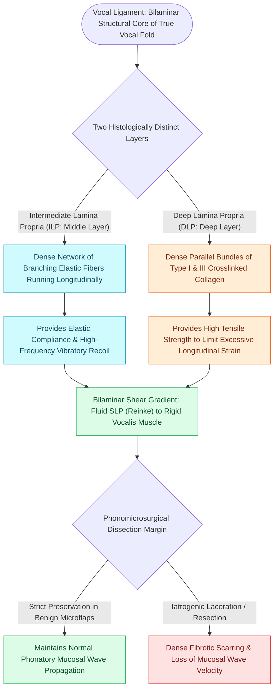

# The vocal ligament comprises intermediate and deep lamina propria

## Active Recall

> [!question]- Why does the vocal ligament act as both a rubber band and a cotton cord under different mechanical loads?
> *Answer / Clinical Rationale*: At low strains, the elastin fibers of the ILP provide elastic compliance (rubber band); at high longitudinal strains (high pitch), the crimped collagen fibers of the DLP straighten and resist further stretch (cotton cord).

> [!question]- What structural landmark anchors the vocal ligament anteriorly to the thyroid cartilage?
> *Answer / Clinical Rationale*: Broyles' ligament (anterior commissure tendon).

## Core Clinical & Mechanistic Principles
The **vocal ligament** constitutes the structural transition layer between the pliable vibratory cover ([[Stratified squamous epithelium forms the vocal fold protective cover|epithelium]] and [[The superficial lamina propria acts as a pliable shearing fluid bed|superficial lamina propria]]) and the muscular body ([[The thyroarytenoid muscle modulates glottal stiffness and adduction|thyroarytenoid muscle]]).

### Dual Layer Composition
The vocal ligament is formed by two distinct histological zones:
1. **Intermediate Lamina Propria (ILP)**: Dense, branching elastin network providing dynamic elastic recoil and longitudinal compliance.
2. **Deep Lamina Propria (DLP)**: Parallel bundles of Type I and [[Vocal fold scar results from disorganized Type I collagen deposition|Type III collagen]] providing tensile stiffness and limiting over-stretching.

### Biomechanical Role in Pitch Modulation
- When the [[The cricothyroid muscle elongates vocal folds to elevate pitch|cricothyroid muscle]] contracts, the [[Thyroplasty cartilage window dimensions differ between males and females|thyroid cartilage]] tilts anteriorly, stretching the vocal fold.
- The vocal ligament bears the passive longitudinal tension, increasing the restoring force during vibration and elevating the fundamental frequency ($F_0$).
- At baseline, the elastin fibers of the ILP provide elasticity; at high strains, the collagen fibers of the DLP become uncrimped and bear maximal tensile load.

## Surgical Anatomy, Step-by-Step Technique & Nuances
- **Anterior & Posterior Insertions**: The vocal ligament inserts anteriorly into the thyroid cartilage via [[Broyles' ligament anchors the vocal ligament to thyroid cartilage|Broyles' ligament]] and posteriorly into the vocal process of the [[The cricoarytenoid joint moves via coupled rocking and sliding|arytenoid cartilage]] via the [[The macula flava cushions the vocal fold to cartilage transition|posterior macula flava]].
- **Surgical Barrier**: During benign [[Phonomicrosurgery requires suspension laryngoscopy and stereoscopic magnification|phonomicrosurgery]], the vocal ligament serves as the deep barrier. Violating this barrier leads to scar tethering.

## Critical Failure Modes & Error Traps
- **Micro-invasive Carcinoma Infiltration**: In glottic malignancy, tumor infiltration into the vocal ligament produces vocal fold fixation and an [[Adynamic vocal fold segments indicate mucosal stiffening, malignancy, or scar|adynamic segment]], necessitating at least a [[The ELS classification categorizes endoscopic cordectomies from Types I to VI|Type II or Type III cordectomy]].

## Connected Concepts & Graph Traversal
- **Five Histological Layers**: [[The vocal fold comprises five distinct histological layers|Five Histological Layers]]
- **Basement Membrane Zone**: [[The basement membrane zone anchors epithelium to superficial lamina propria|Basement Membrane Zone]]
- **Broyles' Ligament Anchor**: [[Broyles' ligament anchors the vocal ligament to thyroid cartilage|Broyles' Ligament]]
- **Pitch Tensing Mechanism**: [[The cricothyroid muscle elongates vocal folds to elevate pitch|Cricothyroid Muscle]]
- **Mucosal Wave Dynamics**: [[The mucosal wave travels as a fluid mechanical displacement|Mucosal Wave Dynamics]]
