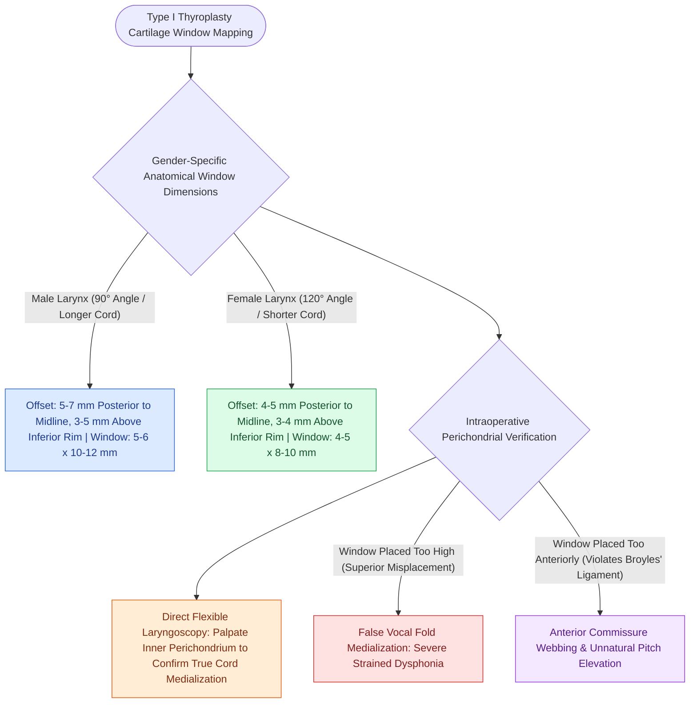

# Thyroplasty cartilage window dimensions differ between males and females

## Active Recall

> [!question]- What are the standard distance landmarks for mapping a Type I thyroplasty window in an adult male?
> *Answer / Clinical Rationale*: **$5\text{–}7\text{ mm}$ posterior** to the anterior midline carina, **$3\text{–}5\text{ mm}$ superior** to the inferior border; dimensions are **$5\text{–}6\text{ mm}$ (height) $\times 10\text{–}12\text{ mm}$ (length)**.

> [!question]- Why are the female thyroplasty window dimensions smaller and positioned closer to the midline and inferior border?
> *Answer / Clinical Rationale*: The female thyroid cartilage is smaller with a wider thyroid angle ($120^\circ$ vs $90^\circ$) and shorter membranous vocal fold length ($8\text{–}10\text{ mm}$ vs $10\text{–}12\text{ mm}$).

## Core Clinical & Mechanistic Principles
In [[Type I thyroplasty medializes the vocal fold with conscious voice tuning|Type I Medialization Thyroplasty]], placing the cartilage fenestration window at the exact level of the true vocal fold is critical. Because male and female thyroid cartilages differ significantly in height, thyroid angle ($90^\circ$ in males vs $120^\circ$ in females), and vocal fold vertical level, standard morphometric measurements must be applied.

### Standard Window Dimensions & Distance Landmarks
| Parameter | Male Larynx (mm) | Female Larynx (mm) | Anatomical Rationale |
| :--- | :--- | :--- | :--- |
| **Distance from Anterior Midline Carina** | **$5\text{–}7\text{ mm}$** | **$4\text{–}5\text{ mm}$** | Prevents medializing the anterior commissure (which causes webbing or blunting). |
| **Distance from Inferior Thyroid Rim** | **$3\text{–}5\text{ mm}$** | **$3\text{–}4\text{ mm}$** | Aligns the lower window border with the subglottic slope of the true vocal fold. |
| **Window Height (Vertical)** | **$5\text{–}6\text{ mm}$** | **$4\text{–}5\text{ mm}$** | Matches the vertical thickness of the thyroarytenoid muscle belly. |
| **Window Length (A-P)** | **$10\text{–}12\text{ mm}$** | **$8\text{–}10\text{ mm}$** | Spans the anterior-posterior length of the membranous true vocal fold. |

**Key Link**: [[The thyroarytenoid muscle modulates glottal stiffness and adduction|Thyroarytenoid muscle]]

## Morphometric Verification Nuances
- **Subperichondrial Level Check**: If there is any doubt regarding the true vocal fold vertical plane, a 70° or flexible fiberoptic scope is passed transorally or transnasally to view the endolarynx while the inner perichondrium is gently palpated with a blunt elevator; direct medial displacement of the true vocal fold (rather than false fold or subglottis) confirms accurate window level.

## Critical Failure Modes & Error Traps
- **Window Placed Too Superiorly**: A common error trap; compressing the false vocal fold or ventricle causes a strained, unnatural ventricular voice without resolving true glottic air leak.
- **Window Placed Too Far Anteriorly**: Compressing [[Broyles' ligament anchors the vocal ligament to thyroid cartilage|Broyles' ligament]] creates an unnatural anterior web and elevates vocal pitch.

## Connected Concepts & Graph Traversal
- **Main Procedure**: [[Type I thyroplasty medializes the vocal fold with conscious voice tuning|Type I Medialization Thyroplasty]]
- **Underlying Muscle Plane**: [[The thyroarytenoid muscle modulates glottal stiffness and adduction|Thyroarytenoid Muscle]]
- **Anterior Insertion Anchor**: [[Broyles' ligament anchors the vocal ligament to thyroid cartilage|Broyles' Ligament]]
- **Adjunctive Framework Surgery**: [[Arytenoid adduction closes large posterior glottic gaps and corrects height mismatch|Arytenoid Adduction]]
- **Clinical Management**: [[The Cernea classification stages EBSLN risk relative to superior thyroid vessels|Cernea Classification]]
