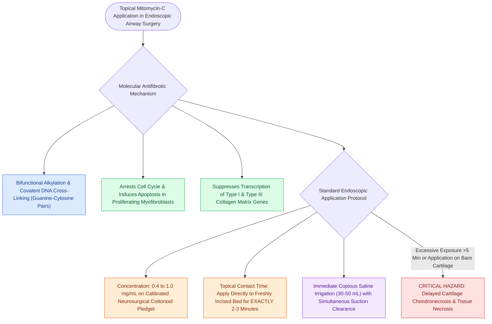

# Topical mitomycin-C inhibits fibroblast proliferation and collagen deposition

## Active Recall

> [!question]- What is the cellular and molecular mechanism of topical Mitomycin-C in preventing airway restenosis?
> *Answer / Clinical Rationale*: It acts as a **bifunctional alkylating agent** that cross-links DNA strands, selectively inhibiting fibroblast and myofibroblast proliferation and suppressing collagen synthesis in the healing wound bed.

> [!question]- What is the standard concentration and application duration of Mitomycin-C in endoscopic airway surgery?
> *Answer / Clinical Rationale*: **$0.4\text{ to }1.0\text{ mg/mL}$ applied topically for 2 to 3 minutes**, followed by immediate copious saline irrigation.

## Core Clinical & Mechanistic Principles
**Mitomycin-C (MMC)** is an antitumor antibiotic isolated from *Streptomyces caespitosus* that functions as a potent **alkylating agent** and inhibitor of cellular proliferation and fibrosis.

### Molecular Mechanism of Antifibrotic Action
- **DNA Cross-Linking**: Metabolically activated within tissue cells to generate a bifunctional alkylating metabolite that forms covalent cross-links between complementary strands of double-stranded DNA (specifically binding at guanine-cytosine base pairs).
- **Inhibition of Fibroblast Proliferation**: Arrests cell cycling, suppressing fibroblast mitosis and inducing apoptosis in rapidly proliferating scar-forming myofibroblasts.
- **Suppression of Collagen Deposition**: Drastically decreases transcription of Type I and [[Vocal fold scar results from disorganized Type I collagen deposition|Type III collagen]] genes, preventing excessive cicatricial matrix formation during wound healing.

## Standard Application Protocol in Airway Endoscopy
1. **Concentration**: **$0.4\text{ to }1.0\text{ mg/mL}$** ($0.4\text{ to }1.0\text{ mg}$ in $1\text{ mL}$ of sterile water).
2. **Neurosurgical Cottonoid Carrier**: Soak a calibrated neurosurgical cottonoid (pledget) in the MMC solution; squeeze out excess liquid to prevent pooling or distal tracheal runoff.
3. **Contact Duration**: Apply the pledget directly to the freshly incised and dilated airway bed for **2 to 3 minutes**.
4. **Copious Saline Irrigation**: Immediately remove the cottonoid and irrigate the airway bed copiously with $30\text{–}50\text{ mL}$ of sterile saline with simultaneous suctioning to clear any residual drug.

## Primary Clinical Indications
- Adjuvant to [[Endoscopic airway dilation combines radial incisions with balloon bronchoplasty|endoscopic radial incision and balloon dilation]] for [[The Cotton-Myer classification grades subglottic stenosis by luminal reduction|subglottic stenosis]].
- Prevention of anterior glottic web recurrence following microflap lysis.
- Prevention of tracheal [[Total laryngectomy achieves en bloc laryngeal resection with permanent end-stoma|stomal stenosis]] and granulation.

## Critical Failure Modes & Error Traps
- **Cartilage Necrosis from Excessive Exposure**: Prolonged contact time (>5 minutes), excessive concentrations (>1.0 mg/mL), or repeated frequent applications to exposed, unvascularized cartilage can cause severe **chondronecrosis, delayed mucosal ulceration, and catastrophic airway collapse**.

## Connected Concepts & Graph Traversal
- **Primary Clinical Application**: [[Endoscopic airway dilation combines radial incisions with balloon bronchoplasty|Endoscopic Airway Dilation]]
- **Alternative Open Surgery**: [[Laryngotracheal reconstruction expands the airway using carved costal cartilage grafts|Laryngotracheal Reconstruction (LTR)]]
- **Target Tissue Matrix**: [[Vocal fold scar results from disorganized Type I collagen deposition|Collagen Deposition and Scarring]]
- **Underlying Inflammation Control**: [[Active reflux and eosinophilic esophagitis compromise airway graft survival|Antireflux Optimization]]
- **Adjunct in Web Repair**: [[Endoscopic anterior glottic web repair requires cold microdivision and endolaryngeal silastic keel stenting to prevent recurrent synechia|Endoscopic Anterior Glottic Web Repair]]
