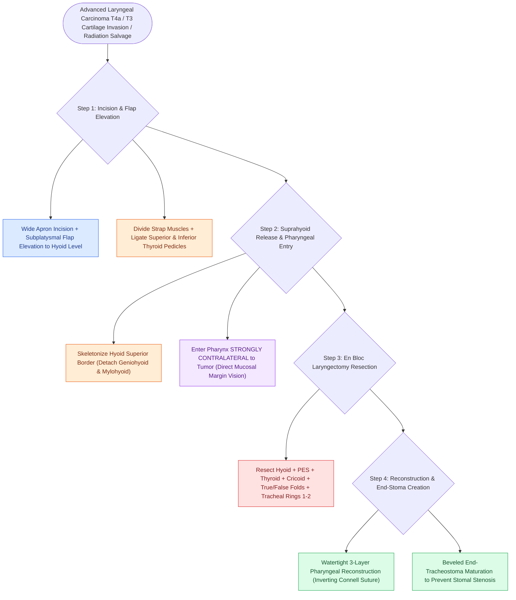

# Total laryngectomy achieves en bloc laryngeal resection with permanent end-stoma

## Active Recall

> [!question]- Why must pharyngeal entry during a total laryngectomy always occur contralateral to the tumor?
> *Answer / Clinical Rationale*: Entering on the unaffected side allows the surgeon to visualize the internal endolarynx and tumor margins directly from the inside, preventing accidental transection through the tumor on the diseased side.

> [!question]- How does total laryngectomy permanently eliminate the risk of pulmonary aspiration?
> *Answer / Clinical Rationale*: It completely severs and reconstructs the pharynx as a closed mucosal tube to the esophagus while venting the trachea directly to the anterior neck skin as an **end-tracheostoma**, permanently dissociating the alimentary and respiratory pathways.

## Core Clinical & Mechanistic Principles
**Total Laryngectomy (TL)** (first performed by Christian Albert Theodor Billroth in 1873) is the definitive oncologic surgical procedure for advanced end-stage laryngeal carcinomas (T4a with through-and-through cartilage erosion or extralaryngeal soft tissue invasion, massive T3 tumors with fixed vocal cords and bilateral [[The paraglottic space facilitates transglottic tumor spread|paraglottic space]] invasion), radiation failure / salvage settings, and intractable chronic aspiration.

### Anatomical Extirpation & Aerodigestive Separation
- **Complete Extirpation**: Resects the **[[Suprahyoid Montgomery release mobilizes the larynx to reduce anastomotic tension|hyoid bone]], [[The pre-epiglottic space enables rapid supraglottic cancer spread|pre-epiglottic space]], entire [[Thyroplasty cartilage window dimensions differ between males and females|thyroid cartilage]], [[Cricotracheal resection removes subglottic stenosis while sparing posterior cricoid and RLNs|cricoid cartilage]], true and false vocal folds, paraglottic spaces, and proximal tracheal rings (1–2 or 2–3)** en bloc.
- **Permanent Dissociation of Airway and Digestive Tract**: Completely eliminates the risk of aspiration by permanently separating the gastrointestinal tract (closed pharynx/esophagus) from the respiratory tract (matured end-tracheostoma).

## Step-by-Step Surgical Execution
1. **Incision & Flap Elevation**: Wide apron or U-shaped incision extending from mastoid tip to mastoid tip, crossing $2\text{ cm}$ above the sternal notch. Elevate subplatysmal flap superiorly to the level of the hyoid.
2. **Skeletonization & Thyroid Lobectomy**: Divide strap muscles at their sternal attachments. Dissect sternothyroid and thyrohyoid muscles. Divide the thyroid isthmus; mobilize and ligate the superior thyroid vascular pedicles. Perform ipsilateral or total thyroidectomy based on subglottic or extralaryngeal extension.
3. **Suprahyoid Release**: Skeletonize the upper border of the hyoid bone, dividing geniohyoid, mylohyoid, and digastric tendon insertions.
4. **Pharyngeal Entry (Contralateral Rule)**: Enter the pharynx **strictly contralateral to the primary tumor site** (via the contralateral vallecula or pyriform sinus) to confirm tumor margins under direct internal vision.
5. **Larynx Excision & Tracheal Transection**: Cut along the pyriform sinuses and post-cricoid mucosa, maximizing mucosal preservation for closure. Transect the trachea between rings 1–2 or 2–3, beveling the cut superiorly on the posterior wall.
6. **Pharyngeal Reconstruction**: Perform a tension-free, 3-layer closure (see [[Pharyngeal reconstruction requires a three-layer closure to prevent fistula|pharyngeal reconstruction]]).
7. **Tracheostoma Maturation**: Create a circular dermal cutout in the lower skin flap; suture the beveled trachea to the dermis with interrupted **3-0 Prolene or Nylon sutures**, locking the cartilaginous rings to the skin to prevent stomal stenosis.

## Critical Failure Modes & Error Traps
- **Stomal Stenosis**: Creating a round, non-beveled tracheal cut without circular dermal interposition causes cicatricial concentric ring stenosis of the stoma.
- **Pharyngocutaneous Fistula**: The most frequent major complication, resulting from excessive closure tension, prior radiotherapy, or poor nutrition (see pharyngeal closure).

## Connected Concepts & Graph Traversal
- **TEP Voice Restoration**: [[Tracheoesophageal puncture diverts pulmonary air through a one-way valve into the neopharynx|Tracheoesophageal Puncture]]
- **Electrolarynx Speech**: [[The electrolarynx provides immediate mechanical speech via acoustic coupling|Electrolarynx Speech]]
- **Hands-Free Stomaplasty**: [[Hands-free stomaplasty stabilizes the peristomal contour using fascia lata slings|Hands-Free Stomaplasty]]
- **PE Segment Function**: [[Pharyngoesophageal segment hypertonicity causes TEP failure treated with Botox or myotomy|PE Segment Hypertonicity]]
- **Emergency Stoma Protocol**: [[Total laryngectomy stomas and tracheostomies require distinct emergency airway resuscitation algorithms|Emergency Stoma Resuscitation]]
- **🔗 Late Stomal Recurrence (Head and Neck)**: [[Stomal recurrence after total laryngectomy is staged by the Sisson classification and requires mediastinal resection with vascularized tissue coverage|Stomal Recurrence (Sisson Classification)]]
