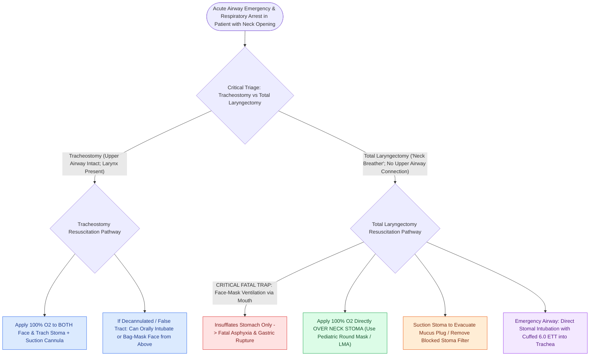

# Total laryngectomy stomas and tracheostomies require distinct emergency airway resuscitation algorithms

## Active Recall

> [!question]- Why is face-mask ventilation via the mouth completely ineffective in a total laryngectomy patient?
> *Answer / Clinical Rationale*: Because the larynx has been removed and the trachea is sewn directly to the neck; there is **no anatomical connection between the pharynx/mouth and the lungs**.

> [!question]- Where should the emergency ventilation mask be applied in a total laryngectomy patient in respiratory distress?
> *Answer / Clinical Rationale*: Directly **over the neck stoma** using a pediatric or neonatal round mask.

## Core Clinical & Mechanistic Principles
In an acute airway emergency, distinguishing between a **patient with a standard [[Standard open tracheotomy utilizes horizontal intersinusoidal or Bjork flap entry|tracheostomy]]** and a **total laryngectomy "neck breather"** is a critical, life-or-death diagnostic fork:
- **Fundamental Anatomical Distinction**:
  - **Tracheostomy Patient**: Upper airway is intact; the larynx and vocal cords are present. Air can travel through the nose/mouth OR through the tracheal stoma. If the stomal tube is blocked or displaced, **the patient can still be bag-mask ventilated or orotracheally intubated from above**.
  - **Total Laryngectomy Patient**: The larynx has been surgically removed; the trachea is transected and sutured directly to the anterior skin of the neck as an **end-tracheostomy (stoma)**. There is **zero connection between the pharynx/mouth and the lungs** (a permanent anatomical dead-end).
- **The Fatal Pitfall in Laryngectomy Emergencies**:
  - Attempting mouth-to-mouth or standard face-mask ventilation in a total laryngectomy patient delivers $100\%$ of airflow into the stomach and esophagus, causing gastric rupture while the patient asphyxiates.
- **Standardized National Tracheostomy Safety Project (NTSP) Algorithm**:
  1. **Identify the Neck Breather**: Look for "Total Laryngectomy" neck wristband or absence of thyroid prominence/larynx.
  2. **Remove Inner Cannula / Deflate Cuff / Remove Stomal Plugs**.
  3. **Oxygenation & Suction**: Apply high-flow $100\%$ O2 via pediatric face mask or LMA directly **over the neck stoma** (and over face in tracheostomy); pass a suction catheter.
  4. **Emergency Tube Insertion**: If obstructed, insert a cuffed 6.0 ETT or tracheostomy tube directly into the neck stoma.

### Surgical Technique & Critical Safety Checks
- **Bedside Signs**: A laryngectomy stoma is typically larger, lower, and flush with the sternal notch, without a visible larynx above.

## Connected Concepts & Graph Traversal
- **En Bloc Total Laryngectomy**: [[Total laryngectomy achieves en bloc laryngeal resection with permanent end-stoma|Total Laryngectomy]]
- **Open Tracheostomy Surgical Steps**: [[Open tracheostomy provides superior exposure and stay suture placement compared to percutaneous technique|Open Tracheostomy]]
- **Tracheoinnominate Fistula**: [[Tracheoinnominate fistula presents with sentinel bleeding requiring hyperinflation tamponade and emergency surgical ligation|Tracheoinnominate Fistula]]
- **Subcutaneous Emphysema**: [[Subcutaneous emphysema arises when tracheotomy incisions are closed too tightly|Subcutaneous Emphysema]]
- **Hands-Free Stoma Slings**: [[Hands-free stomaplasty stabilizes the peristomal contour using fascia lata slings|Hands-Free Stomaplasty]]
