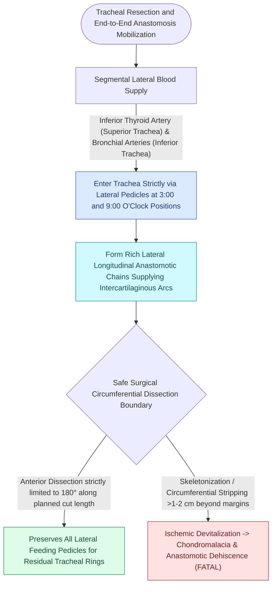

# Tracheal dissection is limited to the anterior 180 degrees to preserve blood supply

## Active Recall

> [!question]- Why must distal tracheal dissection be limited strictly to the anterior 180 degrees during tracheal mobilization?
> *Answer / Clinical Rationale*: The arterial blood supply to the trachea enters exclusively via **lateral soft tissue vascular pedicles** (branches of the inferior thyroid and bronchial arteries); circumferential skeletonization devascularizes the mobilizing tracheal rings, causing ischemic anastomotic necrosis and dehiscence.

> [!question]- Which arteries provide the primary segmental blood supply to the upper and lower trachea?
> *Answer / Clinical Rationale*: The **inferior thyroid arteries** supply the upper trachea and subglottis, while the **bronchial arteries** (and internal mammary/subclavian branches) supply the lower trachea and carina.

## Core Clinical & Mechanistic Principles
During [[Cricotracheal resection removes subglottic stenosis while sparing posterior cricoid and RLNs|cricotracheal resection (CTR)]] or segmental tracheal resection, preserving the microvascular blood supply to the distal mobilizing trachea is the absolute prerequisite for anastomotic healing.

### Segmental Lateral Blood Supply of the Trachea
- **Lateral Vascular Pedicles**: The human trachea does not have an axial longitudinal blood supply running along its anterior surface. Its arterial perfusion arrives **strictly from the lateral soft tissue pedicles** via segmental branches of the **inferior thyroid artery** (superiorly), **subclavian/internal mammary arteries**, and **bronchial arteries** (inferiorly).
- **Transverse Interannular Arterioles**: These lateral segmental vessels penetrate the lateral tracheal walls and branch into microscopic anterior and posterior interannular transverse arches that nourish the cartilage rings and mucosal lining.

## The "Anterior 180° Rule" in Surgical Practice
- **Safe Anterior Plane**: Blunt finger or sponge dissection is confined **strictly to the anterior $180^\circ$ of the pretracheal avascular plane**, carrying dissection inferiorly into the superior mediastinum down to the main carina.
- **Strict Prohibition of Circumferential Skeletonization**: Dissecting laterally beyond the mid-coronal plane or circumferentially skeletonizing the distal trachea completely severs the lateral segmental arteries.
- **Ischemic Necrosis & Anastomotic Dehiscence**: Circumferential devascularization converts the distal tracheal stump into an ischemic, non-perfused cartilage cylinder, resulting in complete anastomotic necrosis, breakdown, and fatal restenosis.

## Critical Failure Modes & Error Traps
- **Over-skeletonization for "Better Exposure"**: Stripping more than $1\text{–}2\text{ cm}$ of lateral tissue beyond the immediate transection margin induces ischemic necrosis of the distal tracheal rings.

## Connected Concepts & Graph Traversal
- **Parent Surgical Procedure**: [[Cricotracheal resection removes subglottic stenosis while sparing posterior cricoid and RLNs|Cricotracheal Resection (CTR)]]
- **Tension Release Maneuvers**: [[Suprahyoid Montgomery release mobilizes the larynx to reduce anastomotic tension|Suprahyoid Montgomery Release]]
- **Immobilization Protocol**: [[The guardian chin-to-chest suture prevents cervical hyperextension and anastomotic dehiscence|Guardian Chin-to-Chest Suture]]
- **Endoscopic Measurement**: [[Rigid bronchoscopy requires 90-degree rotation through the glottis|Operative Rigid Bronchoscopy]]
- **Clinical Management**: [[Adult tracheostomy tube exchange at one week requires a mature tract, tracheal stay sutures, and bougie guidance|Tracheostomy Tube Exchange]]
