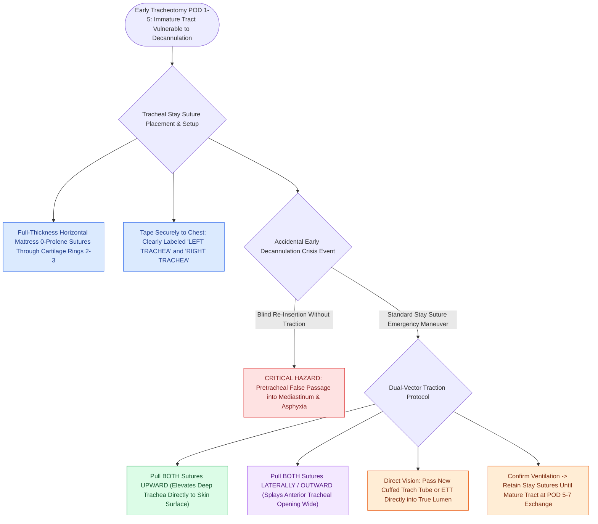

# Tracheal stay sutures prevent false tract entry during accidental decannulation

## Active Recall

> [!question]- How do tracheal stay sutures facilitate emergency re-intubation during accidental decannulation in the ICU?
> *Answer / Clinical Rationale*: Pulling the bilateral stay sutures upward and laterally pulls the deep trachea directly to the skin surface and splays the anterior tracheal opening, allowing the replacement tube to be passed directly into the lumen under direct vision without creating a pretracheal false passage.

> [!question]- When can tracheal stay sutures be safely removed?
> *Answer / Clinical Rationale*: Following the **first successful tracheotomy tube change** (typically on postoperative day 5 to 7), once a stable, epithelialized tract has been established.

## Core Clinical & Mechanistic Principles
**Tracheal Stay Sutures** are heavy, nonabsorbable traction sutures placed through the lateral borders of the tracheal wall during [[Standard open tracheotomy utilizes horizontal intersinusoidal or Bjork flap entry|open tracheotomy]] to safeguard against catastrophic loss of airway during early accidental decannulation.

### Mechanism of Action
- **Traction Vectors**: Upward and lateral traction on bilateral stay sutures pulls the deeply seated anterior tracheal wall directly to the skin surface, elevating the stoma out of the deep pretracheal space.
- **Lumen Widening**: Lateral pulling separates the tracheal incision margins, instantly opening a wide, direct portal into the tracheal lumen.
- **Prevention of False Passage**: Without stay sutures, attempting blind re-insertion through an unepithelialized stoma (during postoperative days 1–5) frequently forces the tracheotomy tube into the loose pretracheal or paratracheal tissue planes, creating a false passage into the anterior mediastinum and causing fatal asphyxiation.

## Step-by-Step Surgical Placement & Protocol
1. **Suture Material**: Place two **0-Prolene, 0-Silk, or 2-0 Ethibond** sutures as full-thickness horizontal mattress sutures through the tracheal cartilage rings immediately flanking the tracheal incision (rings 2, 3, or 4).
2. **Labeling & Securement**:
   - The left suture is labeled *"LEFT TRACHEA"*; the right suture is labeled *"RIGHT TRACHEA"*.
   - Tape both suture ends securely to the patient's chest with sterile tape.
3. **Nursing & Staff Education**: Clear bedside signage must instruct ICU staff: *"In case of accidental decannulation, pull stay sutures firmly UP and OUT to open the airway."*
4. **Removal**: Retained until the first tracheotomy tube change (typically postoperative days 5 to 7), when a mature, epithelialized tract has formed.

## Critical Failure Modes & Error Traps
- **Pulling Single Suture or Cutting Too Early**: Pulling only one stay suture rotates the trachea laterally, occluding the lumen. Removing stay sutures before the first tube change leaves the airway vulnerable to fatal false tract creation.

## Connected Concepts & Graph Traversal
- **Parent Procedure**: [[Standard open tracheotomy utilizes horizontal intersinusoidal or Bjork flap entry|Standard Open Tracheotomy]]
- **Alternative Flap**: [[The Bjork flap facilitates emergency tracheostomy recannulation|The Björk Flap]]
- **Specialized Obesity Technique**: [[Defatting tracheotomy secures the airway in morbidly obese patients|Defatting Tracheotomy]]
- **Avoided Complication**: [[Subcutaneous emphysema arises when tracheotomy incisions are closed too tightly|Subcutaneous Emphysema]]
- **Clinical Management**: [[Adult tracheostomy tube exchange at one week requires a mature tract, tracheal stay sutures, and bougie guidance|Tracheostomy Tube Exchange]]
