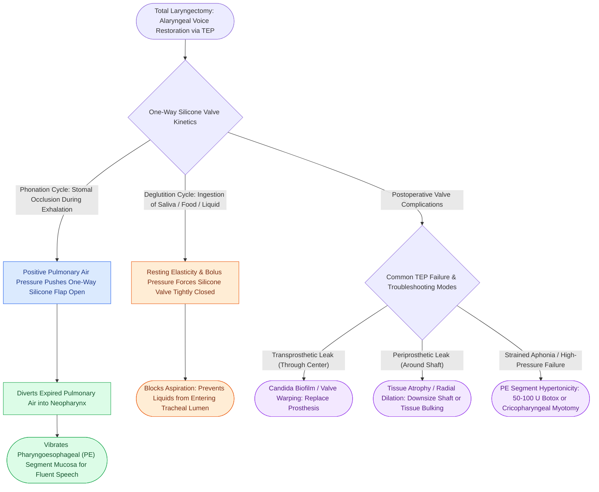

# Tracheoesophageal puncture diverts pulmonary air through a one-way valve into the neopharynx

## Active Recall

> [!question]- Where should a primary TEP puncture be created relative to the tracheostoma?
> *Answer / Clinical Rationale*: **$1.0\text{ to }1.5\text{ cm}$ below the superior cut rim** of the posterior tracheal wall in the exact midline of the tracheoesophageal party wall.

> [!question]- How does a TEP prosthesis allow voicing while preventing aspiration during swallowing?
> *Answer / Clinical Rationale*: It contains a **one-way silicone valve** that opens under positive pulmonary air pressure during expiration (diverting air into the neopharynx for voicing) but remains sealed shut under resting and swallowing pressures (blocking salivary and liquid aspiration into the trachea).

## Core Clinical & Mechanistic Principles
**Tracheoesophageal Puncture (TEP)** (pioneered by Mark Singer and Eric Blom in 1979) is the gold-standard modality for alaryngeal voice restoration following [[Total laryngectomy achieves en bloc laryngeal resection with permanent end-stoma|Total Laryngectomy]].

### The One-Way Valve Mechanism
- **The Fistula Tract**: A controlled surgical fistula is created through the common tracheoesophageal party wall, situated **$1.0\text{ to }1.5\text{ cm}$ below the superior cut rim** of the posterior tracheal wall.
- **The Silicone Voice Prosthesis**: A one-way silicone valve prosthesis (e.g., Blom-Singer, Provox) is placed across the puncture.
- **Phonation vs Aspiration Protection**:
  1. *Phonation*: When the patient digitalizes (occludes) the tracheostoma during exhalation, pulmonary air forces the one-way silicone flap open, diverting expired lung air into the neopharynx to vibrate the [[Esophageal speech utilizes swallowed air across the PE segment for voicing|pharyngoesophageal (PE) segment]], producing a fluent, natural-sounding voice.
  2. *Swallowing / Aspiration Protection*: When the patient swallows, the one-way valve automatically closes by tissue pressure, preventing ingested liquids and saliva from entering the trachea.

## Primary vs Secondary TEP Technique
1. **Primary TEP (Performed during Total Laryngectomy)**:
   - Created under direct vision before pharyngeal closure.
   - Puncture placed $1.0\text{–}1.5\text{ cm}$ below posterior tracheal lip; stented with a 14-Fr red rubber catheter or primary indwelling prosthesis.
   - *Advantage*: Single surgery, earlier voice rehabilitation.
2. **Secondary TEP (Delayed Setting)**:
   - Performed after the stoma and neopharynx have fully healed (typically $>2\text{–}3\text{ months}$ post-op).
   - Executed under rigid esophagoscopy in the OR or via transnasal esophagoscopy (TNE) in the clinic with local anesthesia.

## Primary Troubleshooting & Complications
1. **Transprosthetic Leak**: Fluid leaks through the central valve mechanism due to Candida colonization or mechanical wear.
2. **Periprosthetic Leak**: Fluid leaks around the outside shaft due to tissue atrophy or tract dilation.
3. **PE Segment Hypertonicity / Spasm**: High phonatory pressure with strained, absent sound production.

## Connected Concepts & Graph Traversal
- **Total Laryngectomy Primary**: [[Total laryngectomy achieves en bloc laryngeal resection with permanent end-stoma|Total Laryngectomy]]
- **Periprosthetic Leak Rescue**: [[Periprosthetic TEP leaks occur around the shaft due to tissue atrophy or dilation|Periprosthetic TEP Leaks]]
- **PE Segment Spasm / Botox**: [[Pharyngoesophageal segment hypertonicity causes TEP failure treated with Botox or myotomy|PE Segment Hypertonicity]]
- **Electrolarynx Alternative**: [[The electrolarynx provides immediate mechanical speech via acoustic coupling|Electrolarynx Speech]]
- **Hands-Free Slings**: [[Hands-free stomaplasty stabilizes the peristomal contour using fascia lata slings|Hands-Free Stomaplasty]]
