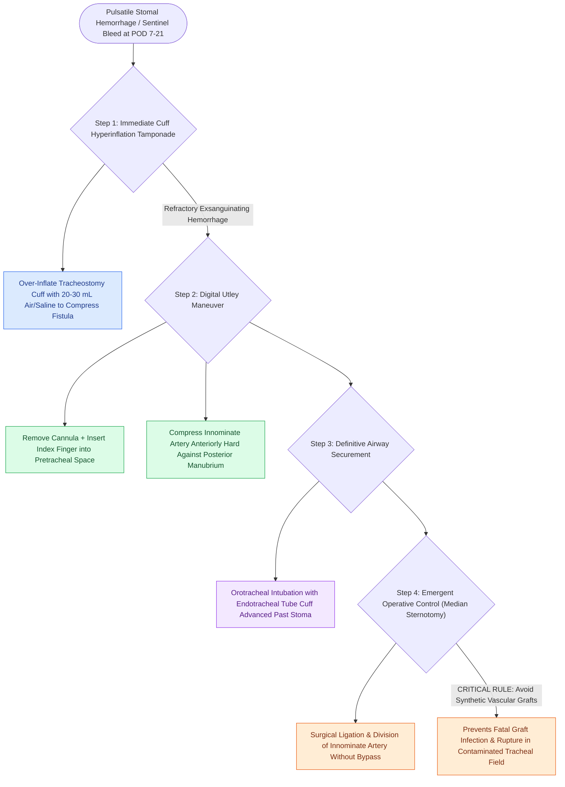

# Tracheoinnominate fistula presents with sentinel bleeding requiring hyperinflation tamponade and emergency surgical ligation

## Active Recall

> [!question]- What is the immediate bedside action when massive arterial stomal hemorrhage occurs post-tracheostomy?
> *Answer / Clinical Rationale*: **Hyperinflate the tracheostomy tube cuff** (or perform the **Utley maneuver** by compressing the artery anteriorly against the posterior sternum with an index finger) while securing the airway with orotracheal intubation.

> [!question]- Why is simple ligation and division preferred over prosthetic bypass during definitive surgery for TIF?
> *Answer / Clinical Rationale*: Because the operative field is **grossly contaminated with tracheal secretions and bacteria**, leading to almost certain infection, disruption, and fatal rupture of prosthetic vascular grafts.

## Core Clinical & Mechanistic Principles
**Tracheoinnominate Fistula (TIF)** is a catastrophic, life-threatening complication of [[Standard open tracheotomy utilizes horizontal intersinusoidal or Bjork flap entry|tracheostomy]] occurring in $0.5\text{–}1.0\%$ of cases, with mortality approaching $>80\text{–}90\%$ if unrecognized:
- **Pathophysiological Mechanism**:
  - The **innominate (brachiocephalic) artery** crosses the trachea anteriorly at the level of the 6th to 9th tracheal rings.
  - TIF is triggered by high-pressure cuff ischemia, low tracheotomy placement (below the 4th tracheal ring), or direct mechanical erosion from the tip/curve of an ill-fitting tracheostomy cannula against the anterior tracheal wall and overlying artery.
- **The "Sentinel Bleed" ($50\text{–}70\%$ of cases)**:
  - A self-limited herald bleed of bright red blood from the stoma occurring **$1\text{ to }3\text{ weeks post-tracheostomy}$**.
  - **Operating Room Rule**: Any stomal bleeding beyond 48 hours post-tracheotomy is considered a TIF until proven otherwise by bedside bronchoscopy and CT angiography in the operating room.
- **Bedside Resuscitation Maneuvers**:
  1. **Hyperinflation Tamponade**: Immediately over-inflate the tracheostomy cuff with a large volume of air ($20\text{–}30\text{ mL}$) or saline to compress the fistula.
  2. **The Utley Maneuver (Digital Tamponade)**: If bleeding continues, withdraw the cannula, insert an index finger through the stoma into the pretracheal space, and compress the innominate artery anteriorly against the posterior surface of the sternum (manubrium) while an assistant orotracheally intubates the patient past the stoma.

## References
1. Ridley, R.W., Zwischenberger, J.B. (2006). Tracheoinnominate fistula: Surgical management of an iatrogenic disaster. *J Laryngol Otol*, 120(8):676-680.
2. Mitchell, R.B., Hussey, H.M., Setzen, G., et al. (2013). Clinical consensus statement: Tracheostomy care. *Otolaryngol Head Neck Surg*, 148(1):6-20.
3. Kraft, S.M., Schindler, J.S. (2020). Tracheotomy. In Flint, P.W., et al. (Eds.), *Cummings Otolaryngology Head and Neck Surgery* 7e (pp. 95-103). Philadelphia, PA: Elsevier.

## Connected Concepts & Graph Traversal
- **Open Tracheostomy Steps**: [[Open tracheostomy provides superior exposure and stay suture placement compared to percutaneous technique|Open Tracheostomy]]
- **Percutaneous Tracheostomy**: [[Percutaneous dilatational tracheostomy utilizes bronchoscopic guidance and Seldinger dilation between tracheal rings|Percutaneous Tracheostomy]]
- **Emergency Resuscitation**: [[Total laryngectomy stomas and tracheostomies require distinct emergency airway resuscitation algorithms|Emergency Airway Algorithms]]
- **Subcutaneous Emphysema**: [[Subcutaneous emphysema arises when tracheotomy incisions are closed too tightly|Subcutaneous Emphysema]]
- **High-Stakes Rescue Protocols**: [[High-stakes laryngeal complications require proactive landmarking and rescue protocols|Laryngeal Complication Protocols]]
