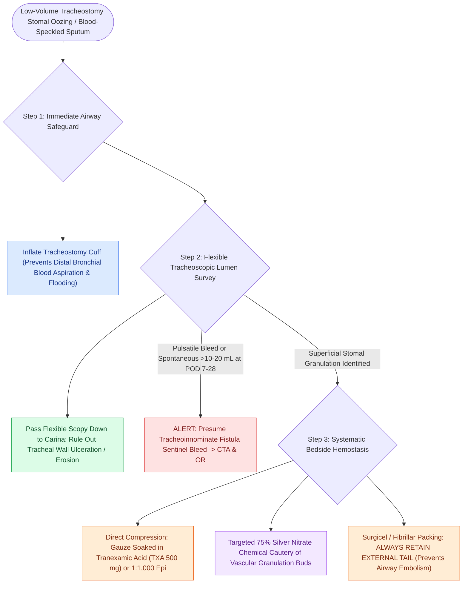

# Tracheostomy stomal bleeding is controlled with cuff overinflation, hemostatic agents, and silver nitrate cautery

## Active Recall

> [!question]- Why must any hemostatic material (e.g., Surgicel) placed in a bleeding tracheostomy tract always have an external tail left outside the wound?
> *Answer / Clinical Rationale*: Without an external tail or anchor, small fragments of hemostatic gauze can migrate through the stoma into the tracheal lumen, causing acute mechanical airway occlusion or distal bronchus plug.

> [!question]- What clinical features distinguish benign stomal granulation bleeding from a tracheoinnominate fistula sentinel bleed?
> *Answer / Clinical Rationale*: Benign granulation produces **low-volume, dark venous oozing or blood-speckled mucus** without pulsation; a sentinel TIF bleed presents as **spontaneous, bright red arterial bleeding (>10–20 mL) or visible tube pulsation**, typically occurring 1–4 weeks post-tracheotomy.

## Core Clinical & Mechanistic Principles
Low-volume bleeding from or around a tracheostomy is a common consultation. While self-limited oozing typically arises from superficial stomal irritation, aggressive suctioning trauma, or vascular granulation tissue, every episode of bleeding must be systematically evaluated to distinguish benign peristomal sources from the **"sentinel bleed"** herald of a life-threatening [[Tracheoinnominate fistula presents with sentinel bleeding requiring hyperinflation tamponade and emergency surgical ligation|tracheoinnominate fistula (TIF)]] or [[Massive tracheostomy hemorrhage requires cuff overinflation, digital compression, and emergent surgical or endovascular control|massive tracheostomy hemorrhage]]:

- **Etiological Classification of Low-Volume Bleeding**:
  - **Peristomal Granulation Tissue**: Exuberant, highly vascularized granulation tissue generated by repetitive friction from tube movement, poorly fitted flanges, and peristomal bacterial colonization (*Pseudomonas aeruginosa*, *Staphylococcus aureus*).
  - **Suctioning Trauma**: Deep, unguided suction catheter passes causing mechanical excoriation and focal mucosal hemorrhage on the posterior tracheal wall or carina.
  - **Tracheal Wall Impingement**: Inappropriate tube curvature (e.g., rigid right-angle tube) causing the distal tip or shaft to abrade the anterior or posterior tracheal mucosa.
  - **Early Postoperative Ooze ($<48\text{ hours}$)**: Venous oozing from divided anterior jugular veins, cut thyroid isthmus edges, or dermal margins.

- **Systematic Bedside Hemostasis Protocol**:
  1. **Cuff Inflation Safeguard**: Immediately inflate the tracheostomy cuff to prevent blood from pooling into the distal bronchial tree and causing aspiration pneumonitis or atelectasis.
  2. **Tracheoscopic Lumen Survey**: Pass a flexible fiberoptic scope through the tube to examine the entire tracheal lumen down to the carina and mainstem bronchi. Confirm the distal tip is centered and rule out intraluminal clots or deep mucosal erosion.
  3. **Stomal Exploration & Hemostatic Packing**: Under headlight illumination, retract the peristomal skin to expose the tract. Apply direct pressure with gauze soaked in **tranexamic acid (TXA, 500 mg)** or $1:1,000$ topical epinephrine. If necessary, place oxidized regenerated cellulose (Surgicel / Fibrillar) into the subcutaneous tract, **always leaving an external tail taped to the skin** to prevent accidental dislodgement into the airway.
  4. **Targeted Silver Nitrate Cautery**: Under direct vision, cauterize discrete granulation buds with a 75% silver nitrate stick. Blot excess moisture immediately to prevent caustic runoff into the trachea.
  5. **Topical Antiseptic Dressing**: For exuberant, chronically infected granulation tissue, apply dilute povidone-iodine compresses (10% betadine diluted 1:20 in normal saline on a drain sponge under the flanges for 10 minutes twice daily).
  6. **Tube Optimization**: If the tube is impinging on the anterior or posterior wall, exchange for a flexible [[Shiley, Bivona, and Portex tracheostomy tubes differ in cannula design, cuff profile, and airway resistance|Bivona TTS]] or extended-length (XLT) tube to realign the shaft coaxially within the trachea.

### Key Consultation Supplies
- Coaxial surgical headlight
- Personal protective equipment (mask with eye shield, gown, sterile gloves)
- Flexible fiberoptic nasopharyngoscope / bronchoscope with video monitor and Fred antifog solution
- Dual suction lines (Yankauer tip and in-line French suction catheters)
- Vienna or Killian nasal speculum / Army-Navy retractors / cricoid hook
- Assorted cuffed endotracheal tubes (sizes 6.0 and 7.0)
- Replacement tracheostomy tubes (same size and one size smaller; cuffed non-fenestrated)
- Lubricated endotracheal bougie
- 10 mL Luer-lock syringe
- Hemostatic agents: 75% silver nitrate applicator sticks, oxidized regenerated cellulose (Surgicel / Fibrillar), sterile 4x4 gauze
- Topical tranexamic acid (TXA 500 mg) or 1:1,000 topical epinephrine

### The "Sentinel Bleed" Alert
Any episode of brisk, pulsatile bleeding or spontaneous bleeding $>10–20\text{ mL}$ occurring **1 to 4 weeks postoperatively** must be presumed a **sentinel bleed from a tracheoinnominate fistula** until proven otherwise. Immediately obtain a CT angiogram of the neck and chest, alert the operating room and cardiothoracic/vascular teams, and prepare for emergency hyperinflation and digital compression.

> [!example]- **Operative Note Template: Bedside control of tracheostomy stomal bleeding**
> **PROCEDURE**: Bedside control of tracheostomy stomal bleeding
> **PRE-PROCEDURAL DIAGNOSIS**: Tracheostomy stomal bleeding / peristomal granulation tissue
> **POST-PROCEDURAL DIAGNOSIS**: Tracheostomy stomal bleeding / peristomal granulation tissue
> **SURGEON**: [Surgeon Name, MD]
> **ASSISTANT**: [Resident/Fellow Name, MD]
>
> **PROCEDURE IN DETAIL**:
> The patient was evaluated at the bedside for active blood oozing around the tracheostomy tube. Pre-procedural vital signs were verified (BP [XX/XX], HR [XX], SpO2 [XX]%).
>
> The tracheostomy tube cuff was inflated to prevent distal blood aspiration into the lungs. Under coaxial headlight illumination, a flexible fiberoptic laryngoscope was passed through the lumen of the tracheostomy tube. The entire tracheal mucosa down to the carina and proximal mainstem bronchi was systematically examined. The tracheal mucosa was smooth, pink, and intact without active bleeding, erosion, mucosal ulceration, or retained blood clots. The carina was sharp and clear.
>
> Attention was then directed to the peristomal skin and stoma. The tracheostomy collar was loosened and the tube gently retracted to expose the subcutaneous tract with a nasal speculum. A 4 mm vascular granulation tissue bud was identified at the superior stomal margin with active minor oozing. The area was dried with cotton-tip applicators and chemical cauterization was performed with a 75% silver nitrate stick under direct visualization. A small strip of oxidized cellulose (Surgicel) soaked in tranexamic acid was placed into the superficial peristomal tract with an external tail secured to the peristomal skin. Excellent hemostasis was achieved immediately. The tracheostomy tube was returned to neutral positioning and secured with a new Velcro collar. Oxygen saturation remained >96% throughout the procedure.

## References
1. Mitchell, R.B., Hussey, H.M., Setzen, G., et al. (2013). Clinical consensus statement: Tracheostomy care. *Otolaryngol Head Neck Surg*, 148(1):6-20.
2. Kraft, S.M., Schindler, J.S. (2020). Tracheotomy. In Flint, P.W., et al. (Eds.), *Cummings Otolaryngology Head and Neck Surgery* 7e (pp. 95-103). Philadelphia, PA: Elsevier.
3. Durbin Jr., C.G. (2010). Tracheostomy: why, when, and how? *Respir Care*, 55(8):1056-1068.
4. Ridley, R.W., Zwischenberger, J.B. (2006). Tracheoinnominate fistula: Surgical management of an iatrogenic disaster. *J Laryngol Otol*, 120(8):676-680.

## Connected Concepts & Graph Traversal
- **Catastrophic Hemorrhage Rescue**: [[Massive tracheostomy hemorrhage requires cuff overinflation, digital compression, and emergent surgical or endovascular control|Massive Tracheostomy Bleeding Management]]
- **TIF Pathophysiology**: [[Tracheoinnominate fistula presents with sentinel bleeding requiring hyperinflation tamponade and emergency surgical ligation|Tracheoinnominate Fistula]]
- **Tube System Architecture**: [[Shiley, Bivona, and Portex tracheostomy tubes differ in cannula design, cuff profile, and airway resistance|Tracheostomy Tube Types]]
- **Exchange Protocol**: [[Tracheostomy tube exchange technique requires pre-oxygenation, nasal speculum visualization, and endoscopic confirmation|Tracheostomy Tube Exchange]]
- **Surgical Creation**: [[Open tracheostomy provides superior exposure and stay suture placement compared to percutaneous technique|Open Tracheostomy Craft]]
