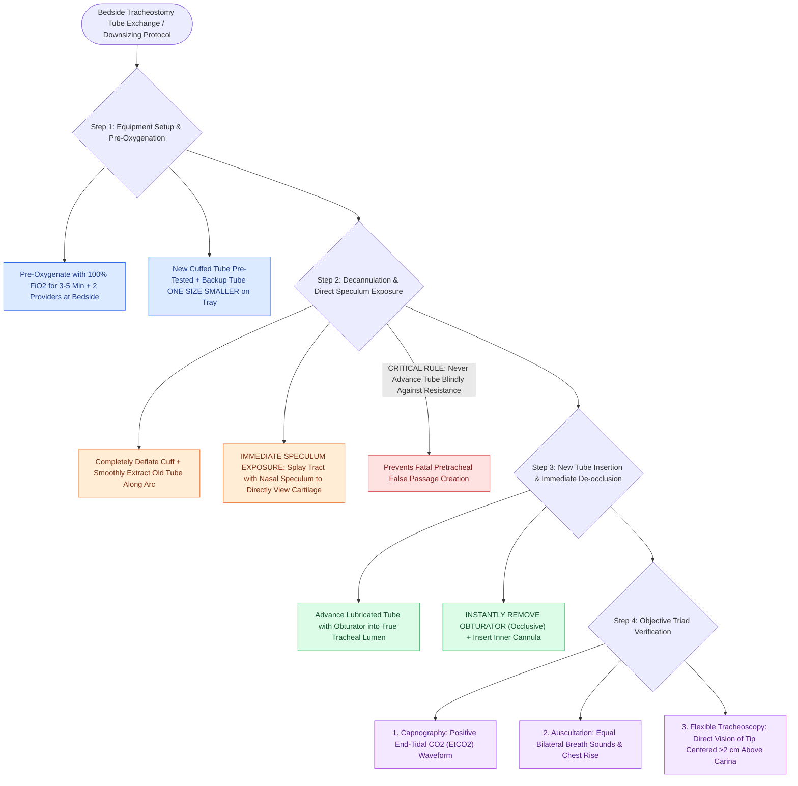

# Tracheostomy tube exchange technique requires pre-oxygenation, nasal speculum visualization, and endoscopic confirmation

## Active Recall

> [!question]- Why is inserting a nasal speculum or tracheal retractors into the stoma critical during a bedside tracheostomy tube exchange?
> *Answer / Clinical Rationale*: It keeps the soft tissue tract from collapsing and allows **direct visual confirmation of the true tracheal cartilage rings**, preventing the operator from blindly driving the new tube into the anterior pretracheal space (false passage).

> [!question]- What objective confirmation steps must be completed immediately following the insertion of a new tracheostomy tube?
> *Answer / Clinical Rationale*: Confirmation of **end-tidal $CO_2$ ($EtCO_2$) capnography**, auscultation of symmetric breath sounds, and **direct visualization of the tube tip sitting >2 cm above the carina via flexible tracheoscopy**.

## Core Clinical & Mechanistic Principles
[[Adult tracheostomy tube exchange at one week requires a mature tract, tracheal stay sutures, and bougie guidance|Tracheostomy tube exchange]] is a foundational bedside procedure in otolaryngology. Performing an exchange in an immature tract ($<7\text{ days}$ postoperatively) or in an obese neck carries significant risk of tract loss and pretracheal **false passage creation**, leading to acute asphyxiation, tension pneumothorax, and subcutaneous emphysema. Adhering to a standardized, multi-step protocol ensures continuous oxygenation, direct tract visualization, and objective verification of correct intraluminal position:

- **Mandatory Bedside Equipment & Preparation**:
  - **Two Providers Minimum**: One physician driving the exchange, accompanied by a dedicated respiratory therapist or nurse managing the ventilator and suction.
  - **Tube Preparation**: The intended new tube (with cuff pre-tested for symmetry and fully evacuated) with obturator lubricated with water-soluble jelly, plus **one size smaller backup tube** instantly accessible on the sterile stand.
  - **Visualization Tools**: Coaxial headlight, nasal speculum (Killian or Vienna), tracheal hook, and flexible fiberoptic nasopharyngoscope/bronchoscope.
  - **Airway Rescue Adjuncts**: [[Tracheal stay sutures prevent false tract entry during accidental decannulation|Tracheal stay sutures]] identified (if present), endotracheal bougie (Cook airway exchange catheter), suction with Yankauer and in-line catheters, and standard oral endotracheal intubation equipment at the bedside.

- **Step-by-Step Procedural Execution**:
  1. **Pre-Oxygenation**: Administer $100\%\text{ }FiO_2$ for 3 to 5 minutes to build physiological pulmonary oxygen reserve against peri-procedural derecruitment.
  2. **Patient Positioning**: Place the patient flat in the supine position with the neck gently extended (place a shoulder roll beneath obese patients).
  3. **Deep Suctioning & Suture Release**: Thoroughly suction the oral cavity and tracheobronchial tree. Cut the stabilizing skin retention sutures while an assistant firmly holds the existing tracheostomy tube flanges against the neck.
  4. **Cuff Deflation & Decannulation**: Completely evacuate the cuff balloon with a 10 mL syringe (expect temporary coughing as pooled supraglottic secretions drop into the trachea). Disconnect the ventilator and smoothly extract the old tube along its natural curvature.
  5. **Direct Stomal Visualization via Nasal Speculum**: Immediately insert a nasal speculum or tracheal retractors into the stoma. Gently spread blades vertically and laterally to illuminate the tract and directly visualize the glistening white cartilaginous tracheal lumen. *Never advance a new tube blindly against resistance.*
  6. **New Tube Placement**: Smoothly insert the new tube with obturator following the arc of the tract into the tracheal lumen. **Instantly withdraw the obturator** (which completely occludes the lumen) and insert the inner cannula.
  7. **Cuff Inflation & Ventilator Connection**: Inflate the cuff with the designated medium (air for [[Shiley, Bivona, and Portex tracheostomy tubes differ in cannula design, cuff profile, and airway resistance|Shiley]], sterile water for Bivona TTS) and reconnect the breathing circuit. Confirm ventilation via colorimetric or capnographic $EtCO_2$ waveform, bilateral chest rise, and lung auscultation.
  8. **Mandatory Flexible Fiberoptic Verification**: Pass a flexible scope through the tube lumen down into the trachea to confirm: (a) the tube resides fully within the true tracheal lumen; (b) the distal tip sits at least 2 to 3 cm above the carina; and (c) the bevel is not impinging on the anterior or posterior tracheal mucosa.
  9. **Secure Flange Fixation**: Fasten the tracheostomy collar snugly, ensuring exactly two fingers can fit beneath the ties.

### Key Consultation Supplies
- Second assistant (nurse or respiratory therapist)
- Personal protective equipment (mask with eye shield, gown, sterile gloves)
- Coaxial headlight
- Appropriately sized replacement tracheostomy tubes (target size plus one size smaller, e.g., Shiley 6 and 4 or Bivona 7 and 6)
- Water-soluble surgical lubricant
- Suture removal kit (stitch scissors, forceps)
- 10 mL Luer-lock syringe (for air-cuff deflation/inflation) or slip-tip syringe with sterile water (for Bivona TTS)
- Suction setup with French suction catheters and sterile Yankauer tip
- Vienna or Killian nasal speculum / Trousseau tracheal dilator
- Retractors (pair of Army-Navy or Senn retractors)
- Cricoid hook
- Tracheostomy collar / Velcro ties (Dale collar)
- Endotracheal bougie (Cook airway exchange catheter)
- Flexible fiberoptic nasopharyngoscope / bronchoscope with video display and Fred antifog solution

### Safety Rules & False Passage Management
- **The "Over-a-Bougie" Technique**: In patients with deep subcutaneous tissue, a history of difficult stomal entry, or recent percutaneous tracheostomy, perform the exchange over a well-lubricated flexible bougie or suction catheter passed through the old tube into the distal trachea before removal, maintaining continuous Seldinger access.
- **Recognizing a False Passage**: If ventilation yields zero $EtCO_2$, high peak inspiratory pressures ($>40\text{ cm }H_2O$), progressive subcutaneous crepitus, and absence of breath sounds, the tube has entered the pretracheal space. Immediately remove the tube, pull stay sutures laterally to expose the true stoma, or orally intubate from above.

> [!example]- **Operative Note Template: Bedside tracheostomy tube exchange**
> **PROCEDURE**: Bedside tracheostomy tube exchange
> **PRE-PROCEDURAL DIAGNOSIS**: Tracheostomy-dependent state requiring routine tube exchange / downsizing
> **POST-PROCEDURAL DIAGNOSIS**: Tracheostomy-dependent state status-post successful tube exchange
> **SURGEON**: [Surgeon Name, MD]
> **ASSISTANT**: [Resident/Fellow Name, MD], [RT/RN Name]
>
> **PROCEDURE IN DETAIL**:
> Informed consent was obtained from the patient/surrogate. A surgical safety pause was observed. The patient was placed in the supine position with the neck gently extended. Pre-oxygenation with 100% FiO2 was conducted for 3 minutes.
>
> The peristomal skin and stoma were examined; the tract appeared clean, mature, and well-epithelialized with no signs of active infection, bleeding, or breakdown. Deep tracheal suctioning was performed. A flexible fiberoptic scope was passed through the existing tube to confirm central positioning without mucosal erosion or obstructive granulation.
>
> The retention sutures were divided with stitch scissors. The old tracheostomy cuff was completely deflated with a 10 mL syringe. The existing tube was gently withdrawn along the curve of the tract while maintaining continuous stomal exposure with a nasal speculum. The tracheal lumen was directly visualized through the speculum. A new, pre-tested, lubricated [Target Size/Brand, e.g., Shiley #6 Cuffed] tracheostomy tube with loaded obturator was smoothly introduced into the tracheal lumen without resistance. The obturator was immediately removed and the inner cannula secured. The cuff was inflated with [X] mL of air to a measured pressure of 22 cm H2O.
>
> End-tidal CO2 waveform capnography and symmetric bilateral breath sounds were verified immediately. Flexible fiberoptic tracheoscopy was performed through the lumen of the new tube, confirming that the distal tip was centered in the true tracheal lumen, >2 cm above the carina, without impinging on the anterior or posterior tracheal walls. The tube was secured snugly with a Dale Velcro collar allowing two fingerbreadths of clearance. The patient tolerated the procedure exceptionally well without oxygen desaturation or complications.

## References
1. Mitchell, R.B., Hussey, H.M., Setzen, G., et al. (2013). Clinical consensus statement: Tracheostomy care. *Otolaryngol Head Neck Surg*, 148(1):6-20.
2. Kraft, S.M., Schindler, J.S. (2020). Tracheotomy. In Flint, P.W., et al. (Eds.), *Cummings Otolaryngology Head and Neck Surgery* 7e (pp. 95-103). Philadelphia, PA: Elsevier.
3. Durbin Jr., C.G. (2010). Tracheostomy: why, when, and how? *Respir Care*, 55(8):1056-1068.

## Connected Concepts & Graph Traversal
- **First Exchange Timing**: [[Adult tracheostomy tube exchange at one week requires a mature tract, tracheal stay sutures, and bougie guidance|First Tracheostomy Exchange Timing]]
- **Tube System Differences**: [[Shiley, Bivona, and Portex tracheostomy tubes differ in cannula design, cuff profile, and airway resistance|Shiley vs Bivona vs Portex]]
- **Surgical Tract Creation**: [[Open tracheostomy provides superior exposure and stay suture placement compared to percutaneous technique|Open vs Percutaneous Tracheostomy]]
- **Emergency Flap Safety**: [[The Bjork flap facilitates emergency tracheostomy recannulation|Bjork Flap Security]]
- **Stomal Bleeding Rescue**: [[Tracheostomy stomal bleeding is controlled with cuff overinflation, hemostatic agents, and silver nitrate cautery|Stomal Bleeding Management]]
