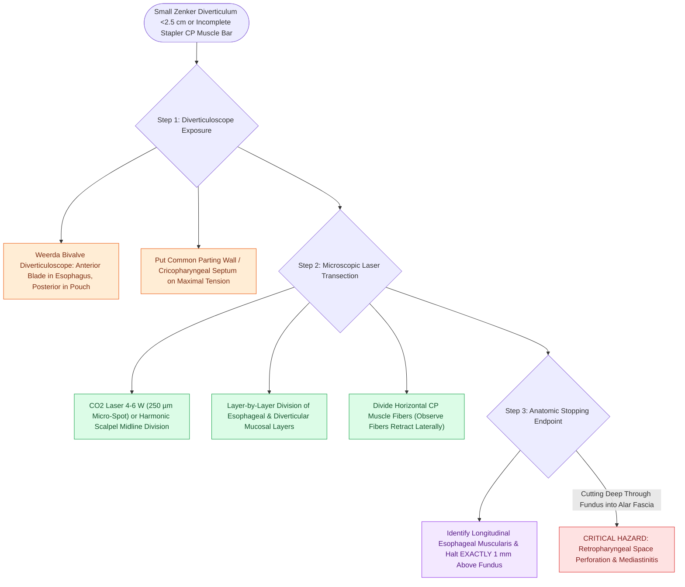

# Transoral laser diverticulotomy divides small Zenker diverticular common bars

## Active Recall

> [!question]- Why is transoral laser diverticulotomy preferred over endoscopic stapler diverticulotomy for a 1.5 cm [[Zenker's diverticulum herniates through Killian's triangle due to elevated pulsion pressure|Zenker diverticulum]]?
> *Answer / Clinical Rationale*: A $1.5\text{-cm}$ pouch cannot accommodate the non-cutting anvil tip of an endoscopic stapler ($8\text{–}10\text{ mm}$); the CO2 laser allows precise microscopic division of the cricopharyngeus muscle **all the way down to the base of the pouch**.

> [!question]- What anatomical endpoint signals complete cricopharyngeal myotomy during laser diverticulotomy?
> *Answer / Clinical Rationale*: Visualization of the complete lateral retraction of all transverse cricopharyngeus muscle fibers and exposure of the longitudinal esophageal muscularis and areolar tissue at the apex of the split.

## Core Clinical & Mechanistic Principles
**Transoral Laser Diverticulotomy** (pioneered by Dohlman in 1960 and updated with the [[The CO2 laser vaporizes tissue via 10600 nm water absorption|CO2 laser]] or Harmonic scalpel) is an endoscopic technique indicated for **small Zenker's diverticula ($<2.5\text{ cm}$ in depth)** or isolated hypertonic **cricopharyngeal bars** that cannot accommodate the physical anvil of an endoscopic stapler.

### Precision Micro-Division under Direct Vision
- **Target Tissue**: The common tissue bridge consisting of the anterior and posterior mucosal layers sandwiching the transverse fibers of the **[[Open diverticulectomy combines pouch resection with cricopharyngeal myotomy|cricopharyngeus muscle]]**.
- **Microscopic Division**: Under stereoscopic magnification using a Weerda bivalve scope, a focused micro-spot $\text{CO}_2$ laser or ultrasonic shears divide the common wall layer by layer down to the absolute base of the pouch.
- **Visual Landmark**: Complete transection of all horizontal cricopharyngeus muscle fibers is verified when the longitudinal esophageal muscularis and prevertebral areolar tissue become visible at the apex.

## Step-by-Step Surgical Craft
1. **Suspension & Scope Insertion**: Place a Weerda bivalve diverticuloscope; engage the anterior blade in the esophagus and the posterior blade in the diverticulum to put the common septum on maximal stretch.
2. **Microscopic Laser Setup**: Align operating microscope with a $400\text{-mm}$ lens and micromanipulator (see [[Phonomicrosurgery requires suspension laryngoscopy and stereoscopic magnification|suspension microscopy]]).
3. **Septum Transection**: Using continuous or superpulse CO2 laser ($4\text{–}6\text{ Watts}$) with a micro-spot size ($250\text{ µm}$), incise the common bridge strictly in the midline.
4. **Vaporization of CP Muscle**: The cut horizontal muscle fibers naturally retract laterally as they are divided, opening the esophageal lumen.
5. **Cessation Landmark**: Halt division precisely $1\text{ mm}$ above the diverticular fundus to avoid cutting into the free retropharyngeal space.

## Primary Clinical Indications
- Small pouches ($<2.5\text{ cm}$) where an [[Endoscopic stapler diverticulotomy divides the cricopharyngeal bar and seals mucosa|endoscopic stapler]] would leave a residual symptomatic muscle bar.
- Revision surgery for persistent dysphagia after incomplete prior stapler division.

## Critical Failure Modes & Error Traps
- **Retropharyngeal Perforation & Mediastinitis**: Cutting through the base of the diverticular fundus creates an open communication with the retropharyngeal "Danger Space," risking fatal [[Descending necrotizing mediastinitis from deep neck infections mandates urgent surgical drainage and broad-spectrum antimicrobial escalation|descending necrotizing mediastinitis]].

## Connected Concepts & Graph Traversal
- **Stapling Counterpart for Large Pouches**: [[Endoscopic stapler diverticulotomy divides the cricopharyngeal bar and seals mucosa|Endoscopic Stapler Diverticulotomy]]
- **Open Surgical Counterpart**: [[Open diverticulectomy combines pouch resection with cricopharyngeal myotomy|Open Transcervical Diverticulectomy]]
- **Laser Biophysics**: [[The CO2 laser vaporizes tissue via 10600 nm water absorption|CO2 Laser Biophysics]]
- **Underlying Anatomical Dehiscence**: [[Killian's triangle is a posterior muscular dehiscence above the cricopharyngeus|Killian's Triangle]]
- **Clinical Management**: [[Zenker's diverticulum herniates through Killian's triangle due to elevated pulsion pressure|Zenker's Diverticulum (ZD)]]
