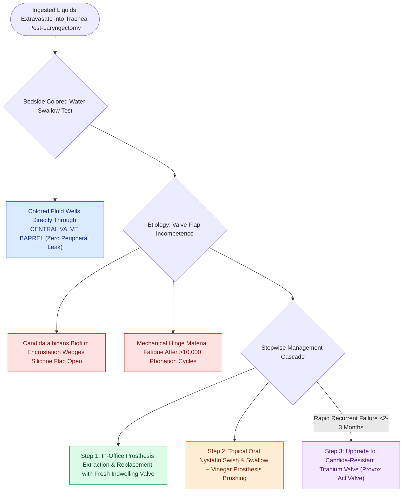

# Transprosthetic TEP leaks occur through the valve due to Candida biofilm or wear

## Active Recall

> [!question]- How is a transprosthetic TEP leak differentiated from a [[Periprosthetic TEP leaks occur around the shaft due to tissue atrophy or dilation|periprosthetic TEP leak]] at the bedside?
> *Answer / Clinical Rationale*: Using the **colored water swallow test**; in a transprosthetic leak, fluid wells up **directly through the center of the prosthesis barrel**, whereas in a periprosthetic leak, fluid escapes **around the exterior silicone collar**.

> [!question]- What is the most common biological cause of premature transprosthetic valve failure?
> *Answer / Clinical Rationale*: **Candida albicans biofilm colonization and encrustation** on the silicone valve flap, which prevents complete coaptation and sealing of the valve.

## Core Clinical & Mechanistic Principles
A **Transprosthetic [[Tracheoesophageal puncture diverts pulmonary air through a one-way valve into the neopharynx|TEP]] Leak** is defined as the leakage of ingested liquids, saliva, or foods **directly through the central lumen / valve mechanism** of the voice prosthesis into the tracheal lumen.

### Pathophysiological Mechanisms
1. **Candida Biofilm Colonization**: The oral cavity and pharynx are heavily colonized by *Candida albicans* and other yeast species. Fungal hyphae adhere to the silicone surface of the one-way valve flap, forming an encrusted biofilm that physically wedges the silicone flap in a partially open position or warps the valve seat.
2. **Mechanical Hinge Wear & Material Fatigue**: Repetitive opening and closing cycles over thousands of phonatory words degrade the silicone hinge, causing valve incompetence.
3. **Foreign Body Incarceration**: Mucus plugs or food particles trapped within the barrel prevent complete closure.

## Bedside Diagnostic Confirmation
- **The Colored Water Test**:
  - The patient drinks water tinted with food coloring (or methylene blue/grape juice) at the bedside while the clinician directly visualizes the tracheostoma under headlamp illumination.
  - In a transprosthetic leak, colored fluid is seen **welling up and leaking directly out of the central opening of the prosthesis barrel** (with zero fluid escaping around the peripheral collar).

## Immediate Management & Treatment Protocol
1. **Immediate In-Office Prosthesis Exchange**: The old, colonized prosthesis is removed using an insertion/extraction tool, the tract is sized, and a new indwelling or non-indwelling voice prosthesis is placed.
2. **Topical Antifungal Therapy**:
   - Oral Nystatin swish-and-swallow or Clotrimazole (Mycelex) troches to reduce pharyngeal fungal load.
   - Brushing the prosthesis lumen twice daily with a dedicated prosthesis brush dipped in 50% vinegar or antifungal solution.
3. **Candida-Resistant Prostheses**: In patients with rapid recurrent fungal colonization (<2–3 months), transition to specialized Candida-resistant voice prostheses featuring silver-oxide coatings or fluoroplastic/titanium valve seats (e.g., Provox ActiValve).

## Connected Concepts & Graph Traversal
- **Core Restoration Modality**: [[Tracheoesophageal puncture diverts pulmonary air through a one-way valve into the neopharynx|Tracheoesophageal Puncture (TEP)]]
- **Peripheral Leak Counterpart**: [[Periprosthetic TEP leaks occur around the shaft due to tissue atrophy or dilation|Periprosthetic TEP Leak Management]]
- **Parent Surgical Procedure**: [[Total laryngectomy achieves en bloc laryngeal resection with permanent end-stoma|Total Laryngectomy]]
- **Hands-Free Speech**: [[Hands-free stomaplasty stabilizes the peristomal contour using fascia lata slings|Hands-Free Stomaplasty]]
- **Clinical Management**: [[Pharyngoesophageal segment hypertonicity causes TEP failure treated with Botox or myotomy|PE Segment Hypertonicity]]
