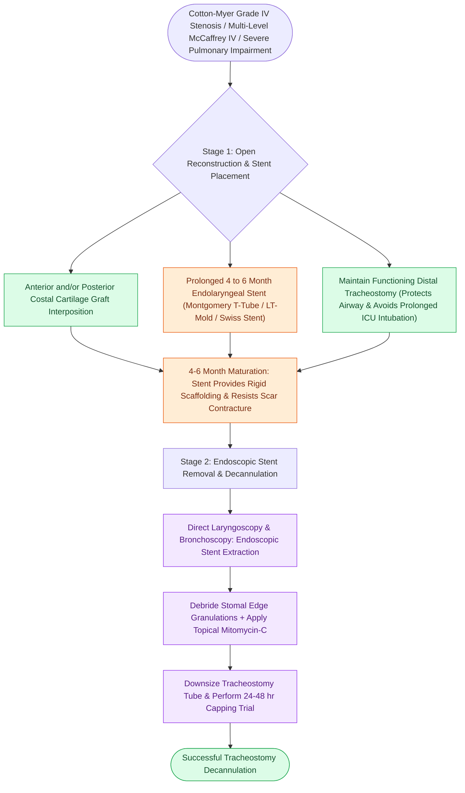

# Two-stage LTR maintains a tracheostomy with prolonged endolaryngeal stenting

## Active Recall

> [!question]- What are the primary clinical indications for choosing a two-stage LTR over a [[Single-stage LTR utilizes an endotracheal tube as a temporary stent avoiding tracheostomy placement|single-stage LTR]]?
> *Answer / Clinical Rationale*: Cotton-Myer Grade IV complete atresia, severe multi-level glottic/subglottic involvement (McCaffrey Stage IV), or patients with significant pulmonary/neurological comorbidities who cannot tolerate prolonged ICU sedation/intubation.

> [!question]- What is the typical duration of endolaryngeal stenting in a two-stage LTR?
> *Answer / Clinical Rationale*: **4 to 6 months**, allowing full maturation, structural stabilization, and complete mucosal coverage of the costal cartilage grafts before stent removal.

## Core Clinical & Mechanistic Principles
**Two-Stage [[Laryngotracheal reconstruction expands the airway using carved costal cartilage grafts|Laryngotracheal Reconstruction]] (TS-LTR)** is an open airway expansion procedure in which costal cartilage grafts are placed while retaining a functioning tracheostomy below the reconstruction site and positioning a dedicated solid or hollow endolaryngeal stent across the grafted airway for a prolonged period (**4 to 6 months**).

### Stenting Devices & Mechanics
- **Stent Types**:
  - *LT-Mold / Swiss Stent*: Solid or hollow molded silicone stent secured with transcutaneous transfixing nonabsorbable sutures.
  - *Aboulker Stent*: Teflon cylindrical prosthesis anchored to a metallic or plastic tracheostomy tube.
  - *Montgomery T-Tube*: Silicone T-shaped device where the vertical limb stents the subglottis and trachea while the horizontal side-limb exits the stoma for ventilation and suctioning.
- **Biomechanical Function**: Prolonged stenting resists scar contracture, provides rigid structural scaffolding for multi-level cartilage grafts, and allows complete, mature mucosal epithelialization over raw surfaces.

## Primary Clinical Indications
1. **Severe / High-Risk Stenosis**: [[The Cotton-Myer classification grades subglottic stenosis by luminal reduction|Cotton-Myer Grade IV]] complete atresia or [[The McCaffrey classification stages laryngotracheal stenosis by anatomical subsite|McCaffrey Stage IV]] stenosis involving glottic cord fixation.
2. **Poor Pulmonary Reserve / Neurologic Impairment**: Patients unable to tolerate 7–14 days of deep sedation/paralysis in the ICU.
3. **Severe Multi-Level Airway Collapse**: Complete absence of cartilaginous framework requiring massive anterior and posterior grafting.

## Decannulation Protocol (Stage 2)
- At **4 to 6 months post-reconstruction**, the patient is taken to the operating room for endoscopic stent removal and direct bronchoscopy.
- Granulation tissue at the stent edges is treated with [[Topical mitomycin-C inhibits fibroblast proliferation and collagen deposition|topical Mitomycin-C]] or laser.
- Once the reconstructed airway demonstrates rigid stability and mucosal maturity, the tracheostomy tube is downsized, capped for 24–48 hours, and decannulated.

## Critical Failure Modes & Error Traps
- **Stent-Induced Granulation Tissue**: Prolonged pressure from an oversized stent can induce ischemic mucosal ulceration and massive obstructing granulation tissue at the superior and inferior stent margins.

## Connected Concepts & Graph Traversal
- **Parent Surgical Technique**: [[Laryngotracheal reconstruction expands the airway using carved costal cartilage grafts|Laryngotracheal Reconstruction (LTR)]]
- **🔗 Single-Stage Alternative (Pediatrics)**: [[Single-stage LTR utilizes an endotracheal tube as a temporary stent avoiding tracheostomy placement|Single-Stage LTR]]
- **Cartilage Grafting Technique**: [[The posterior cricoid split widens the posterior glottis for high-grade stenosis|Posterior Cricoid Split]]
- **Alternative Resection Surgery**: [[Cricotracheal resection removes subglottic stenosis while sparing posterior cricoid and RLNs|Cricotracheal Resection (CTR)]]
- **Primary Tracheotomy Safety**: [[Tracheal stay sutures prevent false tract entry during accidental decannulation|Tracheal Stay Sutures]]
