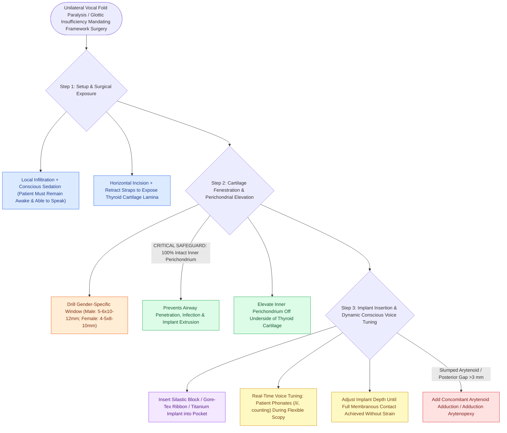

# Type I thyroplasty medializes the vocal fold with conscious voice tuning

## Active Recall

> [!question]- Why must Type I thyroplasty be performed under local anesthesia with conscious sedation rather than general endotracheal anesthesia?
> *Answer / Clinical Rationale*: Patient participation is essential for **intraoperative phonatory tuning**; the surgeon adjusts implant depth and position while the patient phonates (/i/, counting) and undergoes flexible endoscopy to achieve optimal vocal quality without airway obstruction.

> [!question]- What anatomical hazard occurs if the inner perichondrium is torn during cartilage window drilling?
> *Answer / Clinical Rationale*: Mucosal breach creates communication between the airway and the implant pocket, dramatically increasing the risk of **implant infection, extrusion, endolaryngeal hematoma, and subcutaneous emphysema**.

## Core Clinical & Mechanistic Principles
**Type I Medialization Thyroplasty** (first described by Nobuhiko Isshiki) is an open laryngeal framework surgical procedure designed to permanently medialize a paralyzed, paretic, or atrophic true vocal fold by placing an external implant through a fenestrated window in the [[Thyroplasty cartilage window dimensions differ between males and females|thyroid cartilage alar lamina]].

### Primary Biomechanical Action
- **Selective Membranous Medialization**: The rigid implant compresses the [[The thyroarytenoid muscle modulates glottal stiffness and adduction|lateral thyroarytenoid muscle]] and [[The paraglottic space facilitates transglottic tumor spread|paraglottic tissue]] medially, shifting the anterior two-thirds (membranous vocal fold) to the glottic midline.
- **Preservation of Mucosal Wave**: Because the dissection remains entirely external to the laryngeal mucosal envelope, [[The superficial lamina propria acts as a pliable shearing fluid bed|Reinke's space]] and the vibratory cover are uninjured.

## Step-by-Step Surgical Craft
1. **Conscious Sedation & Positioning**: Patient in 30° beach-chair position. Administer local anesthesia (1% lidocaine with 1:100,000 epinephrine) and light conscious sedation (the patient must be awake and capable of dynamic phonation).
2. **Incision & Exposure**: $3\text{–}4\text{ cm}$ horizontal skin crease incision centered over the mid-thyroid cartilage lamina. Retract strap muscles laterally to expose from anterior midline notch to oblique line.
3. **Cartilage Window Mapping**: Mark cartilage window using gender-specific criteria (see thyroplasty window dimensions).
4. **Window Fenestration**: Cut outer perichondrium and cartilage using a 2-mm cutting burr or ultrasonic aspirator. **Preserve the inner perichondrium strictly intact** to prevent airway mucosal perforation.
5. **Inner Perichondrial Elevation**: Elevate inner perichondrium superiorly, inferiorly, and posteriorly toward the vocal process with a right-angle elevator.
6. **Implant Placement & Dynamic Voice Tuning**: Insert hand-carved Silastic block, Gore-Tex ribbon, or preformed titanium/Montgomery implant. Have the patient count, sing /i/, and speak. Perform simultaneous flexible [[Videostroboscopy visualizes mucosal wave dynamics and glottal closure|stroboscopy]] to confirm complete membranous glottal contact without over-medialization or breathiness.
7. **Closure**: Suture strap muscles loosely; place small Penrose or suction drain; layered anatomical closure.

## Critical Failure Modes & Error Traps
- **Inner Perichondrium Perforation**: Tearing the inner perichondrium and endolaryngeal mucosa converts a sterile neck dissection into a contaminated airway tract, risking [[Subcutaneous emphysema arises when tracheotomy incisions are closed too tightly|subcutaneous emphysema]], endolaryngeal bleeding, implant extrusion, and deep neck abscess.
- **Window Placed Too High**: Placing the window superior to the true vocal fold plane medializes the false vocal fold, worsening dysphonia with severe strain.
- **Inability to Close Large Posterior Gaps**: A Type I thyroplasty alone cannot rotate a slumped [[The cricoarytenoid joint moves via coupled rocking and sliding|arytenoid cartilage]]; large posterior gaps (>3 mm) require a concomitant [[Arytenoid adduction closes large posterior glottic gaps and corrects height mismatch|arytenoid adduction]].

## Connected Concepts & Graph Traversal
- **Window Measurements**: [[Thyroplasty cartilage window dimensions differ between males and females|Thyroplasty Window Dimensions]]
- **Adjunctive Procedure for Posterior Gap**: [[Arytenoid adduction closes large posterior glottic gaps and corrects height mismatch|Arytenoid Adduction]]
- **Clinical Indication**: [[Unilateral vocal fold paralysis causes glottic insufficiency, breathiness, and aspiration|Unilateral Vocal Fold Paralysis (UVFP)]]
- **Biomaterial Comparison**: [[Injection laryngoplasty requires precise placement into lateral thyroarytenoid muscle|Injection Laryngoplasty]]
- **Biological Reinnervation Alternative**: [[Ansa cervicalis-to-recurrent laryngeal nerve neurorrhaphy restores vocal fold muscle tone and glottic competence without dynamic vocal fold abduction|Ansa-to-RLN Reinnervation]]
