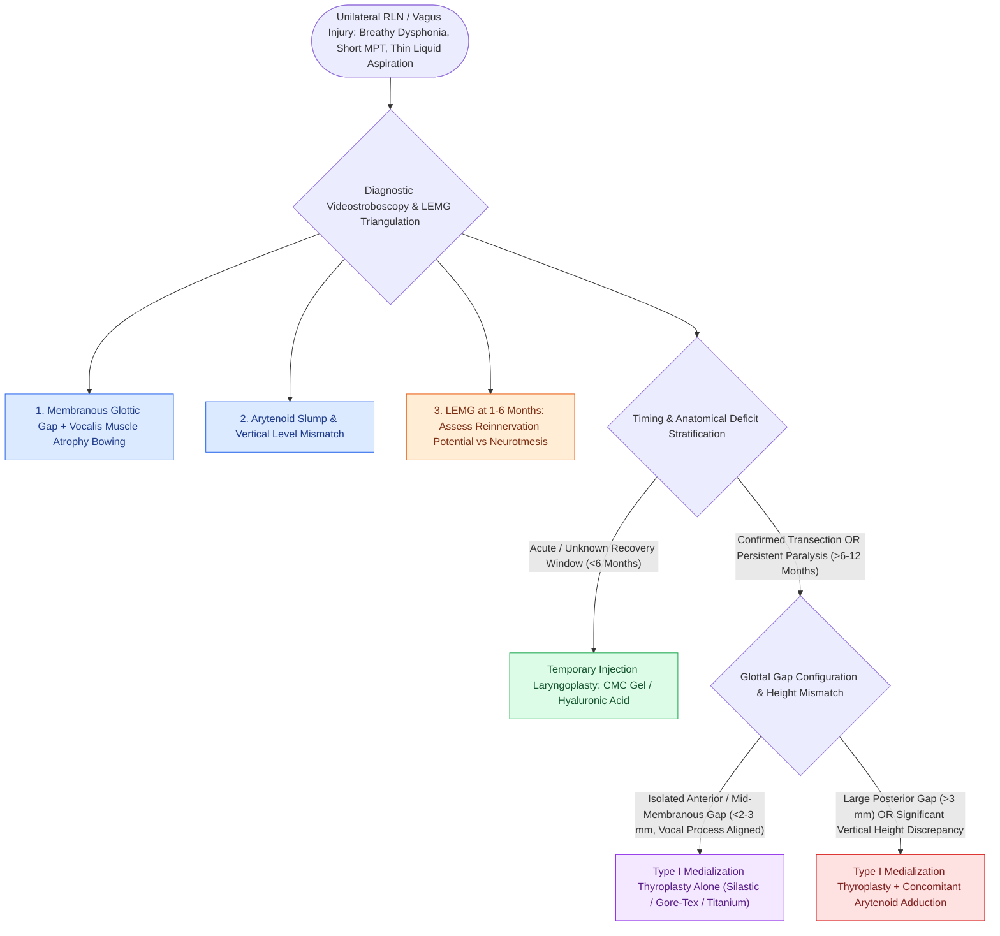

# Unilateral vocal fold paralysis causes glottic insufficiency, breathiness, and aspiration

## Active Recall

> [!question]- Why does high vagal paralysis cause worse dysphagia and aspiration than an isolated low RLN paralysis?
> *Answer / Clinical Rationale*: High vagal paralysis denervates the internal branch of the SLN (causing supraglottic anesthesia) and the [[The cricothyroid muscle elongates vocal folds to elevate pitch|cricothyroid muscle]] (causing vocal fold laxity and wider posterior gap), eliminating the sensation required to trigger the cough reflex while creating severe glottic incompetence.

> [!question]- What are the three mechanical components of the vocal fold deficit in UVFP?
> *Answer / Clinical Rationale*: (1) **Glottal gap** (incomplete adduction), (2) **vertical level mismatch** (arytenoid slump), and (3) **vocal fold bowing** (vocalis muscle atrophy).

## Core Clinical & Mechanistic Principles
**Unilateral Vocal Fold Paralysis (UVFP)** is the clinical manifestation of acute or chronic disruption to the ipsilateral [[The recurrent laryngeal nerve innervates all intrinsic muscles except cricothyroid|recurrent laryngeal nerve (RLN)]] or high vagus nerve (CN X).

### Biomechanical Triad of Deficits
1. **Glottic Gap (Incomplete Adduction)**: Denervation of the [[The lateral cricoarytenoid is the primary membranous fold adductor|lateral cricoarytenoid (LCA)]] and [[The thyroarytenoid muscle modulates glottal stiffness and adduction|thyroarytenoid (TA)]] prevents the paralyzed vocal fold from adducting to the midline during phonation and swallowing.
2. **Arytenoid Slump & Vertical Discrepancy**: Loss of LCA/TA tone causes the arytenoid cartilage to sag forward and tip laterally along the [[The cricoarytenoid joint moves via coupled rocking and sliding|cricoarytenoid facet]], placing the paralyzed vocal fold on a lower vertical plane than the intact side.
3. **Loss of Intrinsic Muscle Bulk (Bowing)**: Progressive [[The thyrovocalis muscle provides isometric pitch and tension control|vocalis muscle]] atrophy creates mid-membranous bowing and a large longitudinal [[Glottal closure patterns identify specific laryngeal biomechanical deficits|glottal gap]].

## Clinical Manifestations
- **Aeroacoustic Incompetence**: Breathy dysphonia, severe vocal fatigue, inability to project voice, and drastically reduced Maximum Phonation Time (MPT < 10 seconds).
- **Deglutition Compromise**: Aspiration of thin liquids and poor cough clearance due to inability to generate subglottic closing pressure.

## Diagnostic Algorithm
1. **Videostroboscopy**: Documents glottic gap magnitude, vertical level mismatch, and presence of compensatory false vocal fold adduction (see videostroboscopy).
2. **Laryngeal Electromyography (LEMG)**: Evaluates neuromuscular integrity (CT vs TA/[[The posterior cricoarytenoid is the sole vocal fold abductor|PCA]]) and spontaneous recovery potential between 1 and 6 months (see [[LEMG denervation potentials indicate axonal injury within one to six months|LEMG waveform analysis]]).
3. **Swallow Evaluation**: [[FEES assesses pharyngeal secretions and aspiration under direct vision|FEES]] or [[VFSS provides continuous radiographic evaluation of all deglutition phases|VFSS]] to assess penetration/aspiration risk.

## Treatment Paradigms
- **Acute / Observation Window (<6 Months)**: Temporary [[Injection laryngoplasty requires precise placement into lateral thyroarytenoid muscle|injection laryngoplasty]] with [[Carboxymethylcellulose gel provides short-acting temporary vocal fold augmentation|carboxymethylcellulose]] or [[Cross-linked hyaluronic acid provides intermediate-duration vocal fold augmentation|hyaluronic acid]].
- **Permanent Medialization (>6–12 Months / Confirmed Transection)**:
  - Membranous gap alone: [[Type I thyroplasty medializes the vocal fold with conscious voice tuning|Type I Medialization Thyroplasty]].
  - Large posterior gap (>3 mm) / Vertical discrepancy: [[Arytenoid adduction closes large posterior glottic gaps and corrects height mismatch|Arytenoid Adduction]] + Type I Thyroplasty.

## Critical Failure Modes & Error Traps
- **Missed Vagal Lesion**: Assuming an isolated RLN injury without evaluating the [[The superior laryngeal nerve provides supraglottic sensation and cricothyroid motor control|superior laryngeal nerve]] or soft palate can miss high skull base / jugular foramen tumors (e.g., glomus jugulare, schwannoma).

## Connected Concepts & Graph Traversal
- **Injection Medialization**: [[Injection laryngoplasty requires precise placement into lateral thyroarytenoid muscle|Injection Laryngoplasty]]
- **Type I Thyroplasty**: [[Type I thyroplasty medializes the vocal fold with conscious voice tuning|Type I Thyroplasty]]
- **Joint Biomechanics**: [[The cricoarytenoid joint moves via coupled rocking and sliding|Cricoarytenoid Joint]]
- **LEMG Electrophysiology**: [[Laryngeal electromyography differentiates vocal fold paralysis from joint fixation|Laryngeal Electromyography (LEMG)]]
- **Aspiration Scale Assessment**: [[The Rosenbek Scale standardizes the depth of airway penetration and aspiration|Rosenbek Penetration Scale]]
- **Biological Reinnervation Alternative**: [[Ansa cervicalis-to-recurrent laryngeal nerve neurorrhaphy restores vocal fold muscle tone and glottic competence without dynamic vocal fold abduction|Ansa-to-RLN Reinnervation]]
