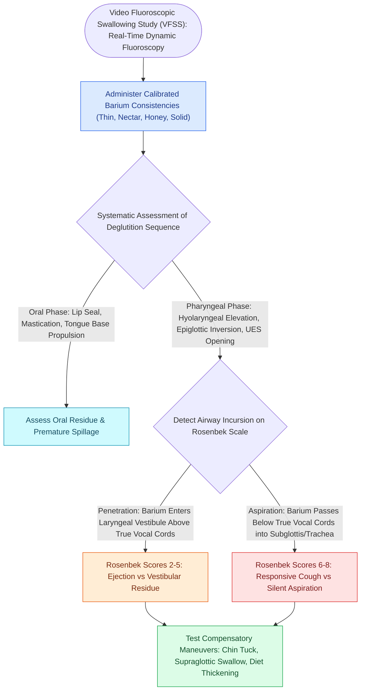

# VFSS provides continuous radiographic evaluation of all deglutition phases

## Active Recall

> [!question]- What major anatomical advantage does VFSS provide over FEES when assessing cricopharyngeal dysfunction?
> *Answer / Clinical Rationale*: VFSS visualizes the entire **upper esophageal sphincter (UES) opening kinetics and cervical esophagus in lateral and A-P views**, allowing direct dynamic identification of a cricopharyngeal bar or Zenker's diverticulum, which are obscured on endoscopy.

> [!question]- How does hyolaryngeal elevation contribute to UES opening during the pharyngeal swallow?
> *Answer / Clinical Rationale*: Superior and anterior traction of the hyoid bone and thyroid framework exerts **mechanical distraction on the anterior wall of the cricopharyngeus muscle**, pulling the sphincter open to receive the descending bolus.

## Core Clinical & Mechanistic Principles
The **Videofluoroscopic Swallow Study (VFSS)**, also referred to as the **Modified Barium Swallow (MBS)**, is the dynamic radiographic gold standard for comprehensive, sub-second evaluation of the oral, pharyngeal, and cervical esophageal phases of deglutition.

### Dynamic Fluoroscopic Capabilities
- **Sub-Second Temporal Resolution**: Records continuous radiographic fluoroscopy at 30 frames per second during bolus ingestion of varying barium consistencies (thin liquid, nectar-thick, honey-thick, paste/pudding, and solid radiopaque cookies).
- **Absence of Whiteout**: Unlike [[FEES assesses pharyngeal secretions and aspiration under direct vision|FEES]], fluoroscopy maintains uninterrupted visualization during the peak pharyngeal swallow, capturing the exact biomechanical instant of bolus penetration, aspiration, or residue.

## Key Evaluative Parameters
1. **Hyolaryngeal Elevation**: Upward and forward displacement of the [[Suprahyoid Montgomery release mobilizes the larynx to reduce anastomotic tension|hyoid bone]] and larynx, which mechanically pulls open the Upper Esophageal Sphincter (UES).
2. **Cricopharyngeal Relaxation**: Evaluates for a prominent posterior indentation (**[[Open diverticulectomy combines pouch resection with cricopharyngeal myotomy|cricopharyngeal bar]]**) or herniation (**[[Zenker's diverticulum herniates through Killian's triangle due to elevated pulsion pressure|Zenker's diverticulum]]**).
3. **Penetration-Aspiration Scoring**: Standardized using the 8-point [[The Rosenbek Scale standardizes the depth of airway penetration and aspiration|Rosenbek Penetration-Aspiration Scale]].

## Clinical Strengths vs Limitations
- **Strengths**: Visualizes the entire deglutition sequence from lips to stomach; identifies the exact biomechanical etiology of aspiration (e.g., delayed swallow trigger, reduced hyolaryngeal elevation, or cricopharyngeal spasm).
- **Limitations**: Involves ionizing radiation exposure; requires transport to the radiology suite; utilizes barium-mixed substances rather than pure natural meals.

## Connected Concepts & Graph Traversal
- **Bedside Endoscopic Alternative**: [[FEES assesses pharyngeal secretions and aspiration under direct vision|Fiberoptic Endoscopic Evaluation of Swallowing (FEES)]]
- **Standardized Aspiration Scale**: [[The Rosenbek Scale standardizes the depth of airway penetration and aspiration|Rosenbek Penetration-Aspiration Scale]]
- **Associated Pathology**: [[Zenker's diverticulum herniates through Killian's triangle due to elevated pulsion pressure|Zenker's Diverticulum]]
- **Framework Surgical Correlate**: [[Arytenoid adduction closes large posterior glottic gaps and corrects height mismatch|Arytenoid Adduction for Aspiration]]
- **Clinical Management**: [[Open diverticulectomy combines pouch resection with cricopharyngeal myotomy|Open Transcervical Diverticulectomy]]
