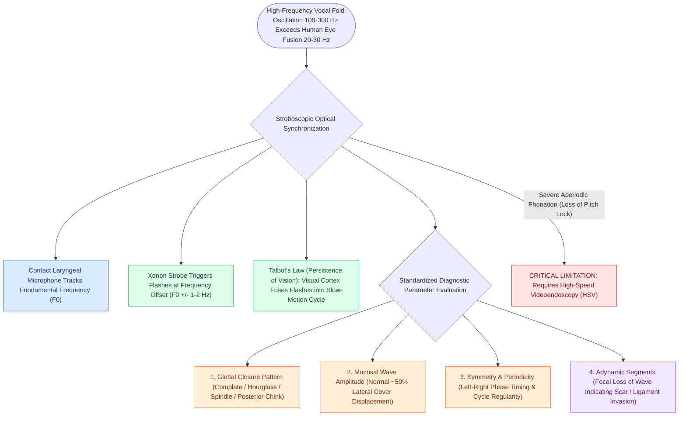

# Videostroboscopy visualizes mucosal wave dynamics and glottal closure

## Active Recall

> [!question]- What physiological optical principle allows videostroboscopy to present a slow-motion view of phonation?
> *Answer / Clinical Rationale*: **Talbot's Law** (persistence of vision) combined with stroboscopic illumination triggered at a frequency offset by $1\text{–}2\text{ Hz}$ from the vocal fold fundamental frequency.

> [!question]- Why does videostroboscopy fail to produce a slow-motion image in patients with severe, highly aperiodic dysphonia?
> *Answer / Clinical Rationale*: Stroboscopy requires cycle-to-cycle periodicity to track $F_0$; severe aperiodicity prevents the pitch-tracking sensor from triggering flashes at predictable points in the vibratory cycle.

## Core Clinical & Mechanistic Principles
Because the human vocal folds oscillate at frequencies far exceeding the temporal resolving capability of the human eye ($100\text{–}300\text{ Hz}$ in conversational speech vs the eye's flicker fusion threshold of ~20–30 Hz), standard continuous light endoscopy visualizes only a blurred image.

### Talbot's Law & Stroboscopic Illusion
**Videostroboscopy** exploits **Talbot's Law** (persistence of vision) and synchronized strobe flashes:
- A contact microphone placed on the thyroid lamina detects the fundamental frequency ($F_0$).
- When light flashes are triggered at a frequency slightly offset (e.g., $F_0 \pm 1\text{–}2\text{ Hz}$) from the [[The vocal fold comprises five distinct histological layers|vocal fold]] vibratory rate, successive flashes illuminate successive phases of subsequent vibratory cycles.
- The human visual cortex fuses these sequential points into a simulated real-time, slow-motion optical illusion of a single vibratory cycle.

## Standardized Evaluative Parameters
1. **Fundamental Frequency ($F_0$) & Pitch Range**: Modal pitch and dynamic register shifts.
2. **Glottal Closure Pattern**: Complete, hourglass, spindle/bowing, posterior chink, or irregular.
3. **Mucosal Wave Amplitude & Excursion**: Horizontal lateral displacement of the mucosal cover (normal is ~50% of the visible vocal fold width).
4. **Periodicity & Phase Symmetry**: Regularity of successive cycles and bilateral symmetry of opening/closing phases.
5. **Non-Vibrating Segments (Adynamic Zones)**: Focal absence of mucosal wave propagation across a designated segment of the free margin.

## Critical Failure Modes & Error Traps
- **Severe Aperiodicity**: In severe dysphonia with aeroacoustic turbulence (e.g., extensive cancer, large papillomas), the contact microphone cannot lock onto a stable fundamental frequency, causing the strobe to lose synchronization and appear chaotic. High-speed videoendoscopy is required in such cases.

## Connected Concepts & Graph Traversal
- **Mucosal Wave Mechanics**: [[The mucosal wave travels as a fluid mechanical displacement|Mucosal Wave Mechanics]]
- **Five Histological Layers**: [[The vocal fold comprises five distinct histological layers|Five Histological Layers]]
- **Adynamic Segment Pathology**: [[Adynamic vocal fold segments indicate mucosal stiffening, malignancy, or scar|Adynamic Segments]]
- **Glottal Closure Morphology**: [[Glottal closure patterns identify specific laryngeal biomechanical deficits|Glottal Closure Patterns]]
- **Presbyphonia Stroboscopy**: [[Presbyphonia reflects vocal fold atrophy and bowing managed with therapy before augmentation|Presbyphonia]]
- **Multidimensional Voice Battery**: [[Multidimensional voice assessment integrates perceptual CAPE-V and GRBAS scales with acoustic perturbation and aerodynamic measures|Multidimensional Voice Assessment]]
