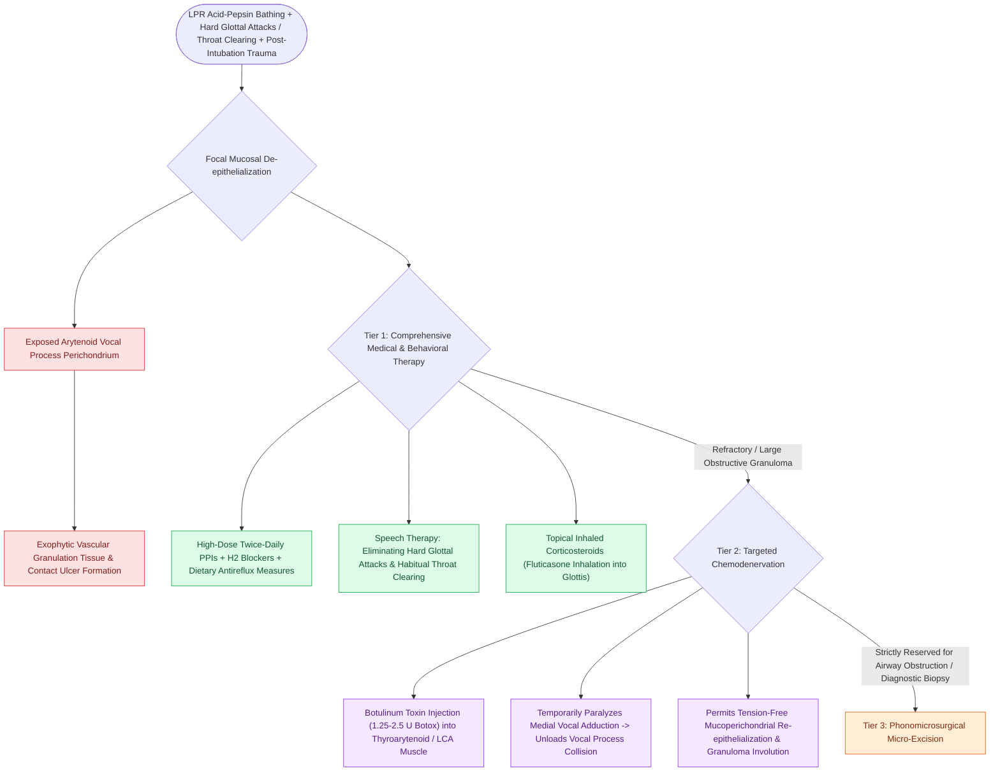

# Vocal fold contact granulomas arise from mechanical perichondritis of the vocal process treated with proton pump inhibitors, voice therapy, and Botox before excision

## Active Recall

> [!question]- Why is the cartilaginous vocal process of the arytenoid cartilage uniquely susceptible to contact ulcer and granuloma formation?
> *Answer / Clinical Rationale*: The vocal process is lined by an exceptionally thin, tightly adherent mucoperichondrium that **completely lacks protective submucosal tissue or superficial lamina propria padding**, leaving the underlying perichondrium directly exposed to mechanical impact trauma and acid-pepsin chemical injury.

> [!question]- Why is primary surgical excision considered a critical error trap for uncomplicated vocal fold contact granulomas?
> *Answer / Clinical Rationale*: Surgical excision without resolving the underlying etiologic drivers (LPR, vocal hyperfunction) results in an unacceptably high **recurrence rate of 50% to 90%**, often causing deeper perichondrial trauma and larger recurrent granulomas.

## Core Clinical & Mechanistic Principles
**Vocal fold contact granulomas** (and their precursor lesions, contact ulcers) are benign, reactive, exophytic inflammatory masses that develop over the medial aspect of the cartilaginous [[The cricoarytenoid joint moves via coupled rocking and sliding|vocal process of the arytenoid cartilage]]. They represent reparative granulation tissue formed in response to focal chondritis and perichondritis.

### The Etiologic Triad
Contact granulomas arise from a combination of chemical, mechanical, and iatrogenic insults:
1. **Laryngopharyngeal Reflux (LPR / GERD)**: Present in $>70\%\text{ to }80\%$ of non-intubated patients. Reflux of hydrochloric acid and pepsin bathes the posterior glottis, digesting mucosal glycoproteins and chemically de-epithelializing the thin mucoperichondrium.
2. **Phonotrauma & Vocal Hyperfunction**: Characterized by low-pitched vocal fry, habitual throat clearing, chronic coughing, and forceful glottal attacks. Forceful adduction causes repetitive, hammer-and-anvil impaction between the opposing cartilaginous vocal processes.
3. **Endotracheal Intubation Trauma**: Direct mechanical erosion or prolonged pressure necrosis from an oversized endotracheal tube sitting in the posterior commissure strips the mucoperichondrium, triggering an intubation granuloma within 2 to 8 weeks post-extubation.

### Pathophysiology & Histology
- **Mucoperichondrial Vulnerability**: Unlike the membranous true vocal fold, which possesses a three-layered lamina propria to absorb vibratory stress, the vocal process has no submucosal fluid bed.
- **Histopathology**: Demonstrates non-specific, highly vascularized granulation tissue lined by ulcerated or hyperplastic squamous epithelium, containing chronic inflammatory infiltrates (plasma cells, lymphocytes, histiocytes) and stromal capillary proliferation without cytologic atypia.

### Therapeutic Hierarchy & Chemodenervation Protocol
- **First-Line Conservative Medical Ladder**:
  - *Profound Acid Suppression*: High-dose proton pump inhibitors (e.g., omeprazole $40\text{ mg}$ or pantoprazole $40\text{ mg}$ twice daily taken 30 minutes before meals) combined with bedtime H2-blockers or alginate therapy for a minimum of 3 to 6 months.
  - *Behavioral Voice Therapy*: Voice retraining focuses on confidential voice, soft vocal onsets, reducing vocal loudness, and replacing throat clearing with silent swallows.
  - *Inhaled Corticosteroids*: Inhaled fluticasone or budesonide delivered without a spacer directly through the glottis delivers potent local anti-inflammatory action with minimal systemic absorption.
- **Second-Line Botulinum Toxin Chemodenervation**:
  - For lesions refractory to medical therapy or patients with persistent hyperfunctional adduction, botulinum toxin A ($1.25\text{ to }2.5\text{ units}$) is injected under EMG or endoscopic guidance into the ipsilateral [[The thyroarytenoid muscle modulates glottal stiffness and adduction|thyroarytenoid]] and [[The lateral cricoarytenoid is the primary membranous fold adductor|lateral cricoarytenoid]] muscles.
  - Inducing a temporary, mild vocal fold paresis eliminates adductor collision forces across the cartilaginous glottis for 8 to 12 weeks, allowing the denuded vocal process perichondrium to re-epithelialize without recurrent trauma. Successful resolution exceeds $80\%\text{ to }95\%$.
- **Strictly Limited Indications for Surgery**:
  - [[Phonomicrosurgery requires suspension laryngoscopy and stereoscopic magnification|Phonomicrosurgical excision]] is strictly restricted to: (1) impending upper airway compromise, (2) diagnostic uncertainty requiring biopsy to rule out squamous cell carcinoma or fungal infection, or (3) lesions that persist despite $>6\text{ months}$ of multi-modality medical and Botox therapy.
  - When surgery is performed, cold micro-scissor excision is carried down to the base without stripping or electrocauterizing underlying cartilage, immediately followed by medical and antireflux therapy.

## Critical Failure Modes & Error Traps
- **Routine Primary Cold/Laser Resection**: Excising a granuloma without aggressive antireflux therapy or voice therapy triggers recurrent ulceration within 4 weeks in up to $90\%$ of patients.
- **Aggressive Cartilage Cauterization**: Applying thermal electrocautery or excessive laser energy to the base of the granuloma causes thermal chondronecrosis of the vocal process and persistent intractable ulceration.

## Connected Concepts & Graph Traversal
- **Arytenoid Chemodenervation**: [[Adductor spasmodic dysphonia causes strained voice breaks treated with thyroarytenoid Botox|Adductor Chemodenervation]]
- **Foreign Body Granuloma**: [[Calcium hydroxylapatite provides durable medialization but causes granulomas if superficial|Foreign Body Vocal Granuloma]]
- **Acid Reflux Environment**: [[Laryngopharyngeal reflux presents with globus and throat clearing but responds inconsistently to empiric PPIs|Laryngopharyngeal Reflux]]
- **Supraglottic Muscle Tension**: [[Muscle tension dysphonia arises from supraglottic hyperfunction and responds to circumlaryngeal voice therapy|Hyperfunctional Voice Strain]]
- **Iatrogenic Trauma**: [[Prolonged intubation beyond seven to ten days increases glottic stenosis and ventilator-associated pneumonia risk|Post-Intubation Vocal Process Trauma]]
