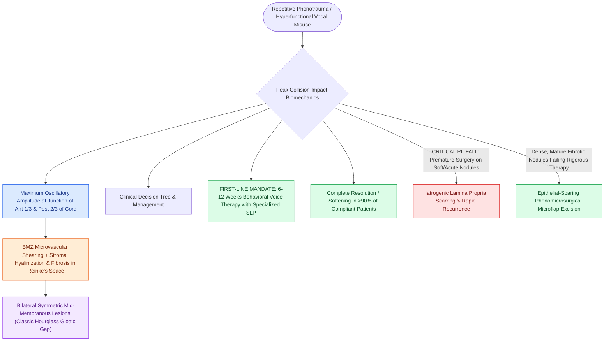

# Vocal fold nodules are bilateral mid-membranous lesions treated with voice therapy

## Active Recall

> [!question]- Why do vocal fold nodules develop specifically at the junction of the anterior 1/3 and posterior 2/3 of the vocal fold?
> *Answer / Clinical Rationale*: This mid-membranous site experiences the highest vibratory amplitude and maximum collision impact forces during cyclic phonation.

> [!question]- Why is primary surgical excision contraindicated as initial treatment for vocal fold nodules?
> *Answer / Clinical Rationale*: Nodules are a functional response to vocal misuse/phonotrauma; without behavioral voice therapy to correct vocal technique, nodules will recur rapidly, and surgery risks causing permanent lamina propria scarring.

## Core Clinical & Mechanistic Principles
**Vocal Fold Nodules** are bilateral, symmetric, inflammatory and fibrous thickenings of the vocal fold cover located characteristically at the **junction of the anterior one-third and posterior two-thirds** of the true vocal folds (the mid-point of the membranous vibratory portion).

### Biomechanical Etiology & Collision Stress
- **Maximum Impact Amplitude**: The junction of the anterior 1/3 and posterior 2/3 represents the point of maximum lateral excursion and maximum mechanical collision impact stress during phonation.
- **Micro-trauma & Remodeling**: Chronic repetitive mechanical shearing forces damage the [[The basement membrane zone anchors epithelium to superficial lamina propria|basement membrane zone (BMZ)]], causing microvascular leak, local edema, and reactive fibroblastic proliferation in the [[The superficial lamina propria acts as a pliable shearing fluid bed|superficial lamina propria]].
- **Histopathology**: Demonstrates thickening and duplication of the BMZ, stromal hyalinization, parakeratosis/hyperkeratosis, and focal fibrosis without cellular atypia.

## Diagnostic Findings on Videostroboscopy
- **Hourglass Glottal Gap**: Symmetric lesions meet at mid-fold during adduction, producing a classic hourglass [[Glottal closure patterns identify specific laryngeal biomechanical deficits|glottal closure pattern]] with persistent anterior and posterior chinks.
- **Mucosal Wave**: Preserved or mildly decreased over the nodule; the wave is rarely completely absent (unlike invasive cancer or deep scar).

## Primary Management & Surgical Contraindication
- **First-Line Therapy (Behavioral Voice Therapy)**: The primary, definitive treatment is **behavioral voice therapy** directed by a specialized speech-language pathologist (SLP). Modifying vocal hygiene, reducing vocal hyperfunction, and resonance therapy lead to complete resolution or marked softening in the vast majority of patients.
- **Surgical Contraindication**: Primary surgical excision is **strictly contraindicated** in early or soft nodules. Surgery does not treat the underlying hyperfunctional phonatory behavior; uncorrected vocal mechanics cause rapid nodule recurrence or permanent [[Vocal fold scar results from disorganized Type I collagen deposition|vocal fold scar]].
- **Refractory Nodules**: Excision via [[Phonomicrosurgery requires suspension laryngoscopy and stereoscopic magnification|phonomicrosurgery]] is reserved exclusively for mature, densely fibrotic nodules that fail to resolve after documented compliance with comprehensive voice therapy.

## Critical Failure Modes & Error Traps
- **Premature Surgical Intervention**: Operating on acute or soft nodules frequently results in unnecessary epithelial resection and irreversible scarring of Reinke's space, leaving the patient with permanent phonatory stiffness worse than the original nodules.

## Connected Concepts & Graph Traversal
- **Histological Layer Involved**: [[The superficial lamina propria acts as a pliable shearing fluid bed|Superficial Lamina Propria (Reinke's Space)]]
- **Anchoring Defect**: [[The basement membrane zone anchors epithelium to superficial lamina propria|Basement Membrane Zone (BMZ)]]
- **Diagnostic Finding**: [[Glottal closure patterns identify specific laryngeal biomechanical deficits|Hourglass Glottal Closure Pattern]]
- **Differential Pathology**: [[Vocal fold polyps arise from phonotraumatic microvascular injury in Reinke's space|Vocal Fold Polyps]]
- **Surgical Technique (if refractory)**: [[The epithelial-sparing microflap preserves native mucosa and prevents glottic webbing|Phonomicrosurgical Microflap Technique]]
