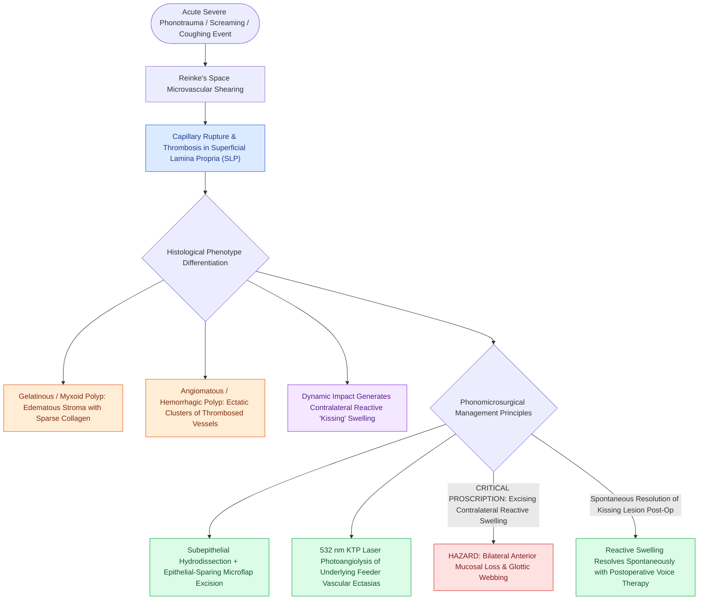

# Vocal fold polyps arise from phonotraumatic microvascular injury in Reinke's space

## Active Recall

> [!question]- What is the typical initiating event in the pathogenesis of a hemorrhagic vocal fold polyp?
> *Answer / Clinical Rationale*: An acute phonotraumatic event causing microvascular shearing, capillary rupture, and localized thrombosis within Reinke's space.

> [!question]- How should a contralateral reactive 'kissing' contact swelling be managed during polyp excision?
> *Answer / Clinical Rationale*: It should be left alone; excising it risks creating opposing raw surfaces and an anterior glottic web. Once the offending polyp is excised, the reactive lesion typically resolves spontaneously with voice therapy.

## Core Clinical & Mechanistic Principles
**Vocal Fold Polyps** are typically unilateral, benign, exophytic or sessile lesions that originate strictly within the [[The superficial lamina propria acts as a pliable shearing fluid bed|superficial lamina propria (Reinke's space)]].

### Pathophysiology & Microvascular Disruption
- **Acute Phonotrauma**: Polyps frequently develop after an acute, severe phonotraumatic event (e.g., screaming, severe coughing fit).
- **Capillary Rupture & Thrombosis**: High shearing forces rupture delicate subepithelial capillaries, causing localized micro-hematoma formation, capillary ectasia, fibrin deposition, and thrombosis within Reinke's space.
- **Histopathology**:
  - *Gelatinous / Myxoid Polyps*: Characterized by extensive edema, loose myxoid stroma, sparse collagen, and minimal vascular proliferation.
  - *Angiomatous / Hemorrhagic Polyps*: Characterized by clusters of dilated, thrombosed capillary vessels with hemosiderin-laden macrophages and organized fibrous stroma.
  - *Reactive Contralateral Lesion*: A reactive fibrovascular contact nodule ("kissing lesion") often forms on the opposing vocal fold due to mechanical impact from the polyp.

## Diagnostic & Stroboscopic Features
- **Unilateral Asymmetry**: Creates marked phase asymmetry and aperiodicity on [[Videostroboscopy visualizes mucosal wave dynamics and glottal closure|videostroboscopy]].
- **Hourglass / Irregular Closure**: Prevents complete [[Glottal closure patterns identify specific laryngeal biomechanical deficits|glottal closure]], producing breathiness and a rough, diplophonic vocal quality.
- **Pedunculated vs Sessile**: Pedunculated polyps may flip between supraglottic and subglottic positions during phonation and respiration.

## Surgical & Clinical Management
- **Preoperative Voice Therapy**: Evaluates vocal mechanics and softens any contralateral reactive contact lesion (which should not be surgically excised).
- **Surgical Excision**: Persistent polyps impairing vocal function require excision via [[The epithelial-sparing microflap preserves native mucosa and prevents glottic webbing|phonomicrosurgical microflap techniques]] with [[Subepithelial hydrodissection expands Reinke's space and protects the vocal ligament|hydrodissection]], sparing the underlying [[The vocal ligament comprises intermediate and deep lamina propria|vocal ligament]].
- **Vascular Ectasia Management**: Associated feeder varices or ectasias can be photocoagulated with a [[The KTP laser targets oxyhemoglobin at 532 nm for photoangiolysis|KTP laser]] (532 nm) or [[The pulsed dye laser targets vascular lesions at 585 nm|PDL laser]] (585 nm).

## Critical Failure Modes & Error Traps
- **Resecting the Contralateral Reactive Lesion**: Inadvertently excising the contralateral reactive swelling during polyp excision risks bilateral anterior mucosal stripping and postoperative anterior glottic web formation. The reactive lesion almost always resolves spontaneously once the primary polyp is removed.

## Connected Concepts & Graph Traversal
- **Histological Layer**: [[The superficial lamina propria acts as a pliable shearing fluid bed|Superficial Lamina Propria (Reinke's Space)]]
- **Surgical Technique**: [[The epithelial-sparing microflap preserves native mucosa and prevents glottic webbing|Phonomicrosurgical Microflap Technique]]
- **Laser Photocoagulation**: [[The KTP laser targets oxyhemoglobin at 532 nm for photoangiolysis|KTP Laser for Vascular Lesions]]
- **Underlying Ligament**: [[The vocal ligament comprises intermediate and deep lamina propria|The Vocal Ligament]]
- **Differential Pathology**: [[Vocal fold nodules are bilateral mid-membranous lesions treated with voice therapy|Vocal Fold Nodules]]
- **Diffuse Polypoid Differential**: [[Reinke's edema causes polypoid degeneration of the superficial lamina propria treated with smoking cessation and lateral microflap evacuation|Reinke's Edema]]
