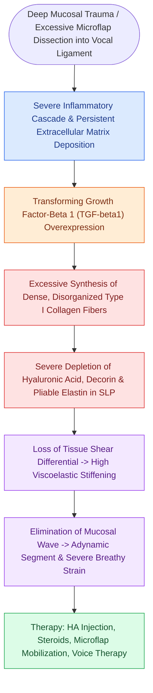

# Vocal fold scar results from disorganized Type I collagen deposition

## Active Recall

> [!question]- Which specific cytokine is the primary mediator driving fibroblast-to-myofibroblast differentiation and Type I collagen deposition in vocal fold scarring?
> *Answer / Clinical Rationale*: **TGF-β1 (Transforming Growth Factor Beta-1)** is the master cytokine that upregulates α-SMA expression and stimulates excessive, disorganized Type I collagen synthesis.

> [!question]- What stroboscopic finding is characteristic of mature vocal fold scar?
> *Answer / Clinical Rationale*: A localized or generalized **adynamic non-vibrating segment** with severe reduction or complete absence of the mucosal wave.

## Core Clinical & Mechanistic Principles
**Vocal Fold Scar** represents the most challenging and intractable pathological entity in clinical laryngology. It develops when the normal extracellular matrix of the [[The superficial lamina propria acts as a pliable shearing fluid bed|superficial lamina propria (Reinke's space)]] is destroyed and replaced by dense, disorganized fibrous scar tissue.

### Cellular & Molecular Wound Healing
1. **Loss of Hyaluronic Acid**: Injury past the [[The basement membrane zone anchors epithelium to superficial lamina propria|basement membrane zone]] causes profound depletion of hyaluronic acid, decorin, and fibromodulin.
2. **Myofibroblast Transformation**: Cytokines (particularly Transforming Growth Factor Beta-1, **TGF-β1**) recruit and transform resident vocal fold fibroblasts into contractile α-smooth muscle actin (α-SMA)-positive myofibroblasts.
3. **Disorganized Type I Collagen Deposition**: Instead of the delicate, loose Type III collagen and unbundled elastin of healthy Reinke's space, myofibroblasts deposit thick, dense, randomly oriented bundles of **Type I collagen**.
4. **Cover-to-Body Tethering**: This fibrotic bridge tethers the overlying [[Stratified squamous epithelium forms the vocal fold protective cover|epithelium]] directly to the underlying [[The vocal ligament comprises intermediate and deep lamina propria|vocal ligament]] or [[The thyrovocalis muscle provides isometric pitch and tension control|vocalis muscle]].

## Functional Impact & Videostroboscopy
- **Loss of Mucosal Wave**: High tissue stiffness and viscosity prevent mucosal oscillation, presenting as a focal [[Adynamic vocal fold segments indicate mucosal stiffening, malignancy, or scar|adynamic segment]] or generalized loss of mucosal wave.
- **Glottal Incompetence**: Scar contracture along the vibratory margin produces a stiff, irregular, or bowed [[Glottal closure patterns identify specific laryngeal biomechanical deficits|glottal gap]].
- **Aeroacoustic Turbulence**: Causes severe dysphonia characterized by breathiness, roughness, elevated phonation threshold pressure (PTP), and severe vocal strain.

## Surgical Prevention & Therapeutic Strategies
- **Prevention (Foremost Strategy)**: In [[Phonomicrosurgery requires suspension laryngoscopy and stereoscopic magnification|phonomicrosurgery]], dissection must remain strictly superficial to the vocal ligament, utilizing [[Subepithelial hydrodissection expands Reinke's space and protects the vocal ligament|hydrodissection]] and cold instrumentation.
- **Therapeutic Modalities**:
  - *Steroid Injections*: Submucosal triamcinolone or dexamethasone to suppress acute fibroblastic proliferation.
  - *Viscoelastic Regenerative Injections*: [[Cross-linked hyaluronic acid provides intermediate-duration vocal fold augmentation|Cross-linked HA]] or autologous micro-fat grafting.
  - *Angiolytic Laser Therapy*: [[The KTP laser targets oxyhemoglobin at 532 nm for photoangiolysis|KTP laser]] to photocoagulate scar-associated abnormal microvessels.

## Critical Failure Modes & Error Traps
- **Aggressive Re-resection of Scar**: Attempting to surgically excise mature vocal fold scar tissue with cold instruments or [[The CO2 laser vaporizes tissue via 10600 nm water absorption|CO2 laser]] almost universally produces a wider, deeper scar bed with worsened dysphonia.

## Connected Concepts & Graph Traversal
- **Destroyed Compartment**: [[The superficial lamina propria acts as a pliable shearing fluid bed|Superficial Lamina Propria (Reinke's Space)]]
- **Depleted Molecule**: [[Hyaluronic acid regulates lamina propria hydration and shock absorption|Hyaluronic Acid Dynamics]]
- **Diagnostic Hallmark**: [[Adynamic vocal fold segments indicate mucosal stiffening, malignancy, or scar|Adynamic Segment on Stroboscopy]]
- **Surgical Prevention**: [[The epithelial-sparing microflap preserves native mucosa and prevents glottic webbing|Phonomicrosurgical Microflap Technique]]
- **Therapeutic Biomaterial**: [[Cross-linked hyaluronic acid provides intermediate-duration vocal fold augmentation|Cross-Linked Hyaluronic Acid]]
