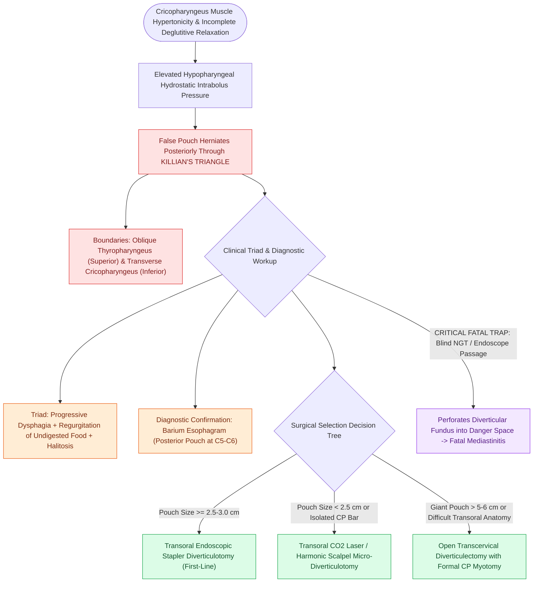

# Zenker's diverticulum herniates through Killian's triangle due to elevated pulsion pressure

## Active Recall

> [!question]- Why is a Zenker's diverticulum classified as a 'false' pulsion diverticulum?
> *Answer / Clinical Rationale*: It is formed by herniation of only the **mucosa and submucosa** through a muscular defect (Killian's triangle), lacking a true muscularis layer in the pouch wall.

> [!question]- What underlying biomechanical muscle dysfunction generates the pulsion pressure in Zenker's diverticulum?
> *Answer / Clinical Rationale*: Incomplete relaxation, delayed opening, or hypertonicity of the **cricopharyngeus muscle**, which increases hypopharyngeal intrabolus pressure during swallowing.

## Core Clinical & Mechanistic Principles
**Zenker's Diverticulum (ZD)** (first described by Friedrich Albert von Zenker in 1877) is a **false, pulsion diverticulum** formed by herniation of the hypopharyngeal mucosa and submucosa through a posterior anatomical muscular weakness known as **[[Killian's triangle is a posterior muscular dehiscence above the cricopharyngeus|Killian's triangle]]**.

### Pathophysiological Mechanism
1. **Cricopharyngeal Hypertonicity / Non-Compliance**: The [[Open diverticulectomy combines pouch resection with cricopharyngeal myotomy|cricopharyngeus]] (CP) muscle fails to relax completely or exhibits delayed, uncoordinated opening during the pharyngeal phase of deglutition.
2. **Elevated Intrabolus Opening Pressure**: The advancing food bolus encounters a rigid, non-compliant CP barrier, generating pathologically elevated hydrostatic intrabolus pressures within the hypopharynx.
3. **Mucosal Herniation through Killian's Triangle**: High pressure forces the hypopharyngeal mucosal envelope to herniate posteriorly between the oblique fibers of the thyropharyngeus and the transverse fibers of the cricopharyngeus muscle.

## Clinical Manifestations & Diagnostic Findings
- **Hallmark Symptoms**: Progressive oropharyngeal dysphagia, regurgitation of undigested food hours after eating, halitosis, noisy deglutition (borborygmi in the neck), nocturnal coughing fits, and recurrent aspiration pneumonia.
- **Diagnostic Modality**: **Barium Esophagram / [[VFSS provides continuous radiographic evaluation of all deglutition phases|VFSS]]** is the definitive diagnostic test, demonstrating a posterior barium-filled pouch projecting at the level of C5–C6 with a prominent cricopharyngeal bar.

## Surgical Management Paradigm
The cornerstone of all surgical approaches is **division of the cricopharyngeal muscle bar** ($\pm$ pouch management):
1. **Transoral Endoscopic Stapler Diverticulotomy**: First-line for pouches $\ge 2.5\text{–}3.0\text{ cm}$.
2. **Transoral Laser / Harmonic Scalpel Diverticulotomy**: Indicated for small pouches ($<2.5\text{ cm}$) or prominent CP bars.
3. **Open Transcervical Excision with CP Myotomy**: Indicated for giant pouches ($>5\text{–}6\text{ cm}$), recurrent disease, or impossible endoscopic transoral access.

## Critical Failure Modes & Error Traps
- **Blind Nasogastric Tube Placement**: Passing a blind NG tube or flexible endoscope in a patient with an un-diagnosed Zenker's can easily perforate the thin-walled diverticular fundus into the retropharyngeal space, causing fatal mediastinitis.

## Connected Concepts & Graph Traversal
- **Open Surgical Diverticulectomy**: [[Open diverticulectomy combines pouch resection with cricopharyngeal myotomy|Open Diverticulectomy]]
- **Esophageal Motility Manometry**: [[High-resolution manometry classifies achalasia and esophageal motility disorders by the Chicago criteria|High-Resolution Manometry]]
- **Aspiration Scale Grading**: [[The Rosenbek Scale standardizes the depth of airway penetration and aspiration|Rosenbek Penetration Scale]]
- **PE Segment Tone**: [[Pharyngoesophageal segment hypertonicity causes TEP failure treated with Botox or myotomy|PE Segment Dysfunction]]
- **LPR Reflux Mimic**: [[Laryngopharyngeal reflux presents with globus and throat clearing but responds inconsistently to empiric PPIs|Laryngopharyngeal Reflux]]
