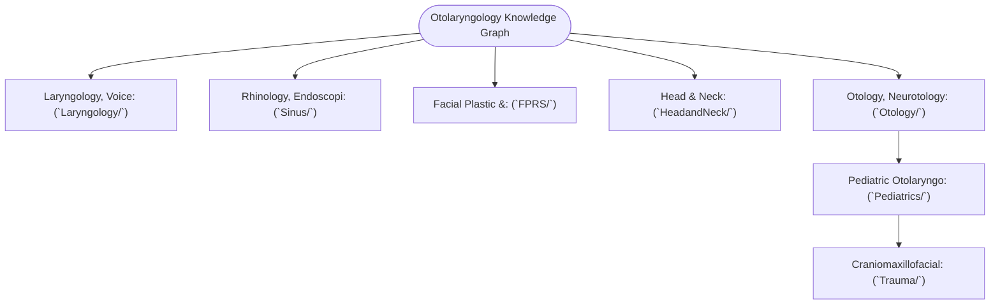

# The Otolaryngology Knowledge Graph provides a unified multi-subspecialty curriculum

<!-- Agent note: Do NOT read this file in full. Use grep or vault search for specific note titles. -->

Welcome to **sk.oto** — the **Unified Comprehensive Otolaryngology — Head & Neck Surgery Knowledge Graph**. This interconnected Obsidian repository unifies **1,036 granular, atomic knowledge notes** across all seven core subspecialty domains into a single load-bearing, bidirectional knowledge graph:

---

## 🏛️ Subspecialty Master Maps of Content (MOCs)

1. **[[The Laryngology Knowledge Graph provides a structured mastery curriculum|Laryngology, Voice & Airway Knowledge Graph MOC]]** (`Laryngology/`)
   - *Scope*: 151 atomic notes covering vocal fold microanatomy, phonosurgery, laser physics (CO2/KTP/PDL), neurolaryngology (RLN/SLN), glottic stenosis (Cotton-Myer/McCaffrey), tracheostomy/TIF/PDT, angioedema, relapsing polychondritis, and master complication rescue protocols.
   - *Linear Guide*: [[Comprehensive Laryngology Residency Mastery Curriculum & Self-Assessment Guide|Comprehensive Laryngology Residency Mastery Curriculum & Self-Assessment Guide]]

2. **[[The Rhinology and Skull Base Knowledge Graph provides a structured mastery curriculum|Rhinology, Endoscopic Sinus & Anterior Skull Base Knowledge Graph MOC]]** (`Sinus/`)
   - *Scope*: 175 atomic notes covering mucociliary clearance, 3D CT mapping (CLOSE checklist, Keros, Kuhn, IFAC), primary & revision FESS, frontal outflow tract (Draf I–III), medical rhinology (T2/non-T2, JNA, AIFRS, biologics, rhinoscleroma, EGPA, contact point headaches), CSF leak repair flaps (Hadad NSF, pericranial, TPFF), and expanded endoscopic corridors (EEA).
   - *Linear Guide*: [[Comprehensive Rhinology, Endoscopic Sinus & Anterior Skull Base Residency Mastery Curriculum & Self-Assessment Guide|Comprehensive Rhinology, Endoscopic Sinus & Anterior Skull Base Residency Mastery Curriculum & Self-Assessment Guide]]

3. **[[The FPRS Knowledge Graph provides a structured mastery curriculum|Facial Plastic & Reconstructive Surgery (FPRS) Knowledge Graph MOC]]** (`FPRS/`)
   - *Scope*: 146 atomic notes covering facial angiosomes, cutaneous local/interpolated flaps (PFF, Abbe, Karapandzic, scalp/galeatomy), functional & aesthetic rhinoplasty (spreader, batten, costal carving, DCF), deep-plane rhytidectomy, facial reanimation (masseteric, free gracilis, CFNG, TMTT), craniomaxillofacial AO trauma (Champy, Le Fort, ZMC, NOE), filler vascular occlusion/hyaluronidase, and microvascular free tissue transfer (RFFF, ALT, FFF, couplers).
   - *Linear Guide*: [[Comprehensive FPRS Residency Mastery Curriculum & Self-Assessment Guide|Comprehensive FPRS Residency Mastery Curriculum & Self-Assessment Guide]]

4. **[[The Head and Neck Oncology Knowledge Graph provides a structured mastery curriculum|Head & Neck Surgical Oncology, Endocrine & Microvascular Reconstruction Knowledge Graph MOC]]** (`Head_and_Neck/`)
   - *Scope*: 182 atomic notes covering cervical lymph node levels (I–VII), deep neck space fascial planes/Danger space, Ludwig angina, Lemierre syndrome, cervical necrotizing fasciitis, comprehensive & selective neck dissections, transoral robotic surgery (TORS), mandibulotomy/mandibulectomy, thyroid & parathyroid surgery (RLN/EBSLN, devascularization, calcium homeostasis), major salivary gland surgery, and free flap crisis management.
   - *Linear Guide*: [[Comprehensive Head & Neck Surgical Oncology, Endocrine & Microvascular Reconstruction Residency Mastery Curriculum & Self-Assessment Guide|Comprehensive Head & Neck Surgical Oncology Residency Mastery Curriculum & Self-Assessment Guide]]

5. **[[The Otology and Lateral Skull Base Knowledge Graph provides a structured mastery curriculum|Otology, Neurotology & Lateral Skull Base Surgery Knowledge Graph MOC]]** (`Otology/`)
   - *Scope*: 186 atomic notes covering cochlear micromechanics (prestin, tonotopy, endocochlear potential), auditory electrophysiology (ABR, ECochG, VEMP, vHIT, caloric), middle ear impedance transformer, tympanoplasty (underlay/overlay/cartilage), ossiculoplasty (PORP/TORP), mastoidectomy (CWU/CWD, facial recess, meatoplasty), cholesteatoma mastercraft, malignant necrotizing otitis externa (MOE), stapes surgery, cochlear implantation, auditory brainstem implantation (ABI), vestibular disorders (BPPV, Meniere, SCDS third mobile window, vestibular neuritis/labyrinthitis), facial nerve disorders (Melkersson-Rosenthal, decompression, ENoG, Bell's, Ramsay Hunt, nerve transfers), and lateral skull base surgery (vestibular schwannoma Koos I–IV, translabyrinthine, retrosigmoid, MCF, glomus jugulare Fisch A–D, and ITFA-A).
   - *Linear Guide*: [[Comprehensive Otology, Neurotology & Lateral Skull Base Surgery Residency Mastery Curriculum & Self-Assessment Guide|Comprehensive Otology Residency Mastery Curriculum & Self-Assessment Guide]]

6. **[[The Pediatric Otolaryngology and Sleep Surgery Knowledge Graph provides a structured mastery curriculum|Pediatric Otolaryngology & Sleep Surgery Knowledge Graph MOC]]** (`Pediatrics/`)
   - *Scope*: 156 atomic notes covering branchial embryology (1st–4th cleft/pouch anomalies, Sistrunk, fibromatosis coli), Starling resistor & Pcrit sleep mechanics, polysomnography (pediatric & adult criteria, PALM endotypes), adenotonsillar disease (Paradise criteria, PTA/Quinsy, hemorrhage rescue), drug-induced sleep endoscopy (VOTE classification, complete concentric collapse), pediatric airway disorders (stridor acoustics, laryngomalacia supraglottoplasty, subglottic hemangioma/propranolol, croup/epiglottitis, Myer-Cotton SGS), open airway reconstruction (single-stage/double-stage LTR, costal cartilage grafts, cricotracheal resection CTR, slide tracheoplasty), syndromic & non-syndromic pediatric SNHL (Pendred, Usher, Waardenburg, Jervell & Lange-Nielsen, Connexin 26/GJB2, congenital CMV), vascular anomalies, cleft lip and palate (Rule of Tens, Millard, Fisher, two-flap, Furlow, VPI), choanal atresia/pyriform stenosis, soft tissue sleep surgery (modified UPPP, ESP, barbed pharyngoplasty, Z-palatoplasty, RFA, TORS tongue base, hyoid suspension, epiglottopexy), and advanced skeletal/neuromodulatory sleep surgery (HGNS, MMA Le Fort I/BSSO/VSP, DOME, and airway emergency rescue).
   - *Linear Guide*: [[Comprehensive Pediatric Otolaryngology & Sleep Surgery Residency Mastery Curriculum & Self-Assessment Guide|Comprehensive Pediatric Otolaryngology & Sleep Surgery Residency Mastery Curriculum & Self-Assessment Guide]]

7. **[[The Craniomaxillofacial Trauma Knowledge Graph provides a structured mastery curriculum|Craniomaxillofacial Trauma & Orthognathic Surgery Knowledge Graph MOC]]** (`Trauma/`)
   - *Scope*: 40 atomic notes covering AO fixation principles, Perren strain theory, locking vs non-locking mechanics, lag screws, load-bearing vs load-sharing, MMF principles, mandibular symphysis/angle/condyle/atrophic fractures, midfacial buttresses, ZMC sphenozygomatic alignment, retrobulbar hematoma emergency canthotomy, NOE Markowitz transnasal canthopexy, frontal sinus anterior/posterior/NFOT/cranialization, temporal bone OCV/OCS, facial nerve decompression, traumatic CSF leaks, calvarial vault reconstruction, panfacial sequencing & zygomatic arch, soft tissue resuspension, pediatric craniofacial elasticity & tooth bud preservation, and orthognathic BSSO/IVRO/Le Fort I/SARPE/2-jaw sequencing/bad splits.
   - *Linear Guide*: [[Comprehensive Craniomaxillofacial Trauma Residency Mastery Curriculum & Self-Assessment Guide|Comprehensive Craniomaxillofacial Trauma Residency Mastery Curriculum & Self-Assessment Guide]]

---

## 📚 Comprehensive Residency Core Syllabus by Subspecialty Domain

## General Otolaryngology, Sleep Medicine & Acute Airway

### Emergency Airway Management & Protocols
- **Surgical Airway Indications & Technique**: [[Standard open tracheotomy utilizes horizontal intersinusoidal or Bjork flap entry|Emergency Open Tracheotomy & Björk Flap Technique]]
- **Stay Sutures & First Tube Exchange**: [[Adult tracheostomy tube exchange at one week requires a mature tract, tracheal stay sutures, and bougie guidance|Adult Tracheostomy Tube Exchange & Stay Sutures]]
- **Percutaneous Dilatational Tracheostomy**: [[Percutaneous dilatational tracheostomy utilizes bronchoscopic guidance and Seldinger dilation between tracheal rings|PDT Bronchoscopic Guidance & Seldinger Dilation]]
- **Tracheostomy Tube Specifications**: [[Shiley, Bivona, and Portex tracheostomy tubes differ in cannula design, cuff profile, and airway resistance|Shiley vs Bivona vs Portex Tube Profiles]]
- **Tracheoinnominate Fistula Emergency**: [[Tracheoinnominate fistula presents with sentinel bleeding requiring hyperinflation tamponade and emergency surgical ligation|TIF Sentinel Bleed & Utley Maneuver]]
- **Laryngectomy Stoma vs Tracheostomy Resuscitation**: [[Total laryngectomy stomas and tracheostomies require distinct emergency airway resuscitation algorithms|Laryngectomy Stoma vs Standard Tracheostomy Resuscitation]]

### Deep Neck Space & Odontogenic Infections
- **Cervical Fascial Planes & Spaces**: [[Deep neck space infections spread along cervical fascial planes between the pharynx, mediastinum, and skull base|Cervical Fascial Layers & Infection Spread]]
- **Parapharyngeal & Retropharyngeal Spaces**: [[The parapharyngeal space is an inverted pyramid connecting peritonsillar, masticator, parotid, and retropharyngeal spaces|Parapharyngeal Space Surgical Anatomy]]
- **Danger Space Extension & Mediastinitis**: [[The danger space permits unrestricted infection spread from skull base to posterior mediastinum|Danger Space & Mediastinal Spread]]
- **Ludwig Angina Management**: [[Ludwig angina presents with bilateral submandibular cellulitis and woody floor of mouth induration compromising the airway|Ludwig Angina Airway Management & Drainage]]
- **Lemierre Syndrome**: [[Lemierre syndrome involves Fusobacterium necrophorum internal jugular thrombophlebitis and septic emboli|Lemierre Syndrome & Fusobacterium Thrombophlebitis]]
- **Cervical Necrotizing Fasciitis**: [[Cervical necrotizing fasciitis requires emergent surgical debridement and broad-spectrum antimicrobial coverage|Necrotizing Fasciitis Emergent Debridement]]

### Systemic, Granulomatous & Immunologic Manifestations
- **Granulomatosis with Polyangiitis**: [[Granulomatosis with polyangiitis presents with necrotizing sinonasal granulomas and saddle nose|GPA c-ANCA Vasculitis & Subglottic Stenosis]]
- **Sarcoidosis**: [[Sarcoidosis of the upper respiratory tract causes non-caseating granulomas and mucosal cobblestoning|Sarcoidosis Non-Caseating Granulomas & Laryngeal Edema]]
- **Eosinophilic Granulomatosis with Polyangiitis**: [[Eosinophilic granulomatosis with polyangiitis causes asthma, peripheral eosinophilia, and necrotizing vasculitis|EGPA Churg-Strauss Vasculitis]]
- **Rhinoscleroma**: [[Rhinoscleroma is a chronic granulomatous Klebsiella infection characterized by Mikulicz cells and Russell bodies|Rhinoscleroma & Mikulicz Cells]]
- **Relapsing Polychondritis**: [[Relapsing polychondritis causes autoimmune auricular and laryngotracheal chondritis with sparing of the non-cartilaginous lobule|Relapsing Polychondritis & Lobule Sparing]]
- **Acute Angioedema**: [[Mast cell-mediated histaminergic angioedema responds rapidly to epinephrine, antihistamines, and corticosteroids|Histaminergic vs Bradykinin Angioedema]]

### Sleep Medicine & Sleep Surgery
- **Diagnostic Polysomnography**: [[Adult polysomnography criteria define obstructive sleep apnea severity by apnea-hypopnea index thresholds of five, fifteen, and thirty|PSG Diagnostic Criteria & AHI Severity]]
- **Sleep Architecture Dynamics**: [[Non-rapid eye movement and rapid eye movement sleep architecture dictate pharyngeal muscle tone|NREM vs REM Sleep Pharyngeal Tone]]
- **Drug-Induced Sleep Endoscopy**: [[Drug-induced sleep endoscopy DISE evaluates dynamic multi-level upper airway collapse under sedation|DISE Protocol & Sedation Depth]]
- **VOTE Classification System**: [[VOTE classification standardizes drug-induced sleep endoscopy findings across velum, oropharynx, tongue base, and epiglottis|VOTE Classification System]]
- **Uvulopalatopharyngoplasty (UPPP)**: [[Modified uvulopalatopharyngoplasty UPPP resects redundant palatal tissue while preserving muscular function|Modified UPPP Surgical Technique]]
- **Expansion Sphincter Pharyngoplasty (ESP)**: [[Expansion sphincter pharyngoplasty ESP rotates the palatopharyngeus muscle to stabilize lateral pharyngeal wall collapse|Expansion Sphincter Pharyngoplasty]]
- **Hypoglossal Nerve Stimulation (HGNS)**: [[Hypoglossal nerve stimulation HGNS activates the medial branch of CN XII to advance the tongue during inspiration|HGNS Candidacy & Medial CN XII Activation]]
- **Maxillomandibular Advancement (MMA)**: [[Maxillomandibular advancement MMA advances the skeletal framework by ten to twelve millimeters to expand the upper airway|MMA Skeletal Advancement]]

### Headache & Craniofacial Pain
- **Rhinogenic Contact Point Headache**: [[Rhinogenic contact point headache arises from mucosal contact between the nasal septum and turbinates|Rhinogenic Contact Point Headache]]
- **Trigeminal Neuralgia**: [[Trigeminal neuralgia causes paroxysmal lancinating facial pain treated with carbamazepine and microvascular decompression|Trigeminal Neuralgia & Microvascular Decompression]]

## Rhinology, Allergy & Anterior Skull Base

### Applied Sinonasal Anatomy & Radiologic Correlates
- **Osteomeatal Complex & Drainage Pathways**: [[The uncinate process superior attachment dictates the frontal sinus drainage pathway|Uncinate Superior Attachment & Drainage]]
- **Incisive Uncinectomy & Lamellar Boundaries**: [[Incisive uncinectomy exposes the ethmoid infundibulum while protecting the nasolacrimal duct|Incisive Uncinectomy & Lacrimal Duct Protection]]
- **Ethmoid Bulla & Ground Lamella**: [[The ethmoid bulla serves as the principal anatomical anchor for anterior ethmoidectomy|Ethmoid Bulla & Basal Lamella Landmarks]]
- **Anatomic Variants & Dangerous Cells**: [[Concha bullosa pneumatization of the middle turbinate can obstruct the ostiomeatal complex|Concha Bullosa]], [[Agger nasi cells form the anterior boundary of the frontal recess|Agger Nasi Air Cells]], [[Infraorbital Haller cells narrow the ethmoid infundibulum and maxillary ostium|Infraorbital Haller Cells]], [[Onodi cells place the optic nerve and carotid artery at risk during posterior ethmoidectomy|Onodi Cells & Optic/Carotid Risk]], [[Supraorbital ethmoid cells suspend the anterior ethmoidal artery below the skull base|Supraorbital Ethmoid Cells]]
- **Frontal Recess Classification**: [[The Kuhn classification stages frontal recess and frontal sinus air cells|Kuhn Frontal Cell Classification (Types I-IV)]]
- **Olfactory Fossa Depth & Skull Base Vulnerability**: [[The Keros classification stages olfactory fossa depth and lateral lamella vulnerability|Keros Classification & Lateral Lamella Vulnerability]]
- **Olfactory & Gustatory Physiology**: [[Olfactory neuroepithelium contains bipolar sensory neurons and basal stem cells|Olfactory Neuroepithelium & Signal Transduction]], [[UPSIT and CCCRC tests quantify olfactory thresholds and odor identification in chemosensory disorders|UPSIT & CCCRC Olfactory Evaluation]], [[Gustatory sensation is transmitted via the chorda tympani, greater superficial petrosal, glossopharyngeal, and superior laryngeal nerves|Gustatory Pathways & Cranial Nerve Innervation]]

### Sinonasal Inflammatory Disease & Allergy
- **Chronic Rhinosinusitis Endotyping**: [[Type 2 CRS exhibits eosinophilic inflammation responsive to targeted biologics|Type 2 Eosinophilic CRS]] vs [[Non-Type 2 CRS features neutrophilic inflammation associated with cystic fibrosis and ciliopathies|Non-Type 2 Neutrophilic CRS]]
- **Allergy Testing & Immunotherapy**: [[Intradermal dilutional testing IDT and modified quantitative testing MQT quantify allergic sensitization to guide safe immunotherapy escalation|IDT and MQT Allergy Testing & Immunotherapy]]
- **Aspirin-Exacerbated Respiratory Disease**: [[AERD manifests with asthma, nasal polyps, and severe aspirin-induced respiratory reactions|AERD Samter Triad & COX-1 Inhibition]]
- **Allergic Fungal Rhinosinusitis**: [[Allergic fungal rhinosinusitis presents with eosinophilic mucin and Charcot-Leyden crystals|AFRS Bent-Kuhn Diagnostic Criteria]]
- **Targeted Biologic Therapeutics**: [[Biologic therapeutics in chronic rhinosinusitis target IgE, IL-4, IL-5, and IL-13 inflammatory pathways|Biologics in CRS (Dupilumab, Omalizumab, Mepolizumab)]]
- **Rhinitis Subtypes & Diagnostics**: [[Rhinitis subtypes are differentiated into allergic, vasomotor, gustatory, and rhinitis medicamentosa|Rhinitis Subtypes (Allergic, Vasomotor, Medicamentosa)]]
- **Radiological & Endoscopic Staging**: [[The Lund-Mackay CT scoring system quantifies sinonasal opacification and ostiomeatal occlusion|Lund-Mackay CT Score]], [[The Lund-Kennedy endoscopic staging system tracks mucosal edema, polyps, and discharge|Lund-Kennedy Endoscopic Staging]]

### Complicated Sinusitis & Infectious Emergencies
- **Orbital Complications & Decompression**: [[Orbital complications of acute sinusitis staged by the Chandler classification dictate medical versus surgical drainage|Chandler Orbital Staging & Surgical Drainage]]
- **Pott Puffy Tumor & Intracranial Spread**: [[Pott's puffy tumor represents subperiosteal abscess and frontal bone osteomyelitis from sinusitis|Pott Puffy Tumor & Diploic Vein Spread]]
- **Acute Invasive Fungal Rhinosinusitis**: [[Acute invasive fungal rhinosinusitis requires emergent surgical debridement and systemic amphotericin B|AIFRS Emergency Debridement & Amphotericin B]]

### Epistaxis Management
- **Anterior & Posterior Epistaxis Pathways**: [[Kiesselbach plexus anterior epistaxis is managed with cautery and anterior nasal packing|Epistaxis Triage & Management Protocol]]
- **Endoscopic Sphenopalatine Artery Ligation**: [[The crista ethmoidalis guides endoscopic sphenopalatine artery ligation|Crista Ethmoidalis & ESPAL]]
- **Hereditary Hemorrhagic Telangiectasia**: [[Hereditary hemorrhagic telangiectasia manifests with mucosal AVMs and recurrent epistaxis|HHT Osler-Weber-Rendu Management]]

### Endoscopic Sinus & Anterior Skull Base Surgery
- **Functional Endoscopic Sinus Surgery (FESS)**: [[Maxillary antrostomy requires incorporating accessory fontanelle ostia to prevent recirculation|Maxillary Antrostomy & Recirculation Prevention]], [[Entering the ethmoid bulla inferomedially avoids orbital and skull base penetration|Safe Inferomedial Bulla Entry]], [[The sphenoid sinus ostium lies medial to the superior turbinate above the choana|Sphenoid Sinus Ostium Localization]]
- **Frontal Sinusotomy**: [[Draf III modified Lothrop unites both frontal sinuses into a common cavity|Draf III Modified Lothrop]], [[Frontal sinus trephination provides combined endoscopic and percutaneous visualization and irrigation|Frontal Sinus Trephination]]
- **CSF Fistula Localization & Skull Base Reconstruction**: [[Beta-2 transferrin and high-resolution CT localize sinonasal CSF fistulas|Beta-2 Transferrin & CT Localization]], [[Intrathecal fluorescein enables visual localization of occult dural defects|Intrathecal Fluorescein Localization]], [[The Hadad-Bassagasteguy nasoseptal flap is pedicled on the posterior septal artery|Hadad-Bassagasteguy Nasoseptal Flap]], [[Multi-layer skull base reconstruction combines underlay, inlay, and overlay barriers|Multi-Layered Skull Base Reconstruction]]
- **Ethmoidal Architecture & Lamellae**: [[The four parallel ethmoidal lamellae guide systematic anterior-to-posterior endoscopic orientation|Four Parallel Ethmoidal Lamellae]]
- **Diagnostic Nasal Endoscopy**: [[Diagnostic rigid nasal endoscopy utilizes a standardized three-pass examination sequence|Three-Pass Diagnostic Nasal Endoscopy]]
- **Transsphenoidal Pituitary & Sellar Exposure**: [[Intraoperative ICA injury requires two-surgeon suction and crushed muscle patch hemostasis|Cavernous Carotid Safety & Muscle Patch Hemostasis]], [[The lateral and medial opticocarotid recesses define critical anatomical corridors in endoscopic skull base surgery|Opticocarotid Recess (OCR) Landmarks]]
- **Sinonasal Neoplasms & Skull Base Oncology**: [[Sinonasal inverting papilloma requires subperiosteal excision and hyperostotic bone drill-out|Inverting Papilloma Subperiosteal Resection]], [[Ohngren line divides the maxillary sinus into anteroinferior and posterosuperior prognostic compartments|Ohngren's Line & Maxillary Compartments]], [[Sinonasal small round blue cell tumors are differentiated by immunohistochemistry into SNUC, olfactory neuroblastoma, melanoma, lymphoma, and rhabdomyosarcoma|Sinonasal Small Round Blue Cell IHC Panel]], [[Sinonasal teratocarcinosarcoma is a highly aggressive malignant mixed tumor containing teratomatous, carcinomatous, and sarcomatous elements|Sinonasal Teratocarcinosarcoma (SNTS)]], [[Sinonasal undifferentiated carcinoma exhibits aggressive neuroendocrine features requiring multimodal therapy|Sinonasal Undifferentiated Carcinoma (SNUC)]], [[Esthesioneuroblastoma Kadish and Hyams staging determines craniofacial resection and adjuvant therapy|Esthesioneuroblastoma Staging]] 

## Laryngology, Voice & Bronchoesophagology

### Microanatomy & Physiology of Phonation
- **Cover-Body Theory & Histology**: [[The vocal fold comprises five distinct histological layers|Cover-Body Theory & Five Histological Layers]]
- **Lamina Propria & Vocal Ligament**: [[The superficial lamina propria acts as a pliable shearing fluid bed|Reinke Space (SLP) Shearing Fluid Bed]], [[Broyles' ligament anchors the vocal ligament to thyroid cartilage|Broyles' Ligament & Vocal Ligament Architecture]]
- **Intrinsic Laryngeal Muscles & Innervation**: [[The posterior cricoarytenoid is the sole vocal fold abductor|PCA Sole Vocal Fold Abductor]], [[The lateral cricoarytenoid is the primary membranous fold adductor|LCA Primary Membranous Adductor]], [[The thyrovocalis muscle provides isometric pitch and tension control|Thyrovocalis Isometric Tension Control]], [[The cricothyroid muscle elongates vocal folds to elevate pitch|Cricothyroid Pitch Elevation (eSLN)]]
- **Neural Pathways & Anastomoses**: [[The superior laryngeal nerve provides supraglottic sensation and cricothyroid motor control|SLN Sensation & Cricothyroid Motor Control]]

### Diagnostic Modalities
- **Videostroboscopy**: [[Videostroboscopy visualizes mucosal wave dynamics and glottal closure|Videostroboscopic Mucosal Wave Assessment]]
- **Laryngeal Electromyography (LEMG)**: [[LEMG denervation potentials indicate axonal injury within one to six months|Laryngeal Electromyography (LEMG) Potentials]]
- **Swallowing Diagnostics & High-Resolution Manometry**: [[FEES assesses pharyngeal secretions and aspiration under direct vision|FEES vs MBS Swallowing Assessment]]

### Benign Vocal Fold Lesions & Phonomicrosurgery
- **Mucosal Pathology**: [[Vocal fold nodules are bilateral mid-membranous lesions treated with voice therapy|Vocal Fold Nodules]], [[Vocal fold polyps arise from phonotraumatic microvascular injury in Reinke's space|Vocal Fold Polyps]], [[Acute vocal fold hemorrhage requires strict voice rest and absolute performance cancellation to prevent permanent fibrovascular scarring|Acute Vocal Fold Hemorrhage]], [[Epidermoid cysts adhere to the vocal ligament and require sharp dissection|Epidermoid & Retention Cysts]], [[Sulcus vocalis manifests as mucosal furrowing staged by the Ford classification|Sulcus Vocalis & Ford Staging]]
- **Phonomicrosurgical Dissection**: [[Phonomicrosurgery requires suspension laryngoscopy and stereoscopic magnification|Phonomicrosurgery & Microflap Dissection]]
- **Laryngeal Lasers**: [[The CO2 laser vaporizes tissue via 10600 nm water absorption|CO2 Laser Photoablation (10,600 nm)]], [[The KTP laser targets oxyhemoglobin at 532 nm for photoangiolysis|KTP/PDL Angiolytic Laser (532 nm)]]

### Neurolaryngology & Vocal Fold Motion Impairment
- **Unilateral Vocal Fold Paralysis Workup**: [[Unilateral vocal fold paralysis causes glottic insufficiency, breathiness, and aspiration|Unilateral Paralysis Evaluation & Skull Base-to-AP Window CT]]
- **Injection Augmentation**: [[Injection laryngoplasty requires precise placement into lateral thyroarytenoid muscle|Injection Laryngoplasty Craft]], [[Calcium hydroxylapatite provides durable medialization but causes granulomas if superficial|Calcium Hydroxylapatite (Radiesse)]]
- **Laryngeal Framework Surgery**: [[Type I thyroplasty medializes the vocal fold with conscious voice tuning|Type I Medialization Thyroplasty]], [[Arytenoid adduction closes large posterior glottic gaps and corrects height mismatch|Arytenoid Adduction & Adduction Arytenopexy]]
- **Bilateral Vocal Fold Paralysis**: [[Bilateral abductor vocal fold paralysis causes acute airway compromise requiring glottic enlargement|Bilateral Abductor Vocal Fold Paralysis]], [[Endoscopic transverse cordotomy widens posterior airway while preserving anterior phonation|Endoscopic Transverse Cordotomy]]
- **Movement Disorders & Neuromodulation**: [[Adductor spasmodic dysphonia causes strained voice breaks treated with thyroarytenoid Botox|Adductor Spasmodic Dysphonia (TA Botox)]], [[Abductor spasmodic dysphonia causes breathy voice breaks treated with PCA Botox|Abductor Spasmodic Dysphonia (PCA Botox)]], [[Essential voice tremor causes rhythmic four to eight Hertz phonatory oscillations treated with propranolol, primidone, and botulinum toxin|Essential Voice Tremor (EVT)]]

### Upper Aerodigestive Stenosis & Bronchoesophagology
- **Subglottic Stenosis Staging**: [[The Cotton-Myer classification grades subglottic stenosis by luminal reduction|Cotton-Myer Subglottic Stenosis Staging]]
- **Endoscopic Airway Interventions**: [[Endoscopic airway dilation combines radial incisions with balloon bronchoplasty|Endoscopic Radial Incision & Balloon Dilation]]
- **Open Laryngotracheal Reconstruction**: [[Single-stage and double-stage laryngotracheal reconstruction LTR repair mature high-grade subglottic stenosis|Single vs Double-Stage LTR]], [[Laryngotracheal reconstruction expands the airway using carved costal cartilage grafts|Costal Cartilage Airway Grafting]], [[Cricotracheal resection CTR achieves primary end-to-end anastomosis for severe Grade III and IV subglottic stenosis|Cricotracheal Resection (CTR)]]
- **Esophageal & Pharyngeal Pathology**: [[Killian's triangle is a posterior muscular dehiscence above the cricopharyngeus|Killian's Triangle Anatomy]], [[Zenker's diverticulum herniates through Killian's triangle due to elevated pulsion pressure|Zenker's Diverticulum & Cricopharyngeal Myotomy]], [[Active reflux and eosinophilic esophagitis compromise airway graft survival|Eosinophilic Esophagitis (EoE)]]

### Laryngeal Hypersensitivity, Functional Voice & Reflux
- **Laryngopharyngeal Reflux**: [[Laryngopharyngeal reflux presents with globus and throat clearing but responds inconsistently to empiric PPIs|Laryngopharyngeal Reflux]]
- **Chronic Refractory Cough**: [[Chronic refractory cough reflects laryngeal hypersensitivity treated with neuromodulators and behavioral suppression therapy|Chronic Refractory Cough]]
- **Paradoxical Vocal Fold Motion**: [[Paradoxical vocal fold motion causes inspiratory stridor from episodic adduction relieved by rescue breathing|Paradoxical Vocal Fold Motion]]
- **Muscle Tension Dysphonia**: [[Muscle tension dysphonia arises from supraglottic hyperfunction and responds to circumlaryngeal voice therapy|Muscle Tension Dysphonia]]
- **Presbyphonia**: [[Presbyphonia reflects vocal fold atrophy and bowing managed with therapy before augmentation|Presbyphonia]]

### Laryngeal Trauma, Caustic & Foreign Body Emergencies
- **Laryngeal Trauma**: [[External laryngeal trauma is staged by the Schaefer classification directing tracheostomy and open repair|Laryngeal Trauma]]
- **Caustic Ingestion**: [[Caustic ingestion injury is graded endoscopically by the Zargar classification within forty-eight hours|Caustic Ingestion]]
- **Button Battery Ingestion**: [[Pediatric esophageal button battery impaction causes liquefaction necrosis within two hours and mandates emergent endoscopic extraction|Button Battery Ingestion]]

### Esophagology & Motility
- **Achalasia**: [[High-resolution manometry classifies achalasia and esophageal motility disorders by the Chicago criteria|Achalasia]]

## Head & Neck Surgical Oncology, Endocrine & Microvascular Reconstruction

### Tumor Biology & Principles of Therapeutics
- **HPV Oncoproteins & Molecular Pathogenesis**: [[Transoral robotic surgery TORS achieves en bloc resection of tonsillar and base of tongue neoplasms|HPV Oncoproteins (E6/E7) & p16 Staining]]
- **Targeted Biologics & Immune Checkpoint Inhibitors**: [[Cetuximab targets EGFR overexpression while pembrolizumab and nivolumab inhibit PD-1 in head and neck SCC|EGFR Cetuximab & PD-1 Pembrolizumab]]
- **Radiation Toxicity & Vasculopathy**: [[Post-radiation carotid vasculopathy and osteoradionecrosis represent severe late radiotherapy sequelae|Carotid Vasculopathy & Mandibular Osteoradionecrosis]]
- **Referred Otalgia Dashboard**: [[Referred otalgia originates from shared sensory pathways of cranial nerves V, VII, IX, X, and cervical roots C2-C3|Referred Otalgia Dashboard]]

### Cervical Fascia, Deep Neck Spaces & Lymphatics
- **Cervical Lymph Node Boundaries**: [[Cervical lymph node levels I through VII define regional metastatic drainage basins|Cervical Lymph Node Levels I–VII]]
- **Neck Dissection Classification**: [[Radical neck dissection removes levels I through V while sacrificing CN XI, the IJV, and the SCM|Radical Neck Dissection (RND)]], [[Modified radical neck dissection types I, II, and III preserve non-lymphatic structures|Modified Radical Neck Dissection (MRND Types I-III)]], [[Central compartment neck dissection clears level VI nodes between the carotid sheaths and suprasternal notch|Level VI Central Compartment Dissection]]
- **Vascular & Chylous Complications**: [[Cervical chyle leaks are managed with MCT diet, octreotide, or surgical thoracic duct ligation|Thoracic Duct Chyle Leak Management]], [[Carotid blowout syndrome is classified into threatened, impending, and acute hemorrhage|Carotid Blowout Syndrome Staging & Intervention]]

### Upper Aerodigestive Squamous Cell Carcinoma (SCC) & Premalignant Disorders
- **Premalignant Lesions & Syndromes**: [[Plummer-Vinson syndrome combines iron deficiency anemia, postcricoid esophageal webs, and mucosal atrophy with malignant potential|Plummer-Vinson Sideropenic Dysphagia]], [[Verrucous carcinoma exhibits pushing non-infiltrative margins without regional nodal metastasis and is treated with wide local surgical excision|Verrucous Carcinoma (Ackerman Tumor)]]
- **Oral Cavity SCC Staging & Approaches**: [[Elective neck dissection is indicated for oral cavity squamous cell carcinoma with depth of invasion exceeding four millimeters|Depth of Invasion (DOI > 4 mm) & END Criteria]], [[Lip-split paramedian mandibulotomy provides wide exposure for posterior oral cavity and oropharyngeal tumors|Lip-Split Paramedian Mandibulotomy Exposure]]
- **Oropharyngeal SCC & TORS Craft**: [[Transoral robotic surgery TORS achieves en bloc resection of tonsillar and base of tongue neoplasms|TORS Radical Tonsillectomy & BOT Resection]], [[Lingual artery branches require clip ligation during TORS base of tongue resection|Lingual Artery Prophylactic Clip Ligation]], [[Supracricoid partial laryngectomy achieves organ preservation for T2 to T3 laryngeal cancer by resecting the thyroid cartilage while preserving at least one cricoarytenoid unit|Supracricoid Partial Laryngectomy (CHEP / CHP)]]
- **Odontogenic Neoplasms & Cysts**: [[Ameloblastoma exhibits multilocular soap-bubble radiolucency and requires segmental resection with one-centimeter bony margins|Ameloblastoma & Multilocular Soap-Bubble Radiolucency]], [[Odontogenic keratocysts arise from PTCH1 mutations in Gorlin syndrome and exhibit high recurrence after simple enucleation|Odontogenic Keratocysts & Gorlin Syndrome]], [[Dentigerous cysts arise from the follicular epithelium surrounding the crown of an unerupted third molar|Dentigerous Cysts & Pericoronal Radiolucency]], [[Stafne bone defects represent asymptomatic cortical lingual mandibular concavities containing ectopic salivary gland tissue|Stafne Bone Defect / Static Bone Cavity]], [[Paradise criteria define evidence-based indications for pediatric tonsillectomy in recurrent throat infections|Paradise Criteria for Elective Tonsillectomy]]

### Thyroid & Parathyroid Surgery
- **Embryology & Congenital Anomalies**: [[Thyroglossal duct cyst tract tracks from the foramen cecum through the hyoid bone to the anterior neck|Thyroglossal Duct Embryology]], [[Third and fourth branchial pouch anomalies present as recurrent left thyroid bed abscesses and piriform sinus fistulas|3rd & 4th Branchial Pouch Anomalies]]
- **Thyroid Malignancy & Neural Preservation**: [[Papillary thyroid carcinoma spreads via cervical lymphatics to central and lateral neck compartments|Papillary Thyroid Carcinoma]], [[Intraoperative neuromonitoring of the RLN and EBSLN verifies nerve integrity and aids nerve identification|Intraoperative Neuromonitoring (RLN & EBSLN)]], [[The recurrent laryngeal nerve is identified within Simon's triangle and followed through Berry's ligament|Simon's Triangle & Berry's Ligament]], [[A nonrecurrent laryngeal nerve arises directly from the vagus due to an aberrant retroesophageal right subclavian artery|Nonrecurrent Laryngeal Nerve (Arteria Lusoria)]], [[The RET proto-oncogene dictates medullary thyroid carcinoma aggression and timing of prophylactic thyroidectomy in MEN 2|RET Mutations & Prophylactic Thyroidectomy in MEN 2]]
- **Parathyroid Disorders & Intraoperative PTH**: [[Primary hyperparathyroidism is caused by single adenomas, multigland hyperplasia, or parathyroid carcinoma|Primary Hyperparathyroidism]], [[The Miami criterion requires a fifty percent intraoperative PTH drop at ten minutes post-excision|Miami Criterion Intraoperative PTH Kinetics]]
- **Postoperative Metabolic Management**: [[Post-thyroidectomy hypocalcemia is managed with oral calcium, calcitriol, and intravenous calcium gluconate|Post-Thyroidectomy Hypocalcemia Management]]

### Salivary Gland Neoplasms & Surgery
- **Facial Nerve Trunk Localization**: [[The facial nerve main trunk is localized using the tragal pointer, tympanomastoid suture, and digastric ridge|Tragal Pointer & Digastric Ridge Landmarks]]
- **Benign Salivary Tumors**: [[Pleomorphic adenoma requires superficial parotidectomy with a cuff of normal tissue to prevent pseudopod recurrence|Pleomorphic Adenoma Superficial Parotidectomy]], [[Warthin tumor presents as a cystic parotid neoplasm associated with smoking and bilateral occurrence|Warthin Tumor]]
- **Malignant Salivary Neoplasms**: [[Mucoepidermoid carcinoma is graded by AFIP Brandwein criteria and driven by CRTC1-MAML2 translocation|Mucoepidermoid Carcinoma & CRTC1-MAML2]], [[Adenoid cystic carcinoma exhibits prominent perineural invasion and late distant hematogenous metastasis|Adenoid Cystic Carcinoma & Perineural Invasion]]
- **Ductal Obstruction & Sialendoscopy**: [[Wharton duct sialolithiasis is managed with transoral sialodochoplasty or sialendoscopy|Wharton Duct Sialolithiasis & Sialodochoplasty]]

### Reconstructive Surgery & Microvascular Free Tissue Transfer
- **Graft Take Dynamics & Regional Flaps**: [[Full-thickness and split-thickness skin grafts differ in primary contraction and vascular take|FTSG vs STSG Take Physiology]], [[Skin graft bolsters and negative pressure wound therapy optimize graft bed inosculation|Bolsters & NPWT Inosculation]], [[Pectoralis major muscle flap reinforcement prevents pharyngocutaneous fistula in salvage laryngectomy|Pectoralis Major Myocutaneous Flap]]
- **Fasciocutaneous & Osseous Free Flaps**: [[The radial forearm free flap provides thin, pliable fasciocutaneous tissue for oral and pharyngeal defects|Radial Forearm Free Flap (RFFF)]], [[The anterolateral thigh free flap provides versatile soft tissue volume based on the LCFA|Anterolateral Thigh (ALT) Flap]], [[The fibula osteocutaneous free flap provides up to twenty-five centimeters of vascularized bone for mandible reconstruction|Fibula Osteocutaneous Flap]], [[The subscapular system provides chimeric bone and soft tissue flaps based on the circumflex scapular artery|Subscapular Chimeric Flap]]
- **Flap Monitoring & Crisis Salvage**: [[Postoperative free flap monitoring includes Doppler ultrasound, pinprick bleeding, and capillary refill checks|Postoperative Flap Monitoring Protocol]], [[Postoperative free flap compromise within forty-eight hours requires emergent surgical re-exploration for pedicle salvage|Free Flap Re-Exploration & Pedicle Salvage]], [[Leech therapy with Hirudo medicinalis decompresses venous congested flaps with ciprofloxacin prophylaxis for Aeromonas hydrophila|Medicinal Leeching & Aeromonas Prophylaxis]]

### Second-Echelon Oncology Heads
- **KEYNOTE-689 Perioperative Immunotherapy**: [[KEYNOTE-689 establishes neoadjuvant and adjuvant pembrolizumab as standard for locally advanced head and neck squamous cell carcinoma|KEYNOTE-689 Trial in HNSCC]]
- **Neoadjuvant Cemiplimab in cSCC**: [[Neoadjuvant cemiplimab achieves high pathological response rates in resectable locally advanced cutaneous squamous cell carcinoma|Neoadjuvant Cemiplimab in cSCC]]
- **ECOG-3311 & ORATOR Trials**: [[The ECOG-3311 and ORATOR trials establish pathological risk-stratified de-escalation and functional trade-offs in HPV-positive OPSCC|ECOG-3311 & ORATOR De-escalation Trials]]
- **MSLT-1 & MSLT-2 Landmark Trials**: [[The MSLT-1 and MSLT-2 trials establish sentinel lymph node biopsy utility and ultrasound surveillance safety in melanoma|MSLT-1 & MSLT-2 Trials]]
- **Merkel Cell Carcinoma**: [[Merkel cell carcinoma is an aggressive neuroendocrine cutaneous malignancy staged by SLNB and managed with wide excision and adjuvant radiotherapy|Merkel Cell Carcinoma (MCC)]]
- **Nasopharyngeal Carcinoma**: [[Nasopharyngeal carcinoma is an EBV-driven malignancy treated primarily with radiation and concurrent chemotherapy|Nasopharyngeal Carcinoma]]
- **Carcinoma of Unknown Primary**: [[HPV-positive carcinoma of unknown primary is localized by palatine tonsillectomy and TORS lingual mucosectomy|Carcinoma of Unknown Primary]]
- **Head and Neck Melanoma**: [[Cutaneous head and neck melanoma is staged by Breslow depth and sentinel lymph node biopsy|Head and Neck Melanoma]]
- **Cutaneous SCC**: [[High-risk cutaneous squamous cell carcinoma drains first to parotid and perifacial nodal basins|Cutaneous SCC]]
- **Esthesioneuroblastoma**: [[Esthesioneuroblastoma arises from olfactory neuroepithelium and is staged by the Kadish classification|Esthesioneuroblastoma]]

### Thyroid Oncology Completion
- **2025 ATA Guidelines**: [[The 2025 ATA guidelines establish active surveillance criteria and lobectomy preference for low-risk differentiated thyroid cancer|2025 ATA Differentiated Thyroid Cancer Guidelines]]
- **Medullary Thyroid Carcinoma**: [[Medullary thyroid carcinoma arises from parafollicular C cells and mandates RET testing with calcitonin surveillance|Medullary Thyroid Carcinoma]]
- **Anaplastic Thyroid Carcinoma**: [[Anaplastic thyroid carcinoma is an airway and molecular emergency requiring immediate BRAF testing|Anaplastic Thyroid Carcinoma]]
- **Bethesda System**: [[Bethesda cytology and molecular testing stratify thyroid nodule malignancy risk before surgery|Bethesda System]]

### Vascular & Lymphoid Neck Masses
- **Vagal Paraganglioma**: [[Vagal paragangliomas present as lateral neck masses with Fontaine sign and anteromedial carotid displacement without bifurcation splaying|Vagal Paraganglioma & Fontaine Sign]]
- **NTM Cervicofacial Lymphadenitis**: [[Nontuberculous mycobacterial lymphadenitis presents as a violaceous cervicofacial mass treated with complete surgical excision|NTM Cervicofacial Lymphadenitis]]
- **Carotid Body Tumor**: [[Carotid body paragangliomas splay the bifurcation and are graded by the Shamblin classification|Carotid Body Tumor]]
- **Cervical Lymphoma**: [[Suspected cervical lymphoma requires excisional or core biopsy because cytology cannot assess architecture|Cervical Lymphoma]]

### Salivary & Systemic Clinic
- **Acute Sialadenitis**: [[Acute suppurative sialadenitis affects dehydrated patients and is dominated by Staphylococcus aureus|Acute Sialadenitis]]
- **Sjogren Syndrome**: [[Sjogren syndrome causes autoimmune sicca with parotid enlargement and markedly elevated MALT lymphoma risk|Sjogren Syndrome]]
- **Plunging Ranula**: [[Plunging ranula is a sublingual mucus extravasation pseudocyst herniating around the mylohyoid free edge|Plunging Ranula]]
- **Frey Syndrome**: [[Frey syndrome results from aberrant auriculotemporal reinnervation of sweat glands after parotidectomy|Frey Syndrome]]

## Otology, Neurotology & Lateral Skull Base

### Auditory Anatomy, Biophysics & Testing
- **Auricular Embryology & Hillocks of His**: [[The six auricular hillocks of His derive from the first and second branchial arches to form the pinna|Auricular Embryology & Hillocks of His]]
- **Retrotympanic Compartments & Sinus Tympani**: [[The retrotympanum is partitioned into sinus tympani, facial sinus, and subtympanic sinus by the ponticulus and subiculum|Retrotympanum Anatomy & Sinus Tympani]]
- **Otic Capsule Invariant**: [[The otic capsule is an immutable endochondral bone that provides fixed surgical reference landmarks|Otic Capsule Invariant & Three Temporal Bone Coordinates]]
- **Cochleariform Constant**: [[The cochleariform process serves as the constant middle ear landmark triangulating the geniculate ganglion, tympanic CN VII, and tensor tympani tendon|Cochleariform Process Triangulation]]
- **Infant Temporal Bone Anatomy**: [[The infant mastoid lacks a developed tip placing the facial nerve in a subcutaneous vulnerable position at the stylomastoid foramen|Infant Mastoid & Subcutaneous Facial Nerve]]
- **Petrosal Parasympathetic Couriers**: [[The greater and lesser petrosal nerves function as parasympathetic couriers connecting middle ear nerves to the lacrimal and parotid glands|GSPN & Lesser Petrosal Parasympathetic Couriers]]
- **Middle Ear Transformer Mechanics**: [[The middle ear transformer ratio provides twenty-seven decibels of acoustic impedance matching|Middle Ear Transformer Ratio (27 dB Impedance Matching)]]
- **Inner Ear & Cochlear Electromotility**: [[Outer hair cell electromotility driven by prestin amplifies cochlear micromechanics|Prestin Outer Hair Cell Electromotility]], [[The stria vascularis generates the endocochlear potential of positive eighty millivolts|Stria Vascularis & +80 mV Endocochlear Potential]]
- **Tuning Fork Testing**: [[Tuning fork tests utilize the 512-Hertz fork to differentiate conductive from sensorineural hearing loss via Weber and Rinne tests|Tuning Fork Bedside Tests (512 Hz Weber & Rinne)]]
- **Tympanometric Classification**: [[Tympanometry classifies middle ear compliance and pressure into Jerger Types A, As, Ad, B, and C|Jerger Tympanometric Curves (Types A, As, Ad, B, C)]]
- **Acoustic Reflex Diagnostics**: [[Acoustic reflex thresholds and reflex decay testing identify retrocochlear lesions and facial nerve pathology|Acoustic Reflex Arc & Reflex Decay Testing]]
- **Audiometry & Electrophysiology**: [[Auditory brainstem response waves I through V identify retrocochlear and brainstem pathology|Auditory Brainstem Response (ABR Waves I-V)]], [[Otoacoustic emissions evaluate outer hair cell integrity and differentiate cochlear from auditory neuropathy spectrum disorder|Otoacoustic Emissions (TEOAE & DPOAE)]], [[Electrocochleography SP to AP ratio exceeding zero point four indicates endolymphatic hydrops|Electrocochleography (ECoG SP/AP Ratio)]]

### External Ear Pathology
- **Infectious & Traumatic Auricular Disorders**: [[Acute otitis externa is managed with topical antimicrobial-steroid drops and aural debridement|Acute Otitis Externa Management]], [[Ear wick placement bridges severe canal edema to deliver topical antimicrobial drops to the medial external auditory canal|Ear Wick Insertion Technique]], [[Auricular hematoma evacuation and bolster compression prevents permanent cauliflower ear deformity|Auricular Hematoma Evacuation & Bolster]]
- **Keratosis Obturans vs EAC Cholesteatoma**: [[Keratosis obturans and external auditory canal cholesteatoma differ in clinical presentation, bone erosion patterns, and systemic associations|Keratosis Obturans vs EAC Cholesteatoma]]
- **Malignant (Necrotizing) Otitis Externa**: [[Malignant necrotizing otitis externa is an invasive pseudomonal skull base osteomyelitis in elderly diabetic patients|Malignant Otitis Externa & Skull Base Osteomyelitis]], [[Technetium-99 and Gallium-67 scans differentiate osteoblastic bone involvement from active soft tissue infection in necrotizing otitis externa|Tc-99m & Ga-67 Scintigraphy Resolution Monitoring]]
- **Foreign Body Extraction Protocols**: [[External auditory canal foreign bodies require atraumatic extraction under microscopic guidance to protect the tympanic membrane|EAC Foreign Body Microscopic Extraction]], [[Live insect foreign bodies in the ear canal require mineral oil immobilization prior to microscopic extraction|Live Insect Mineral Oil Immobilization]]

### Middle Ear, Mastoid & Temporal Bone
- **Epitympanic Ventilation & Dysventilation**: [[The epitympanic diaphragm and tympanic isthmus govern attic ventilation and selective epitympanic dysventilation|Epitympanic Diaphragm & Selective Dysventilation]]
- **Acute Otitis Media & Suppurative Complications**: [[Uncomplicated acute otitis media in pediatric and adult patients is treated with first-line high-dose amoxicillin|Uncomplicated AOM Management]], [[Acute coalescent mastoiditis causes trabecular osteoclasis and subperiosteal abscess formation|Coalescent Mastoiditis & Cortical Mastoidectomy]], [[Subperiosteal mastoid abscesses are categorized into postauricular, Bezold, Citelli, and zygomatic abscesses based on anatomical planes of pus tracking|Subperiosteal Abscess Subtypes (Bezold, Citelli, Luc)]], [[Tuberculous otitis media presents with painless otorrhea, multiple tympanic membrane perforations, and early profound hearing loss|Tuberculous Otitis Media Triad]]
- **Cholesteatoma & Mastoidectomy**: [[Primary acquired cholesteatoma arises from retraction pocket invagination of the pars flaccida into Prussak space|Primary Acquired Cholesteatoma & Prussak Space]], [[Canal wall down mastoidectomy lowers the facial ridge and exteriorizes the mastoid into the ear canal|Canal-Wall-Down vs Canal-Wall-Up Mastoidectomy]]
- **Tympanoplasty & Ossicular Reconstruction**: [[Underlay and overlay tympanoplasty techniques have distinct advantages and complication profiles|Underlay vs Overlay Tympanoplasty]], [[The Austin-Kartush classification categorizes ossicular chain defects based on the presence of the malleus handle and stapes arch|Austin-Kartush Ossiculoplasty Classification]], [[Partial ossicular replacement prosthesis PORP requires an intact and mobile stapes superstructure|PORP Reconstruction]], [[Total ossicular replacement prosthesis TORP bridges the malleus or tympanic membrane to the stapes footplate|TORP Reconstruction]]
- **Otosclerosis & Stapes Surgery**: [[Otosclerosis is characterized by abnormal bone remodeling of the otic capsule causing stapes fixation|Otosclerosis & Stapes Fixation]], [[Carhart notch presents as an artificial bone-conduction dip at two thousand Hertz in stapes fixation|Carhart Notch (2,000 Hz Artifact)]]

### Inner Ear, Hearing Loss & Implants
- **Inner Ear Dysplasias**: [[Inner ear malformations are classified by Jackler and Sennaroglu based on embryonic arrest timing and cochleovestibular architecture|Sennaroglu Inner Ear Malformations & Mondini Triad]]
- **Congenital CMV Hearing Loss**: [[Congenital cytomegalovirus infection is the most common non-genetic cause of pediatric sensorineural hearing loss|Congenital CMV Infection & Pediatric SNHL]]
- **Sudden Sensorineural Hearing Loss**: [[Idiopathic sudden sensorineural hearing loss requires prompt systemic corticosteroids and intratympanic salvage injection|Sudden SNHL Systemic & Intratympanic Perfusion]]
- **Auditory Implants & Candidacy**: [[Bone-anchored hearing implants BAHA stimulate the cochlea directly via bone conduction pathways|BAHA Bone Conduction Systems]], [[Streptococcus pneumoniae vaccination is mandatory prior to cochlear implantation to prevent post-implantation bacterial meningitis|Pneumococcal Vaccination in CI Recipients]], [[Cochlear implant candidacy criteria include severe to profound bilateral sensorineural hearing loss|Cochlear Implantation Candidacy Criteria]], [[Single-sided deafness is rehabilitated via CROS hearing aids, osseointegrated bone conduction implants, and cochlear implantation|Single-Sided Deafness (CROS, BAHA, CI)]], [[Auditory Brainstem Implantation ABI bypasses the cochlea and cochlear nerve to stimulate the cochlear nucleus in NF2|Auditory Brainstem Implantation (ABI)]]

### Vestibular Disorders & Balance Medicine
- **Vestibular Nystagmus Principles**: [[Ewald's laws and Alexander's law govern the directional dynamics and intensity of vestibular nystagmus|Ewald's Laws & Alexander's Law of Nystagmus]]
- **Vestibular Diagnostics**: [[Cervical and ocular vestibular evoked myogenic potentials test saccular and utricular otolith function|cVEMP & oVEMP Otolith Diagnostics]], [[Bithermal caloric testing calculates Jongkees formula to quantify unilateral vestibular paresis|Bithermal Caloric Testing & Jongkees Formula]]
- **Benign Paroxysmal Positional Vertigo**: [[Benign paroxysmal positional vertigo BPPV results from canalithiasis or cupulolithiasis in semicircular canals|BPPV Canalithiasis vs Cupulolithiasis]]
- **Meniere Disease (Endolymphatic Hydrops)**: [[Meniere disease is characterized by episodic vertigo, fluctuating low-frequency SNHL, tinnitus, and aural fullness|Meniere Disease Diagnostic Criteria]], [[Intratympanic dexamethasone and gentamicin provide non-ablative and chemical ablative control of Meniere vertigo|Intratympanic Dexamethasone vs Gentamicin Chemical Labyrinthectomy]]
- **Superior Semicircular Canal Dehiscence**: [[Superior semicircular canal dehiscence SCDS presents with Tullio phenomenon and sound-induced vertigo|SSCD Third-Window Dynamics & Tullio Phenomenon]]
- **Vestibular Neuritis & Labyrinthitis**: [[Vestibular neuritis causes acute spontaneous prolonged vertigo without auditory symptoms|Vestibular Neuritis vs Labyrinthitis]]

### Facial Nerve & Lateral Skull Base Surgery
- **Facial Nerve Anatomy & Electrodiagnostics**: [[The facial nerve traverses six distinct anatomical segments from the pons to the parotid gland|Facial Nerve Intratemporal Segments]], [[The Seddon and Sunderland classifications grade peripheral nerve injury from Class I neuropraxia to Class V neurotmesis|Seddon & Sunderland Nerve Injury Classifications]], [[Topodiagnostic testing localizes facial nerve injury through Schirmer testing, stapedius reflexometry, and electrogustometry|Facial Nerve Topodiagnostic Testing]], [[Electroneuronography showing greater than ninety percent degeneration within fourteen days indicates severe facial nerve axonal injury|ENoG 90% Degeneration Threshold]], [[Acute Bell's palsy presents with unilateral lower motor neuron facial paralysis treated with early oral steroids|Bell's Palsy Management]]
- **Vestibular Schwannoma & CPA Approaches**: [[Koos grading system classifies vestibular schwannomas from Stage I intracanalicular to Stage IV brainstem compression|Koos Grading of Vestibular Schwannomas]], [[The translabyrinthine approach provides direct exposure of the internal auditory canal with complete hearing sacrifice|Translabyrinthine Approach]], [[The retrosigmoid suboccipital approach allows hearing preservation for small to medium vestibular schwannomas|Retrosigmoid Approach]], [[The middle cranial fossa approach provides hearing preservation for intracanalicular schwannomas with lateral fundus extension|Middle Cranial Fossa Approach]], [[Internal auditory canal lipomas demonstrate T1 hyperintensity with fat saturation signal loss and mandate conservative observation|IAC Lipoma & Fat-Sat MRI]]
- **Petrous Apex Pathology**: [[Petrous apex lesions are differentiated into cholesterol granuloma, cholesteatoma, and mucocele by T1, T2, and non-EPI diffusion-weighted MRI|Petrous Apex MRI Multi-Sequence Diagnostics]], [[Endolymphatic sac tumors present as destructive lesions of the posterior petrous ridge associated with VHL|Endolymphatic Sac Tumors & VHL]]
- **Paragangliomas & Temporal Bone Malignancies**: [[Preoperative embolization reduces intraoperative blood loss in hypervascular glomus jugulare tumors|Glomus Tympanicum & Pre-op Embolization]], [[Jugular paragangliomas arise from the glomus body in the adventitia of the jugular bulb|Glomus Jugulare & Fisch Staging]], [[The University of Pittsburgh staging system classifies external auditory canal carcinoma from T1 canal limited to T4 medial wall and facial paralysis|University of Pittsburgh EAC Staging System]]
- **Temporal Bone Trauma**: [[Temporal bone longitudinal and transverse fractures cause delayed or immediate facial paralysis|Temporal Bone Longitudinal vs Transverse Fractures]]

### Otologic Emergencies & Complications of Otitis Media
- **Otogenic Intracranial Complications**: [[Otogenic intracranial complications escalate from meningitis to sigmoid sinus thrombosis and brain abscess|Otogenic Intracranial Complications]]
- **Gradenigo Syndrome**: [[Gradenigo triad of otorrhea, retroorbital pain, and abducens nerve palsy indicates suppurative petrous apicitis|Gradenigo Syndrome]]
- **Sigmoid Sinus Thrombosis**: [[Lateral sinus thrombophlebitis presents with picket fence fevers and Griesinger sign requiring intravenous antibiotics and mastoidectomy|Sigmoid Sinus Thrombosis]]
- **Perilymphatic Fistula**: [[Perilymphatic fistula causes fluctuating hearing loss and pressure-induced vertigo after barotrauma or stapes surgery|Perilymphatic Fistula]]
- **Tegmen Dehiscence**: [[Spontaneous CSF otorrhea from tegmen dehiscence requires multilayer middle fossa or transmastoid repair|Tegmen Dehiscence]]
- **Congenital Cholesteatoma**: [[Congenital cholesteatoma presents as an anterosuperior white mass behind an intact tympanic membrane|Congenital Cholesteatoma]]
- **Congenital Aural Atresia**: [[Congenital aural atresia candidacy is graded by the ten-point Jahrsdoerfer scale|Congenital Aural Atresia]]
- **Eustachian Tube Dysfunction**: [[Eustachian tube dysfunction divides into dilatory and patulous forms with opposite treatment goals|Eustachian Tube Dysfunction]], [[Patulous Eustachian tube manifests with autophony, respiratory-synchronous tinnitus, and tympanic membrane excursions on nasal breathing|Patulous Eustachian Tube Syndrome]]
- **Adult Unilateral OME**: [[Adult unilateral otitis media with effusion mandates nasopharyngoscopy to exclude nasopharyngeal carcinoma|Adult Unilateral OME]]
- **Tympanostomy Tubes**: [[Tympanostomy tube placement follows guideline criteria for chronic effusion and recurrent acute otitis media|Tympanostomy Tubes]]

### Clinical Audiology, Tinnitus & Hearing Rehabilitation
- **Pulsatile Tinnitus**: [[Pulsatile tinnitus is differentiated into arterial and venous etiologies by auscultation, jugular compression, and targeted vascular imaging|Pulsatile Tinnitus Arterial vs Venous Algorithm]]
- **Presbycusis**: [[Presbycusis produces symmetric high-frequency sensorineural loss with disproportionate speech-in-noise decline|Presbycusis]]
- **Noise-Induced Hearing Loss**: [[Noise-induced hearing loss produces a four-kilohertz notch and is governed by damage-risk exchange rates|Noise-Induced Hearing Loss]]
- **Ototoxicity**: [[Platinum and aminoglycoside ototoxicity mandates baseline and serial high-frequency audiometric monitoring|Ototoxicity]]
- **Hearing Aids**: [[Hearing aid selection is driven by audiometric configuration and verified with real-ear measurement|Hearing Aids]]
- **Tinnitus**: [[Chronic subjective tinnitus is managed with cognitive behavioral and sound-based therapy rather than cure|Tinnitus]]
- **Autoimmune Inner Ear Disease**: [[Autoimmune inner ear disease causes rapidly progressive bilateral sensorineural loss responsive to corticosteroids|Autoimmune Inner Ear Disease]]

### Vestibular Medicine Completion
- **HINTS Exam**: [[The HINTS examination separates vestibular neuritis from posterior circulation stroke in acute vestibular syndrome|HINTS Exam]]
- **Vestibular Migraine**: [[Vestibular migraine is the most common cause of episodic spontaneous vertigo|Vestibular Migraine]]
- **PPPD**: [[Persistent postural-perceptual dizziness is a chronic functional vestibular disorder treated with rehabilitation and SSRIs|PPPD]]
- **Bilateral Vestibulopathy**: [[Bilateral vestibulopathy causes oscillopsia and dark-dependent imbalance from bilateral hair cell loss|Bilateral Vestibulopathy]]
- **Vestibular Rehabilitation**: [[Vestibular rehabilitation exploits adaptation habituation and substitution to recalibrate gaze and posture|Vestibular Rehabilitation]]

## Pediatric Otolaryngology

### The Pediatric Airway & Stridor
- **Airway Noise & Dynamic Obstruction**: [[Pediatric stertor and stridor differentiate upper supraglottic airway obstruction from intrathoracic tracheobronchial disease|Stertor vs Stridor Mechanics]]
- **Laryngomalacia & Supraglottoplasty**: [[Laryngomalacia is the most common cause of congenital pediatric stridor characterized by dynamic supraglottic collapse|Laryngomalacia Supraglottic Collapse]], [[Endoscopic supraglottoplasty cold-steel and laser division of aryepiglottic folds relieves severe laryngomalacia|Supraglottoplasty Technique]]
- **Subglottic Stenosis & Open Reconstruction**: [[Single-stage and double-stage laryngotracheal reconstruction LTR repair mature high-grade subglottic stenosis|Congenital vs Acquired Subglottic Stenosis]], [[Slide tracheoplasty achieves immediate vascularized mucosal lumen doubling with lowest restenosis rates|Slide Tracheoplasty & Tracheal Reconstruction]]
- **Infectious Airway Emergencies**: [[Viral laryngotracheobronchitis croup presents with a barking cough and subglottic steeple sign on radiography|Croup & Steeple Sign]], [[Acute epiglottitis causes rapid supraglottic swelling with thumbprint sign and mandates controlled operating room intubation|Acute Epiglottitis & Thumbprint Sign]]
- **Recurrent Respiratory Papillomatosis**: [[Recurrent respiratory papillomatosis RRP is driven by HPV six and eleven causing recurrent laryngeal lesions|RRP HPV Types 6/11 & Derkay Scoring]]
- **Vascular Airway Compression**: [[Complete tracheal rings present with generalized tracheal stenosis and stovepipe appearance on imaging|Complete Tracheal Rings]], [[Innominate artery compression syndrome causes dynamic anterior tracheal pulsatile collapse|Innominate Artery Compression Syndrome]]

### Congenital Midline, Craniofacial & Neck Anomalies
- **Cleft Lip and Palate**: [[Unilateral and bilateral cleft lip and palate result from failure of fusion of the maxillary and medial nasal prominences|Cleft Lip & Palate Embryology]], [[The Rule of Tens establishes pediatric surgical safety thresholds for elective cleft lip repair|Rule of Tens for Cleft Lip Repair]], [[Two-flap palatoplasty and Furlow double-reversing Z-plasty reconstruct the hard and soft palate musculature|Two-Flap & Furlow Palatoplasty]]
- **Velopharyngeal Insufficiency (VPI)**: [[Velopharyngeal insufficiency VPI causes hypernasal resonance and nasal air emission during speech|Velopharyngeal Insufficiency & Submucous Cleft]], [[Superiorly based posterior pharyngeal flaps create a central tissue bridge for coronal velopharyngeal insufficiency|Posterior Pharyngeal Flap]], [[Sphincter pharyngoplasties transpose bilateral palatopharyngeus flaps to narrow the lateral velopharyngeal port in sagittal insufficiency|Sphincter Pharyngoplasty]]
- **Congenital Nasal Obstruction**: [[Congenital bilateral choanal atresia causes cyclical cyanosis relieved by crying and requires urgent oral airway placement|Choanal Atresia & CHARGE Association]], [[Congenital pyriform aperture stenosis causes neonatal nasal obstruction and presents with a solitary central incisor|Pyriform Aperture Stenosis & Solitary Central Incisor]]
- **Congenital Neck Masses & Cysts**: [[Thyroglossal duct cyst tract tracks from the foramen cecum through the hyoid bone to the anterior neck|Thyroglossal Duct Cyst Embryology]], [[Sistrunk procedure resects the thyroglossal duct cyst with the central body of the hyoid bone and foramen cecum core|Sistrunk Procedure Technique]], [[First branchial cleft Work Type I and Type II anomalies require superficial parotidectomy with facial nerve dissection|1st Branchial Cleft Anomalies (Work I/II)]], [[Second branchial cleft anomalies represent the most common branchial anomaly situated anterior to the sternocleidomastoid|2nd Branchial Cleft Anomalies]], [[Third and fourth branchial pouch anomalies present as recurrent left thyroid bed abscesses and piriform sinus fistulas|3rd & 4th Branchial Pouch Fistulas]], [[Fibromatosis coli presents as a benign neonatal sternocleidomastoid mass causing congenital muscular torticollis|Fibromatosis Coli & Pseudotumor of Infancy]]

### Vascular Anomalies of the Head & Neck
- **Infantile Hemangiomas**: [[Infantile hemangiomas exhibit rapid neonatal proliferation followed by slow involution driven by GLUT-1 positivity|Infantile Hemangioma GLUT-1 Biology]], [[Oral propranolol is the first-line pharmacotherapy for proliferating infantile hemangiomas|Oral Propranolol First-Line Pharmacotherapy]], [[Beard distribution infantile hemangiomas are associated with symptomatic subglottic hemangiomas requiring oral propranolol|Beard Distribution & Subglottic Hemangioma]]
- **Vascular Malformations & Sclerotherapy**: [[Lymphatic malformations are slow-flow vascular anomalies classified into macrocystic and microcystic lesions|Lymphatic Malformations (Macrocystic vs Microcystic)]], [[Bleomycin and OK-432 picibanil sclerotherapy provide targeted ablation of macrocystic lymphatic malformations|Bleomycin & OK-432 Sclerotherapy]]

### Pediatric Adenotonsillar Disease & Hearing Loss
- **Adenotonsillar Pathology & Surgery**: [[Adenotonsillectomy is the first-line surgical treatment for pediatric obstructive sleep apnea|Pediatric Adenotonsillectomy for OSA]], [[Paradise criteria define evidence-based indications for pediatric tonsillectomy in recurrent throat infections|Paradise Criteria for Tonsillectomy]], [[Peritonsillar abscess presents with unilateral palatal fullness, uvular deviation, and trismus requiring drainage|Peritonsillar Abscess (Quinsy)]]
- **Congenital & Syndromic Hearing Loss**: [[Connexin 26 mutations in GJB2 and congenital CMV infection are leading causes of non-syndromic pediatric sensorineural hearing loss|Connexin 26 (GJB2) & Congenital CMV SNHL]], [[Syndromic pediatric sensorineural hearing loss encompasses Pendred, Usher, Waardenburg, and Jervell and Lange-Nielsen syndromes|Syndromic SNHL (Pendred, Usher, Waardenburg, JLN)]]

### Congenital Midline & Airway Completion
- **Midline Nasal Masses**: [[Congenital midline nasal masses must be imaged before any biopsy to exclude intracranial connection|Midline Nasal Masses]]
- **Laryngeal Cleft**: [[Laryngeal clefts are graded by the Benjamin-Inglis classification from interarytenoid notch to intrathoracic extension|Laryngeal Cleft]]
- **Airway Foreign Body**: [[Airway foreign body aspiration mandates rigid bronchoscopy despite normal radiographs|Airway Foreign Body]]
- **Esophageal Button Battery**: [[Pediatric esophageal button battery impaction causes liquefaction necrosis within two hours and mandates emergent endoscopic extraction|Esophageal Button Battery & Liquefaction Necrosis]]

### Function & Development
- **Pediatric Drooling**: [[Pediatric sialorrhea is managed along a ladder from anticholinergics and botulinum toxin to duct surgery|Pediatric Drooling]]
- **Newborn Hearing Screening**: [[Newborn hearing screening follows the one-three-six EHDI timeline with early CMV testing|Newborn Hearing Screening]]
- **Ankyloglossia**: [[Ankyloglossia release is indicated for functional breastfeeding impairment rather than appearance|Ankyloglossia]]

## Facial Plastic, Reconstructive & Maxillofacial Trauma Surgery

### Aesthetic Facial Analysis & Rhinoplasty
- **Internal & External Nasal Valves**: [[Alar batten and lateral crural strut grafts prevent external nasal valve inspiratory collapse|External Nasal Valve Grafts]], [[Spreader grafts restore internal nasal valve patency and prevent inverted-V deformity|Spreader Grafts & Internal Valve Patency]]
- **Tip Dynamics & Structural Support**: [[Tongue-in-groove and septal extension grafts provide rigid columellar and tip stabilization|Septal Extension & Tongue-in-Groove Grafts]], [[The Anderson tripod theory governs nasal tip projection, rotation, and support dynamics|Anderson Tripod Theory Dynamics]]
- **Dorsal & Vault Reconstruction**: [[Saddle nose deformity requires multi-tier dorsal and caudal structural reconstruction|Saddle Nose Reconstruction]]

### Aging Face, Periorbital & Soft Tissue Rejuvenation
- **Cervical Aging Classification**: [[The Dedo classification categorizes cervical aging deformities based on skin laxity, submental fat, platysma banding, and skeletal morphology|Dedo Classification of Cervical Aging]]
- **Rhytidectomy & SMAS Dissection**: [[Deep-plane rhytidectomy mobilizes the skin and SMAS as a composite flap across retaining ligaments|Deep-Plane Rhytidectomy & Facial Retaining Ligaments]]
- **Blepharoplasty & Periorbital Craft**: [[Upper blepharoplasty requires precise skin crease marking to avoid lagophthalmos|Upper Blepharoplasty Skin Markings]], [[Lower blepharoplasty addresses fat herniation while preserving the inferior oblique muscle|Lower Blepharoplasty & Inferior Oblique Preservation]], [[Lateral canthopexy and lateral tarsal strip suspension prevent post-blepharoplasty ectropion|Lateral Tarsal Strip Suspension]]
- **Injectable Complications & Rescue**: [[Hyaluronic acid filler vascular occlusion requires immediate high-dose pulsed hyaluronidase to prevent skin necrosis and blindness|Filler Vascular Occlusion & High-Dose Pulsed Hyaluronidase]]

### Maxillofacial Trauma & Rigid Internal Fixation
- **Maxillary Buttress Disruption**: [[Le Fort I fractures separate the hard palate and require bilateral buttress plate fixation|Le Fort I Transverse Maxillary Fractures]], [[Le Fort II pyramidal and Le Fort III craniofacial disjunction fractures disrupt facial buttresses|Le Fort II & III Craniofacial Disjunction]]
- **Mandibular AO Principles**: [[Mandible fractures require anatomical reduction and load-sharing miniplate fixation along Champy lines of ideal osteosynthesis|Champy Lines of Fixation]], [[Champy lines of ideal osteosynthesis dictate monocortical miniplate fixation along mandibular tension zones|Mandibular Angle Tension Band Fixation]], [[Mandibular condyle fractures managed via open versus closed reduction depend on displacement and occlusion|Condylar Fracture Decision Tree]]
- **ZMC & Orbital Fractures**: [[Zygomaticomaxillary complex fractures disrupt four buttress articulations requiring multi-point reduction|Multi-Point ZMC Reduction & Buttress Fixation]], [[Orbital floor blowout fractures with muscle entrapment or significant enophthalmos mandate reconstruction|Orbital Floor Volume Restoration & Mesh Reconstruction]], [[Pediatric white-eyed blowout fractures cause muscle entrapment requiring emergent surgical release|Pediatric White-Eyed Blowout Trapdoor Entrapment]]
- **NOE Complex Staging**: [[Naso-orbito-ethmoid NOE fractures staged by Markowitz and Manson require medial canthal tendon fixation|NOE Fractures & Markowitz-Manson Staging]]
- **Frontal Sinus Fractures**: [[Displaced posterior table frontal sinus fractures and nasofrontal outflow injury require obliteration or cranialization|Frontal Sinus Obliteration vs Cranialization]]

### Soft Tissue Repair, Local Flaps & Scar Revision
- **Wound Healing Biology**: [[Wound healing progresses through hemostasis, inflammation, proliferation, and maturation|Wound Healing Kinetics & Collagen Phases]]
- **SCALP & Facial Lacerations**: [[Scalp laceration repair requires layered subgaleal and galeal closure with galeatomy to achieve tension-free closure|SCALP Laceration Repair & Galeatomy]]
- **Local Cutaneous Flaps**: [[The Zitelli bilobed flap restricts rotation to ninety degrees to prevent pincushioning|Zitelli Bilobed Flap]], [[Rhombic and Limberg flaps transpose tissue into sixty-degree and one-hundred-twenty-degree defects|Rhombic & Limberg Transposition Flaps]], [[Advancement flaps recruit adjacent tissue laxity along a linear vector without rotation|Advancement Flaps]], [[Rotation flaps redistribute closing tension along a curvilinear arc of rotation|Rotation Flaps]]
- **Scar Revision Craft**: [[Z-plasty and W-plasty reorient scar vectors and break up linear contracture lines|Z-Plasty & W-Plasty Scar Revision]]

---

### Auricular & Adjunct Aesthetic Surgery
- **Otoplasty**: [[Mustarde and Furnas sutures correct antihelical effacement and conchal hypertrophy|Otoplasty]]
- **Microtia Reconstruction**: [[Microtia reconstruction spans staged autologous costal cartilage frameworks and porous polyethylene implants|Microtia Reconstruction]]
- **Keloids**: [[Hypertrophic scars and keloids result from abnormal TGF-beta signaling and collagen deposition|Keloids]]
- **Scar Revision**: [[Scar revision employs Z-plasty W-plasty and geometric broken line closure along relaxed skin tension lines|Scar Revision]]
- **Cosmetic Botulinum Toxin**: [[Cosmetic botulinum toxin treats dynamic rhytids through presynaptic acetylcholine blockade|Cosmetic Botulinum Toxin]]

## 🚨 Emergency On-Call Consultation Protocols (Headmirror Topics 1–36)

ANGIOEDEMA
- **Mechanisms & Management Protocol**: [[Mast cell-mediated histaminergic angioedema responds rapidly to epinephrine, antihistamines, and corticosteroids|Histaminergic vs Bradykinin-Mediated Angioedema]]
- **Diagnostic Serology**: [[Hereditary angioedema types I through III exhibit distinct C1 esterase inhibitor and C4 complement patterns|HAE Complement Subtyping & Lab Patterns]]
- **Targeted Therapeutics**: [[Icatibant and ecallantide provide targeted treatment for bradykinin-mediated angioedema refractory to standard therapy|Targeted Bradykinin Rescue Therapy]]
- **Airway Protocol**: [[Awake fiberoptic intubation is the preferred airway technique for angioedema with impending obstruction|Awake FOI & Surgical Airway Readiness]]

POST-TONSILLECTOMY BLEED
- **Pathophysiology & Classification**: [[Post-tonsillectomy secondary hemorrhage occurs seven to ten days postoperatively from eschar sloughing requiring urgent airway control|Primary vs Secondary Hemorrhage & Vascular Anatomy]]
- **Bedside Management**: [[Post-tonsillectomy hemorrhage bedside management requires ice water gargling, oxymetazoline compression, and silver nitrate cautery|Bedside Cautery & Hemostasis Protocol]]
- **Operative Control**: [[Operative post-tonsillectomy hemorrhage control employs suction cautery, pillar suturing, and orogastric suctioning|OR Control, Pillar Suturing & Operative Template]]

DEEP NECK SPACE INFECTION
- **Fascial Anatomy & Diagnosis**: [[Deep neck space infections spread along cervical fascial planes between the pharynx, mediastinum, and skull base|Cervical Fascial Planes, Danger Space & Clinical Algorithm]]
- **Parapharyngeal Space**: [[The parapharyngeal space is an inverted pyramid connecting peritonsillar, masticator, parotid, and retropharyngeal spaces|Parapharyngeal Space Architecture]]
- **Retropharyngeal Space**: [[The retropharyngeal space extends from skull base to tracheal bifurcation and contains lymph nodes draining the nasopharynx|Retropharyngeal Space Anatomy]]
- **Antimicrobial Therapy & Drainage**: [[Empiric antimicrobial therapy for deep neck space infections targets polymicrobial oral flora and MRSA|Antimicrobial Selection, Transcervical I&D & Operative Note]]
- **Vascular Complication**: [[Lemierre syndrome involves Fusobacterium necrophorum internal jugular thrombophlebitis and septic emboli|Lemierre Syndrome]]

EPIGLOTTITIS & SUPRAGLOTTITIS
- **Clinical Presentation & Management**: [[Acute epiglottitis presents with rapid-onset odynophagia, fever, and the tripod sign requiring immediate airway protection|Acute Epiglottitis & Supraglottitis Protocol]]
- **Radiographic Evaluation**: [[The lateral neck thumb sign and steeple sign differentiate epiglottitis from croup on plain radiography|Lateral Neck Thumb Sign vs Steeple Sign]]
- **Epidemiology & Prevention**: [[Haemophilus influenzae type b vaccination dramatically reduced pediatric epiglottitis incidence|Hib Conjugate Vaccination Impact]]

AIRWAY & ESOPHAGEAL FOREIGN BODIES
- **Comprehensive Endoscopy Protocol**: [[Tracheobronchial foreign body aspiration presents with choking and air trapping requiring rigid bronchoscopy|Emergency Aerodigestive Endoscopy]]
- **Rigid Bronchoscopy Technique**: [[Rigid bronchoscopy technique for pediatric airway foreign body removal requires systematic distal-to-proximal examination|Pediatric Airway Foreign Body Extraction]]
- **Esophageal Impaction Sites**: [[Esophageal foreign body locations correspond to anatomic narrowings at the cricopharyngeus, aortic arch, and lower esophageal sphincter|Anatomic Esophageal Narrowings]]
- **Button Battery Emergency**: [[Pediatric esophageal button battery impaction causes liquefaction necrosis within two hours and mandates emergent endoscopic extraction|Button Battery Extraction Protocol]]

ADULT TRACHEOSTOMY CONSULT
- **Open vs. Percutaneous Technique**: [[Open tracheostomy provides superior exposure and stay suture placement compared to percutaneous technique|Open vs Percutaneous Tracheostomy & Operative Note]]
- **Timing & Prolonged Intubation Risk**: [[Prolonged intubation beyond seven to ten days increases glottic stenosis and ventilator-associated pneumonia risk|Prolonged Intubation Laryngeal Trauma & Timing]]
- **Tracheotomy Standard Technique**: [[Standard open tracheotomy utilizes horizontal intersinusoidal or Bjork flap entry|Standard Open Tracheotomy & Björk Flap Entry]]
- **Stay Sutures & Exchange Readiness**: [[Adult tracheostomy tube exchange at one week requires a mature tract, tracheal stay sutures, and bougie guidance|Stay Sutures & Stomal Tract Maturation]]

TRACHEOSTOMY TUBE EXCHANGE
- **First Exchange Timing & Safety**: [[Adult tracheostomy tube exchange at one week requires a mature tract, tracheal stay sutures, and bougie guidance|First Tracheostomy Exchange Protocol]]
- **Exchange Technique & Procedure Note**: [[Tracheostomy tube exchange technique requires pre-oxygenation, nasal speculum visualization, and endoscopic confirmation|Bedside Exchange Technique, Supplies & Procedure Template]]
- **Tube Profiles & Biomechanics**: [[Shiley, Bivona, and Portex tracheostomy tubes differ in cannula design, cuff profile, and airway resistance|Shiley vs Bivona vs Portex Specifications]]

TRACHEOSTOMY BLEED
- **Minor Bleeding & Stomal Hemostasis**: [[Tracheostomy stomal bleeding is controlled with cuff overinflation, hemostatic agents, and silver nitrate cautery|Stomal Granulation, Supplies & Hemostasis Procedure Note]]
- **Massive Hemorrhage & Utley Maneuver**: [[Massive tracheostomy hemorrhage requires cuff overinflation, digital compression, and emergent surgical or endovascular control|Massive Tracheostomy Hemorrhage Rescue]]
- **Tracheoinnominate Fistula**: [[Tracheoinnominate fistula presents with sentinel bleeding requiring hyperinflation tamponade and emergency surgical ligation|Tracheoinnominate Fistula Pathophysiology]]

SIALADENITIS
- **Suppurative Infection & Medical Escalation**: [[Suppurative sialadenitis of the parotid and submandibular glands is treated with hydration, sialagogues, and anti-staphylococcal antibiotics|Suppurative Sialadenitis, Supplies & Antimicrobial Therapy]]
- **Sialolithiasis Management Algorithm**: [[Salivary gland sialolithiasis management ranges from manual massage to sialendoscopy based on stone size and location|Sialolithiasis Stepwise Algorithm]]
- **Wharton Duct Sialodochoplasty**: [[Wharton duct sialolithiasis is managed with transoral sialodochoplasty or sialendoscopy|Wharton Duct Stones & Sialodochoplasty]]

SENTINEL BLEEDS AND CAROTID BLOWOUT
- **CTA Diagnostic Workup & Protocol**: [[Sentinel bleeding in head and neck cancer patients requires urgent CT angiography to evaluate for threatened carotid blowout|Sentinel Bleed CTA Workup & Balloon Occlusion]]
- **Classification & Staging**: [[Carotid blowout syndrome is classified into threatened, impending, and acute hemorrhage|Carotid Blowout Classification & Staging]]
- **Emergency Resuscitation & Interventions**: [[Carotid blowout syndrome management includes throat packing, endovascular embolization, and carotid stenting|Throat Packing, Embolization, Stenting & Supplies]]

EAR FOREIGN BODIES
- **Microscopic Extraction & Instrumentation**: [[External auditory canal foreign bodies require atraumatic extraction under microscopic guidance to protect the tympanic membrane|EAC Foreign Body Extraction & Procedure Note]]
- **Live Insect Immobilization**: [[Live insect foreign bodies in the ear canal require mineral oil immobilization prior to microscopic extraction|Mineral Oil Suffocation & Extraction Protocol]]
- **Traumatic Tympanic Perforation**: [[Traumatic tympanic membrane perforations heal spontaneously in the majority of cases without early surgery|Traumatic Tympanic Membrane Injury]]

ACUTE OTITIS EXTERNA
- **Debridement & Antimicrobial Therapy**: [[Acute otitis externa is managed with topical antimicrobial-steroid drops and aural debridement|Acute Otitis Externa, Supplies & Procedure Template]]
- **Severe Edema & Ear Wick Stenting**: [[Ear wick placement bridges severe canal edema to deliver topical antimicrobial drops to the medial external auditory canal|Pope Oto-Wick Insertion & Canal Stenting]]
- **Necrotizing Skull Base Extension**: [[Malignant necrotizing otitis externa is an invasive pseudomonal skull base osteomyelitis in elderly diabetic patients|Malignant Otitis Externa Differentiation]]

PERICHONDRITIS AND AURICULAR HEMATOMA
- **Suppurative Perichondritis**: [[Acute perichondritis of the auricle requires antipseudomonal therapy to prevent cartilage necrosis|Auricular Perichondritis & Antipseudomonal Therapy]]
- **Auricular Hematoma Evacuation**: [[Auricular hematoma evacuation and bolster compression prevents permanent cauliflower ear deformity|Auricular Hematoma Evacuation & Bolster Placement]]
- **Autoimmune Lobule-Sparing Mimic**: [[Relapsing polychondritis causes autoimmune auricular and laryngotracheal chondritis with sparing of the non-cartilaginous lobule|Relapsing Polychondritis]]

MALIGNANT OTITIS EXTERNA
- **Skull Base Osteomyelitis Management**: [[Malignant necrotizing otitis externa is an invasive pseudomonal skull base osteomyelitis in elderly diabetic patients|Necrotizing Otitis Externa Diagnostic Cascade]]
- **Nuclear Medicine Imaging Protocol**: [[Technetium-99 and Gallium-67 scans differentiate osteoblastic bone involvement from active soft tissue infection in necrotizing otitis externa|Tc-99m vs Ga-67 / In-111 Scintigraphy Kinetics]]
- **Facial Neuropathy Risk**: [[The facial nerve traverses six distinct anatomical segments from the pons to the parotid gland|Facial Nerve Fallopian Canal Anatomy]]

ACUTE OTITIS MEDIA, UNCOMPLICATED
- **First-Line Medical Therapy**: [[Uncomplicated acute otitis media in pediatric and adult patients is treated with first-line high-dose amoxicillin|AOM First-Line High-Dose Amoxicillin]]
- **Tympanostomy Tube Mechanics**: [[Two-flap palatoplasty and Furlow double-reversing Z-plasty reconstruct the hard and soft palate musculature|Tympanostomy Tube Indications]]
- **Spontaneous Perforation**: [[Traumatic tympanic membrane perforations heal spontaneously in the majority of cases without early surgery|Traumatic Tympanic Membrane Injury]]

ACUTE OTITIS MEDIA (COMPLICATED) INCLUDING MASTOIDITIS
- **Coalescent Mastoiditis & Cortical Mastoidectomy**: [[Acute coalescent mastoiditis causes trabecular osteoclasis and subperiosteal abscess formation|Coalescent Mastoiditis & Cortical Mastoidectomy]]
- **Pediatric Subperiosteal Abscess**: [[Pediatric acute mastoiditis with subperiosteal abscess requires intravenous ceftriaxone, myringotomy tube placement, and cortical mastoidectomy|Subperiosteal Abscess Protocol & Myringotomy]]

SUDDEN SENSORINEURAL HEARING LOSS
- **Primary Systemic & Salvage Protocol**: [[Idiopathic sudden sensorineural hearing loss requires prompt systemic corticosteroids and intratympanic salvage injection|ISSNHL Diagnostic Workup, Supplies & Procedure Template]]
- **Local Intratympanic Perfusion Kinetics**: [[Intratympanic dexamethasone injection delivers high local cochlear drug concentrations for sudden sensorineural hearing loss salvage|Round Window Membrane Diffusion & Drug Delivery]]
- **Retrocochlear Evaluation**: [[Koos grading system classifies vestibular schwannomas from Stage I intracanalicular to Stage IV brainstem compression|Vestibular Schwannoma MRI Workup]]
- **Vestibular Mimic**: [[Labyrinthitis presents with acute prolonged vertigo combined with sudden sensorineural hearing loss|Acute Suppurative Labyrinthitis]]
- **Auditory Rehabilitation**: [[Cochlear implant candidacy criteria include severe to profound bilateral sensorineural hearing loss|Cochlear Implantation & BiCROS]]

ACUTE FACIAL NERVE PARALYSIS
- **Etiology & Corticosteroid Therapy**: [[Acute Bell's palsy presents with unilateral lower motor neuron facial paralysis treated with early oral steroids|Bell's Palsy Management, Supplies & Decompression]]
- **Clinical Staging & Grading**: [[The House-Brackmann facial nerve grading system standardizes facial paralysis severity|House-Brackmann Facial Grading System]]
- **Electroneurography Prognostication**: [[Electroneuronography showing greater than ninety percent degeneration within fourteen days indicates severe facial nerve axonal injury|ENoG 90% Degeneration Threshold & Timing]]
- **Lagophthalmos Eye Protection**: [[Lagophthalmos in facial nerve paralysis requires aggressive corneal lubrication, moisture chambers, and eyelid taping|Corneal Lubrication, Moisture Chamber & Taping Protocol]]
- **Herpes Zoster Oticus**: [[Ramsay Hunt syndrome herpes zoster oticus presents with severe facial paralysis, otalgia, and auricular vesicles|Ramsay Hunt Syndrome]]
- **Anatomical Course**: [[The facial nerve traverses six distinct anatomical segments from the pons to the parotid gland|Facial Nerve Fallopian Canal Anatomy]]

TEMPORAL BONE TRAUMA
- **Classification & Facial Paralysis Protocol**: [[Temporal bone longitudinal and transverse fractures cause delayed or immediate facial paralysis|Temporal Bone Fractures, Supplies & Management]]
- **Perilymph Fistula & Stapes Subluxation**: [[Traumatic perilymphatic fistula and stapes subluxation present with pneumolabyrinth, vertigo, and mixed hearing loss|Pneumolabyrinth, Hennebert Sign & Window Patching]]
- **Electrodiagnostic Threshold**: [[Electroneuronography showing greater than ninety percent degeneration within fourteen days indicates severe facial nerve axonal injury|ENoG Decompression Criteria]]
- **Corneal Protection**: [[Lagophthalmos in facial nerve paralysis requires aggressive corneal lubrication, moisture chambers, and eyelid taping|Lagophthalmos Eye Care Protocol]]
- **CSF Otorrhea Management**: [[Cerebrospinal fluid CSF leak and pseudomeningocele require lumbar drainage, fat obliteration, and re-exploration|CSF Otorrhea & Beta-2 Transferrin]]

TYMPANIC MEMBRANE PERFORATION
- **Conservative Management & Paper Patching**: [[Traumatic tympanic membrane perforations heal spontaneously in the majority of cases without early surgery|Traumatic TM Perforation, Supplies & Paper-Patch Procedure Note]]
- **Stapes Subluxation Differentiation**: [[Traumatic perilymphatic fistula and stapes subluxation present with pneumolabyrinth, vertigo, and mixed hearing loss|Pneumolabyrinth & Perilymph Fistula Exclusion]]
- **Definitive Tympanoplasty**: [[Underlay and overlay tympanoplasty techniques have distinct advantages and complication profiles|Underlay vs Overlay Tympanoplasty]]

ACUTE TONSILLITIS
- **Diagnostic Stratification & Centor Criteria**: [[Pediatric acute bacterial tonsillitis is differentiated from viral pharyngitis using modified Centor criteria|Modified Centor / McIsaac Criteria & Paradise Criteria]]
- **Infectious Mononucleosis & Airway Distress**: [[Infectious mononucleosis with severe tonsillar hypertrophy requires systemic corticosteroids and avoidance of amoxicillin to prevent rash|EBV Tonsillitis, Corticosteroid Rescue & Ampicillin Rash Avoidance]]
- **Post-Tonsillectomy Hemorrhage Risk**: [[Post-tonsillectomy secondary hemorrhage occurs seven to ten days postoperatively from eschar sloughing requiring urgent airway control|Post-Tonsillectomy Hemorrhage Risk]]

PERITONSILLAR ABSCESS & PHLEGMON
- **Bedside Drainage & Carotid Safety**: [[Peritonsillar abscess needle aspiration and incision and drainage require superior pole local anesthetic and landmark-guided needle guard protection|PTA Needle Aspiration, I&D Technique, Supplies & Procedure Template]]
- **Cellulitis vs Abscess Medical Therapy**: [[Peritonsillar phlegmon is managed with intravenous ampicillin-sulbactam and corticosteroids without operative incisional drainage|Peritonsillar Phlegmon Medical Protocol & Imaging Differentiation]]
- **Urgent Extirpation & Abscess Drainage**: [[Quinsy tonsillectomy provides immediate abscess drainage and definitive tonsillar extirpation for refractory peritonsillar infection|Quinsy Tonsillectomy Indications & Dissection]]
- **Parapharyngeal Space Spread**: [[The parapharyngeal space is an inverted pyramid connecting peritonsillar, masticator, parotid, and retropharyngeal spaces|Parapharyngeal Space Spread]]

PEDIATRIC NOISY BREATHING
- **Acoustic & Dynamic Differentiation**: [[Pediatric stertor and stridor differentiate upper supraglottic airway obstruction from intrathoracic tracheobronchial disease|Stertor vs Stridor Acoustic Localization]]
- **Respiratory Phase Localization**: [[Inspiratory, biphasic, and expiratory stridor localize pediatric airway obstruction to supraglottic, subglottic, and tracheobronchial subsites|Inspiratory, Biphasic & Expiratory Stridor Mechanics]]
- **Laryngomalacia Pathophysiology**: [[Laryngomalacia is the most common cause of congenital pediatric stridor characterized by dynamic supraglottic collapse|Laryngomalacia Dynamic Supraglottic Collapse]]
- **Supraglottoplasty Craft**: [[Supraglottoplasty corrects severe laryngomalacia with failure to thrive, apnea, or cor pulmonale by dividing shortened aryepiglottic folds|Supraglottoplasty Technique & Indications]]
- **Subglottic Hemangioma**: [[Beard distribution infantile hemangiomas are associated with symptomatic subglottic hemangiomas requiring oral propranolol|Beard Distribution Hemangioma & Oral Propranolol]]

NASAL FOREIGN BODIES
- **Extraction Protocol & Caustic Battery Emergency**: [[Nasal foreign bodies presenting with unilateral foul-smelling rhinorrhea mandate urgent removal with particular vigilance for button batteries|Nasal Foreign Body Extraction, Supplies & Procedure Template]]
- **Retrograde Balloon Extraction**: [[Katz extractor and balloon catheter extraction technique removes smooth spherical nasal foreign bodies atraumatically|Katz Extractor & Fogarty Balloon Technique]]
- **Epistaxis Management**: [[Kiesselbach plexus anterior epistaxis is managed with cautery and anterior nasal packing|Epistaxis Hemostasis & Cautery]]
- **Pediatric Aerodigestive Foreign Bodies**: [[Tracheobronchial foreign body aspiration presents with choking and air trapping requiring rigid bronchoscopy|Pediatric Aerodigestive Foreign Bodies]]

FREE FLAP CHECKS
- **Emergency Salvage Cascade**: [[Postoperative free flap compromise within forty-eight hours requires emergent surgical re-exploration for pedicle salvage|Free Flap Monitoring Orders, Supplies & Re-Exploration]]
- **Venous Congestion Diagnostics**: [[Postoperative free flap venous congestion presents with purple discoloration, rapid pinprick dark bleeding, and hyperdynamic Doppler signals|Venous Congestion Signs & Doppler Diagnostics]]
- **Medicinal Leech Decompression**: [[Leech therapy with Hirudo medicinalis decompresses venous congested flaps with ciprofloxacin prophylaxis for Aeromonas hydrophila|Leech Therapy Protocol & Ciprofloxacin Prophylaxis]]
- **Fasciocutaneous Workhorse**: [[The radial forearm free flap provides thin, pliable fasciocutaneous tissue for oral and pharyngeal defects|Radial Forearm Free Flap]]
- **Vascularized Osseous Flap**: [[The fibula osteocutaneous free flap provides up to twenty-five centimeters of vascularized bone for mandible reconstruction|Fibula Free Flap]]
- **Soft Tissue Reconstruction**: [[The anterolateral thigh free flap provides versatile soft tissue volume based on the LCFA|Anterolateral Thigh Free Flap]]

POSTOPERATIVE HEMATOMA
- **Emergency Airway Decompression**: [[Postoperative neck hematoma after thyroidectomy or neck dissection requires emergent bedside wound opening for airway decompression|Neck Hematoma Bedside Decompression, Supplies & Procedure Template]]
- **Free Flap Pedicle Compression**: [[Postoperative free flap compromise within forty-eight hours requires emergent surgical re-exploration for pedicle salvage|Free Flap Pedicle Compression]]
- **Cartilage Bolster Compression**: [[Auricular hematoma evacuation and bolster compression prevents permanent cauliflower ear deformity|Auricular & Septal Hematoma Evacuation]]
- **Penetrating Vascular Injury**: [[The no-zone approach to penetrating neck trauma triages stable patients with CTA based on hard and soft signs|Penetrating Neck Trauma]]

POSTOPERATIVE HYPOCALCEMIA
- **Diagnostic Signs & Replacement Protocol**: [[Post-thyroidectomy hypocalcemia is managed with oral calcium, calcitriol, and intravenous calcium gluconate|Postoperative Hypocalcemia, ECG, Supplies & Treatment Protocol]]
- **Parathyroid Autotransplantation**: [[Devascularized parathyroid glands require confirmation biopsy and autotransplantation into the SCM|Parathyroid Autotransplantation]]
- **Total Thyroidectomy Craft**: [[The recurrent laryngeal nerve is identified within Simon's triangle and followed through Berry's ligament|Total Thyroidectomy & RLN Protection]]
- **Central Neck Lymphadenectomy**: [[Central compartment neck dissection clears level VI nodes between the carotid sheaths and suprasternal notch|Level VI Central Neck Dissection]]

ACUTE SINUSITIS, COMPLICATED
- **Orbital Staging & Decompression**: [[Orbital complications of acute sinusitis staged by the Chandler classification dictate medical versus surgical drainage|Chandler Classification, Supplies & Endoscopic Decompression]]
- **Frontal Osteomyelitis & Breschet Veins**: [[Pott's puffy tumor represents subperiosteal abscess and frontal bone osteomyelitis from sinusitis|Pott's Puffy Tumor & Diploic Veins]]
- **Emergent Lateral Canthotomy**: [[Retrobulbar hematoma requires emergent bedside lateral canthotomy and cantholysis|Retrobulbar Hematoma & Cantholysis Protocol]]
- **Frontal Sinus Outflow Mechanics**: [[The frontal recess is bounded by the agger nasi, middle turbinate, and skull base|Frontal Recess & Drainage Pathways]]
- **Frontal Trephination Craft**: [[Frontal sinus trephination provides combined endoscopic and percutaneous visualization and irrigation|Frontal Trephination & Drainage]]

EPISTAXIS
- **Anterior vs Posterior Pathways**: [[Kiesselbach plexus anterior epistaxis is managed with cautery and anterior nasal packing|Epistaxis Ladder, Supplies & Procedure Templates]]
- **Endoscopic Sphenopalatine Artery Ligation**: [[The crista ethmoidalis guides endoscopic sphenopalatine artery ligation|Crista Ethmoidalis Landmark & ESPAL]]
- **Hemostatic Matrices & Packing**: [[Topical hemostatic matrix agents and nasal packing mitigate postoperative epistaxis and synechiae|Hemostatic Agents & Tamponade]]
- **Hereditary Hemorrhagic Telangiectasia**: [[Hereditary hemorrhagic telangiectasia manifests with mucosal AVMs and recurrent epistaxis|HHT & Mucosal Arteriovenous Malformations]]
- **Pediatric Nasal Foreign Body Differential**: [[Nasal foreign bodies presenting with unilateral foul-smelling rhinorrhea mandate urgent removal with particular vigilance for button batteries|Nasal Foreign Bodies & Epistaxis]]

ACUTE INVASIVE FUNGAL RHINOSINUSITIS
- **Angioinvasive Emergency Protocol**: [[Acute invasive fungal rhinosinusitis requires emergent surgical debridement and systemic amphotericin B|AIFRS Emergency Resection, Supplies & Biopsy Template]]
- **Non-Invasive Allergic Differential**: [[Allergic fungal rhinosinusitis presents with eosinophilic mucin and Charcot-Leyden crystals|Allergic Fungal Rhinosinusitis]]
- **Sinonasal Mycetoma**: [[Chronic non-invasive fungal ball presents with dense maxillary mycetoma without tissue invasion|Sinonasal Fungal Ball]]
- **High-Stakes Sinonasal Crisis**: [[High-stakes sinonasal complications require proactive landmarking and emergency rescue protocols|High-Stakes Complication Matrix]]

FRONTAL BONE FRACTURES
- **Anterior & Posterior Table Decision Tree**: [[Displaced posterior table frontal sinus fractures and nasofrontal outflow injury require obliteration or cranialization|Frontal Sinus Fractures, Supplies & Decision Tree]]
- **Osteoplastic Obliteration Craft**: [[Osteoplastic flap with frontal sinus obliteration manages lateral frontal disease and osteomyelitis|Osteoplastic Flap & Adipose Obliteration]]
- **Scalp & Facial Soft Tissue Trauma**: [[Scalp laceration repair requires layered subgaleal and galeal closure with galeatomy to achieve tension-free closure|SCALP Layers, Galeatomy & Laceration Closure]]
- **Facial Aesthetic Units**: [[Gonzalez-Ulloa facial aesthetic subunits guide complete subunit reconstruction|Facial Aesthetic Subunits]]
- **Suture Selection Principles**: [[Monofilament versus braided absorbable and non-absorbable sutures have distinct tissue reactivity|Suture Biomechanics & Tensile Strength]]
- **Local Anesthetic Guidelines**: [[Local anesthetic pharmacology and epinephrine limits govern safe office-based facial surgery|Local Anesthetic Toxicology & Dosing]]

NASAL BONE FRACTURES
- **Timing & Closed vs Open Reduction**: [[Nasal bone fractures are reduced within seven to fourteen days using closed reduction under local or general anesthesia|Nasal Fracture Timing, Supplies & Closed Reduction Templates]]
- **Septal Hematoma & Saddle Nose Prevention**: [[Saddle nose deformity requires multi-tier dorsal and caudal structural reconstruction|Septal Hematoma & Saddle Nose Deformity]]
- **Naso-Orbito-Ethmoid Complex**: [[Naso-orbito-ethmoid NOE fractures staged by Markowitz and Manson require medial canthal tendon fixation|NOE Complex Fractures & Telecanthus]]
- **Midface Buttress Trauma**: [[Zygomaticomaxillary complex fractures disrupt four buttress articulations requiring multi-point reduction|ZMC & Orbital Floor Blowout Fractures]]
MANDIBLE FRACTURES
- **Biomechanical Tension Lines & Miniplate Fixation**: [[Mandible fractures require anatomical reduction and load-sharing miniplate fixation along Champy lines of ideal osteosynthesis|Champy's Lines of Fixation, Supplies & Protocol]]
- **External Oblique Ridge Tension Band**: [[Champy lines of ideal osteosynthesis dictate monocortical miniplate fixation along mandibular tension zones|Champy's Principle & Angle Fractures]]
- **Condylar Fracture Algorithms**: [[Mandibular condyle fractures managed via open versus closed reduction depend on displacement and occlusion|Condylar Fracture Decision Tree]]
- **Maxillomandibular Fixation**: [[Maxillomandibular fixation MMF using arch bars, hybrid systems, and IMF screws re-establishes occlusion|Erich Arch Bars & IMF Screws]]
- **Vascularized Osseous Reconstruction**: [[The fibula osteocutaneous free flap provides up to twenty-five centimeters of vascularized bone for mandible reconstruction|Fibula Free Flap Mandible Reconstruction]]

MIDFACE FRACTURES
- **ZMC & Orbital Buttress Alignment**: [[Zygomaticomaxillary complex fractures disrupt four buttress articulations requiring multi-point reduction|ZMC Buttress Alignment, Supplies & Fixation]]
- **Multi-Point ZMC Reduction**: [[Zygomaticomaxillary complex fractures disrupt four buttress articulations requiring multi-point reduction|Multi-Point ZMC Reduction]]
- **Transverse Palatal Fractures**: [[Le Fort I fractures separate the hard palate and require bilateral buttress plate fixation|Le Fort I Fractures]]
- **Craniofacial Disjunction**: [[Le Fort II pyramidal and Le Fort III craniofacial disjunction fractures disrupt facial buttresses|Le Fort II & III Disjunction]]
- **Naso-Orbito-Ethmoid Disruption**: [[Naso-orbito-ethmoid NOE fractures staged by Markowitz and Manson require medial canthal tendon fixation|NOE Fractures & Markowitz Staging]]
- **Trismus from Arch Impingement**: [[Coronoidectomy relieves severe trismus caused by temporalis impingement under displaced zygomatic arch|Zygomatic Arch & Trismus]]

ORBITAL TRAUMA
- **Acute Compartment Syndrome**: [[Acute retrobulbar hematoma in facial trauma requires immediate bedside lateral canthotomy|Retrobulbar Hematoma, Supplies & Cantholysis Technique]]
- **Orbital Volume & Reconstruction**: [[Orbital floor blowout fractures with muscle entrapment or significant enophthalmos mandate reconstruction|Orbital Floor Volume Restoration & Titanium Mesh]]
- **Pediatric Trapdoor Entrapment**: [[Pediatric white-eyed blowout fractures cause muscle entrapment requiring emergent surgical release|Pediatric White-Eyed Blowout & Oculocardiac Reflex]]
- **Post-Blepharoplasty Hematoma**: [[Post-blepharoplasty retrobulbar hematoma requires immediate bedside decompression to prevent blindness|Post-Blepharoplasty Orbital Compartment Decompression]]
- **Apex & Fissure Syndromes**: [[Orbital apex syndrome and superior orbital fissure syndrome manifest with ophthalmoplegia and vision loss|Orbital Apex Syndrome]]

PENETRATING NECK TRAUMA
- **No-Zone Algorithm & Hard Signs**: [[The no-zone approach to penetrating neck trauma triages stable patients with CTA based on hard and soft signs|No-Zone Management, Supplies & Exploration Protocol]]
- **Emergency Surgical Airway**: [[Standard open tracheotomy utilizes horizontal intersinusoidal or Bjork flap entry|Emergency Open Tracheotomy]]
- **Threatened Carotid Hemorrhage**: [[Carotid blowout syndrome is classified into threatened, impending, and acute hemorrhage|Carotid Blowout Staging & Endovascular Management]]
- **Fascial Plane Trajectories**: [[Deep neck space infections spread along cervical fascial planes between the pharynx, mediastinum, and skull base|Cervical Fascial Compartments]]
