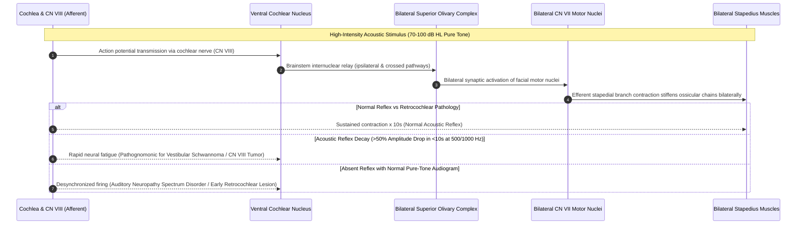

# Acoustic reflex thresholds and reflex decay testing identify retrocochlear lesions and facial nerve pathology

## Active Recall

> [!question]- What is the complete four-step neural pathway of the stapedial acoustic reflex arc (afferent limb, brainstem interneurons, and efferent limb)?
> *Answer / Clinical Rationale*: (1) **Afferent Limb**: Sound stimulates cochlear hair cells $\rightarrow$ **Cochlear Nerve ($CN\ VIII$)** $\rightarrow$ **Ventral Cochlear Nucleus (VCN)** in the pontomedullary junction. (2) **Brainstem Interneurons**: Axons project ipsilaterally and cross the trapezoid body to the contralateral **Superior Olivary Complex (SOC)**. (3) **Interneuron Connection**: SOC neurons project to the **Facial Nerve Motor Nucleus ($CN\ VII$)** bilaterally. (4) **Efferent Limb**: Facial motor fibers travel through the mastoid $CN\ VII$ segment $\rightarrow$ **Nerve to the Stapedius muscle** $\rightarrow$ bilateral stapedius muscle contraction, stiffening the ossicular chain.

> [!question]- What are the diagnostic criteria for a positive acoustic reflex decay test, and what retrocochlear pathology does it indicate?
> *Answer / Clinical Rationale*: A test is **positive for abnormal reflex decay** if the amplitude of the stapedius reflex contraction **declines by $>50\%$ within 10 seconds** when presented with a continuous tone at **$10\text{ dB}$ above Acoustic Reflex Threshold (ART) at $500\text{ Hz}$ or $1000\text{ Hz}$**. This rapid neural fatigue (inability of $CN\ VIII$ to maintain synchronous firing under sustained acoustic load) is highly indicative of a **retrocochlear lesion, specifically vestibular schwannoma (acoustic neuroma)** or cerebellopontine angle mass.

> [!question]- How do acoustic reflex patterns localize a facial nerve lesion proximal versus distal to the nerve to the stapedius?
> *Answer / Clinical Rationale*: (1) **Lesion Proximal to Nerve to Stapedius (e.g. Geniculate Ganglion, Tympanic Segment, Intracanalicular)**: Efferent stapedial innervation is disrupted $\rightarrow$ **Acoustic reflexes are absent in the affected ear** (both ipsilateral probe and contralateral stimulus). (2) **Lesion Distal to Nerve to Stapedius (e.g. Mastoid segment distal to nerve takeoff, Stylomastoid foramen, Extracranial Bell's palsy)**: Stapedial branch is spared $\rightarrow$ **Acoustic reflexes remain intact and present bilaterally**.

## Core Clinical & Mechanistic Principles

The **stapedius acoustic reflex** is an involuntary, bilateral [[Tympanometry classifies middle ear compliance and pressure into Jerger Types A, As, Ad, B, and C|middle]] ear muscle contraction triggered by high-intensity acoustic stimuli ($70\text{ to }100\text{ dB HL}$ above pure-tone threshold) designed to attenuate low-frequency sound transmission:

## Connected Concepts & Graph Traversal
- **Tympanometric Classification**: [[Tympanometry classifies middle ear compliance and pressure into Jerger Types A, As, Ad, B, and C|Jerger Tympanometric Curves]]
- **ABR Electrophysiology**: [[Auditory brainstem response waves I through V identify retrocochlear and brainstem pathology|ABR Wave Peak Latencies]]
- **Vestibular Schwannoma Staging**: [[Koos grading system classifies vestibular schwannomas from Stage I intracanalicular to Stage IV brainstem compression|Koos Vestibular Schwannoma Staging]]
- **Facial Nerve Segments**: [[The facial nerve traverses six distinct anatomical segments from the pons to the parotid gland|CN VII Anatomical Segments]]
- **Facial Paralysis Workup**: [[Electroneuronography showing greater than ninety percent degeneration within fourteen days indicates severe facial nerve axonal injury|ENoG & Facial Nerve Prognostication]]
- **Otosclerosis & Stapes Fixation**: [[Otosclerosis is characterized by abnormal bone remodeling of the otic capsule causing stapes fixation|Otosclerosis Footplate Pathology]]
