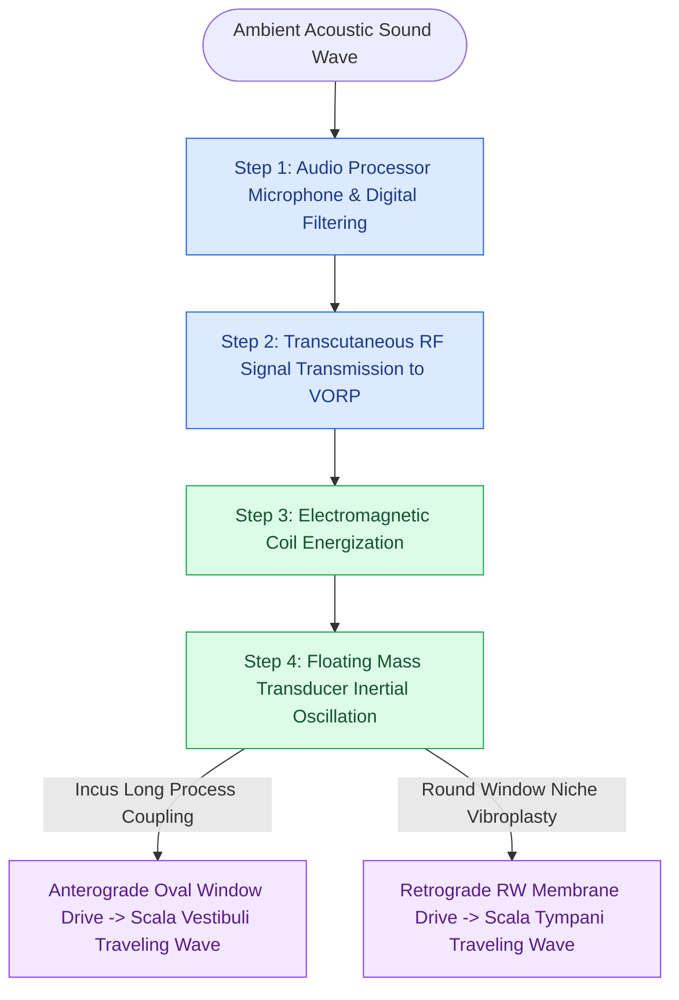

# Active middle ear implants drive ossicular vibration via floating mass transducers to rehabilitate sensorineural and mixed hearing loss without external canal occlusion

## Active Recall

> [!question]- How does the floating mass transducer (FMT) of an active middle ear implant generate vibratory signal without an external fixed counter-bearing?
> *Answer / Clinical Rationale*: The FMT consists of a miniature hermetically sealed titanium cylinder housing an internal permanent magnet suspended between two delicate coils. When incoming audio signals energize the electromagnetic coils, the internal magnet oscillates by inertial reaction. Because the mass of the magnet vibrates within the housing, reactive mechanical forces drive the titanium casing to vibrate against whatever middle ear or inner ear structure it is coupled to (e.g., the long process of the incus for anterograde stapes/oval window drive, or the round window membrane niche for retrograde scala tympani drive), effectively driving cochlear sound transmission without requiring an external rigid bony anchor.
>
> [!question]- What are the primary clinical indications for choosing an active middle ear implant over a conventional acoustic hearing aid?
> *Answer / Clinical Rationale*: AMEIs are indicated for patients with moderate-to-severe sensorineural hearing loss, conductive hearing loss, or mixed hearing loss who cannot wear conventional hearing aids due to chronic external otitis, canal stenosis, severe cerumen impaction, or intolerable occlusion effect. Furthermore, because the ear canal remains completely open and sound is delivered directly as mechanical vibration to the ossicles or inner ear, acoustic feedback (whistling) is completely eliminated, enabling superior high-frequency gain and musical fidelity.

## Core Clinical & Mechanistic Principles

Active middle ear implants (AMEIs) bridge the therapeutic gap between conventional acoustic hearing aids and cochlear implants. Conventional hearing aids rely on acoustic amplification delivered via a loudspeaker into the external auditory canal. In patients with severe mixed hearing loss, canal stenosis, or chronic eczematous otitis externa, acoustic amplification produces severe occlusion sensations, ear canal moisture entrapment, and acoustic feedback squeal at high gains. AMEIs circumvent the external auditory canal entirely by converting acoustic energy into direct mechanical vibrations of the middle ear ossicular chain or the otic capsule.

The most widely utilized semi-implantable system is the Vibrant Soundbridge (VSB), consisting of an external audio processor (AP) held magnetically against the postauricular scalp and an internal vibrating ossicular prosthesis (VORP). The active component of the VORP is the Floating Mass Transducer (FMT). Unlike traditional piezoelectric devices that require fixed rigid mounting to the mastoid cortex (which are susceptible to skull vibration dampening and surgical shifting), the FMT operates on inertial electromagnetic mechanics. The FMT casing is crimped directly onto the long process of the incus, parallel to the natural ossicular axis of vibration, preserving the native [[The middle ear transformer ratio provides twenty-seven decibels of acoustic impedance matching|acoustic impedance matching]] of the tympano-ossicular apparatus.

In ears with severe ossicular discontinuity, fixed stapes, or congenital aural atresia, the FMT can be coupled directly to the [[Round window and extended round window insertions minimize intracochlear acoustic trauma|round window membrane]] (round window vibroplasty). In this configuration, the FMT is nestled into the round window niche and secured against a fascia or perichondrium interposition graft. The inertial oscillations directly compress and decompress the perilymph within the scala tympani, establishing a retrograde cochlear traveling wave that provides powerful amplification across speech frequencies (500 to 4000 Hz) without requiring ossicular reconstruction.

### Surgical Technique & Coupling Biomechanics

1. **Cortical Mastoidectomy & Posterior Tympanotomy**: A standard cortical mastoidectomy and wide facial recess approach are completed to visualize the incudostapedial joint, long process of the incus, and round window niche.
2. **VORP Receiver Well Creation**: A shallow bone bed is drilled in the parieto-occipital calvarium 45 to 60 mm posterior-superior to the external canal, with tie-down suture holes to anchor the ceramic receiver package.
3. **FMT Delivery and Alignment**: The flexible conductor link is guided through the mastoid cavity and facial recess into the middle ear. For incus attachment, the FMT titanium clip is positioned onto the middle third of the long process of the incus, ensuring that the longitudinal axis of the transducer aligns with the vector of stapes footplate displacement.
4. **Crimping Dynamics**: Specialized crimping forceps gently compress the titanium clip wings around the incus. Under-crimping leads to loose coupling, acoustic energy loss, and high-frequency gain attenuation; over-crimping risks ischemic necrosis of the incus long process.
5. **Round Window Vibroplasty Protocol**: When the incus is absent, the round window niche overhang is meticulously drilled with a 1.0 mm diamond burr to expose the entire secondary tympanic membrane. A 0.2 mm snippet of autologous temporal fascia is positioned over the membrane, and an angled clip or ball-type FMT is seated directly against the niche, stabilized with fibrin glue.

## Connected Concepts & Graph Traversal
- **Prosthetic Alternative**: [[Total ossicular replacement prosthesis TORP bridges the malleus or tympanic membrane to the stapes footplate]]
- **Surgical Approach**: [[Posterior tympanotomy facial recess approach opens the corridor between CN VII and chorda tympani]]
- **Implant Alternative**: [[Transcutaneous and percutaneous bone conduction implants bypass conductive and mixed hearing losses]]
- **Audiometric Baseline**: [[Hearing aid selection is driven by audiometric configuration and verified with real-ear measurement]]
- **Incus Microanatomy**: [[The distance from the incus long process to the stapes footplate averages four to four point five millimeters]]
