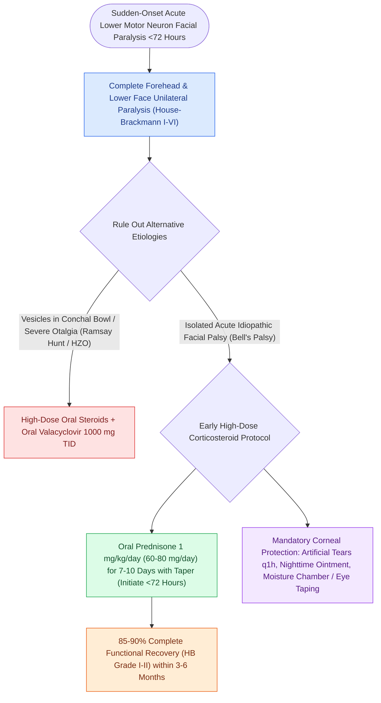

# Acute Bell's palsy presents with unilateral lower motor neuron facial paralysis treated with early oral steroids

## Active Recall

> [!question]- Why is the labyrinthine segment of the facial nerve the primary site of entrapment and ischemia in Bell's palsy?
> *Answer / Clinical Rationale*: The labyrinthine segment is the **narrowest segment of the fallopian canal (averaging 0.68 mm in diameter)** and lacks connective tissue epineurium. Any inflammatory edema induced by viral reactivation immediately compresses the microvascular supply against the unyielding bony canal, causing localized ischemia and conduction block.

> [!question]- What is the gold standard medical treatment for acute Bell's palsy, within what timeframe must it be started, and what is the role of antiviral therapy?
> *Answer / Clinical Rationale*: **High-dose oral corticosteroids (Prednisone $1\text{ mg/kg/day}$ or $60\text{–}80\text{ mg/day}$ for 10 days)** initiated within **$72\text{ hours}$ of symptom onset** (increasing complete recovery from $\sim 70\%$ to $>85\text{–}90\%$). Antiviral monotherapy is ineffective; adding **Valacyclovir ($1,000\text{ mg}$ TID for 7 days)** to oral steroids is optional and may offer modest additive benefit in severe complete paralysis (HB Grade IV–VI).

> [!question]- What electrophysiologic threshold on ENoG indicates severe axonal degeneration warranting consideration for surgical decompression?
> *Answer / Clinical Rationale*: Greater than **90% degeneration** (amplitude reduction) of the paralyzed side CMAP compared to the healthy contralateral side, measured within **3 to 14 days** of onset, coupled with the absence of voluntary motor unit action potentials on needle EMG.

## Core Clinical & Mechanistic Principles

**Bell's palsy** is the most common cause of acute, unilateral, lower motor neuron (LMN) facial nerve paralysis ($60\text{–}70\%$ of all cases), widely attributed to latent herpes simplex virus type 1 (HSV-1) reactivation within the **[[The first genu marks the location of the geniculate ganglion and origin of the greater superficial petrosal nerve|geniculate ganglion]]**. Viral inflammation and demyelination cause axonal edema within the rigid, unyielding bony fallopian canal. The narrowest segment of the fallopian canal—the **[[The labyrinthine segment is the narrowest portion of the Fallopian canal and most vulnerable to edema|labyrinthine segment]]** (meatal foramen, mean diameter $0.68\text{ mm}$)—acts as a mechanical bottleneck; axonal swelling here creates a compartment syndrome, leading to vascular compression, ischemia, and conduction block (**neuropraxia**) or axonal degeneration (**axonotmesis**).

Clinical evaluation reveals acute unilateral paresis or complete paralysis peaking within $<72\text{ hours}$ and affecting all five branches of CN VII equally (including forehead weakness, which distinguishes LMN paralysis from upper motor neuron / stroke-related hemiparesis which spares the forehead due to bilateral cortical innervation). Severity is graded using the [[House-Brackmann grading system stratifies facial nerve function from Grade I normal to Grade VI total paralysis|House-Brackmann (HB) grading scale]] (Grade I normal to Grade VI total flaccid paralysis). Other cranial nerves must be normal, and physical exam must rule out [[Temporal bone longitudinal and transverse fractures cause delayed or immediate facial paralysis|temporal bone trauma]], vesicles of **[[Ramsay Hunt syndrome herpes zoster oticus presents with severe facial paralysis, otalgia, and auricular vesicles|Ramsay Hunt syndrome]]** (Herpes zoster oticus), parotid neoplasms, and middle ear cholesteatoma.

- **Clinical Evidence-Based Pharmacotherapy (AAO-HNS Guidelines)**:
  1. **Oral Corticosteroids (High-Dose Early Administration — Category 1)**:
     - **Oral Prednisone ($1.0\text{ mg/kg/day}$ or $60\text{–}80\text{ mg/day}$ for 7–10 days)**, initiated within **$72\text{ hours}$ of onset**.
     - Class 1 randomized trials demonstrate a significant increase in complete recovery from $70\%$ to **$>85\text{–}90\%$** at 3–9 months.
  2. **Antiviral Therapy (Valacyclovir / Acyclovir)**:
     - Routine antiviral monotherapy is ineffective and strongly discouraged.
     - Adding **Valacyclovir ($1,000\text{ mg}$ PO TID for 7 days)** to oral corticosteroids is optional and may provide marginal benefit in severe or complete paralysis (HB Grade IV–VI).
  3. **Mandatory Corneal Protection**:
     - Hourly preservative-free artificial tears by day, ophthalmic lubricating ointment at night, moisture chambers, and horizontal eyelid taping prevent exposure keratopathy and corneal ulceration.

### Key Consultation Supplies
- Otoscope with pneumatic bulb
- 512 Hz tuning fork
- Fluorescein eye strips and Wood's lamp or blue penlight (for corneal epithelial breakdown evaluation)
- Preservative-free artificial tear eye drops (e.g., Refresh Plus)
- Ophthalmic petrolatum-based lubricating ointment (e.g., Refresh Lacri-Lube or Refresh P.M.)
- Translucent moisture chambers / eye bubbles or polyethylene film
- Hypoallergenic paper or silicone medical tape (for horizontal eyelid closure)
- Oral high-dose corticosteroid prescription (prednisone 60–80 mg/day for 10 days) +/- antiviral therapy (valacyclovir 1 g PO TID for 7 days)
- Electrodiagnostic referral order: ENoG / EMG (timed for day 3 to day 14 post-onset)

## References
1. Baugh, R.F., Basura, G.J., Ishii, L.E., et al. (2013). Clinical Practice Guideline: Bell’s Palsy. *Otolaryngol Head Neck Surg*, 149(3_suppl):S1-S27.
2. Vrabec, J.T., Lin, J.W. (2013). Acute Facial Nerve Paralysis. In Johnson, J.J., Rosen, C.A. (Eds.), *Bailey’s Head and Neck Surgery-Otolaryngology* 5e (pp. 2503-2518). Baltimore, MD: Lippincott Williams & Wilkins.
3. Mattox, D.E., Vivas, E.X. (2020). Clinical Disorders of the Facial Nerve. In Flint, P.W., et al. (Eds.), *Cummings Otolaryngology Head and Neck Surgery* 7e (pp. 2587-2597). Philadelphia, PA: Elsevier.

## Connected Concepts & Graph Traversal
- **🔗 Grading & Assessment (FPRS)**: [[The House-Brackmann facial nerve grading system standardizes facial paralysis severity|House-Brackmann Scale]]
- **🔗 Corneal Protection Craft (FPRS)**: [[Upper eyelid platinum weights and lateral tarsal strips protect the cornea in flaccid facial paralysis|Upper Eyelid Weight Insertion]]
- **Electrodiagnostic Prognosis**: [[Electroneuronography showing greater than ninety percent degeneration within fourteen days indicates severe facial nerve axonal injury|ENoG Prognostication]]
- **Traumatic Differential**: [[Temporal bone longitudinal and transverse fractures cause delayed or immediate facial paralysis|Temporal Bone Trauma & CN VII]]
- **🔗 Advanced Dynamic Reanimation (FPRS)**: [[Hypoglossal-facial nerve transfer restores resting facial symmetry and basal muscle tone|Hypoglossal-Facial Transfer]]
