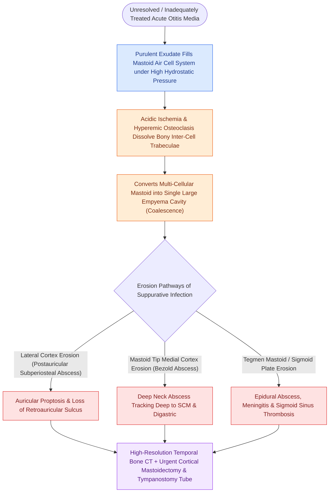

# Acute coalescent mastoiditis causes trabecular osteoclasis and subperiosteal abscess formation

## Active Recall

> [!question]- What pathophysiologic mechanism transforms simple acute mastoiditis into acute *coalescent* mastoiditis?
> *Answer / Clinical Rationale*: Obstruction of the **aditus ad antrum** traps purulent exudate under high pressure within the mastoid air cells. This produces local ischemia, hyperemic decalcification, and **osteoclastic resorption of the thin bony mastoid trabeculae**, coalescing separate air cells into a single large purulent empyema cavity.

> [!question]- What named subperiosteal abscess tracks through the mastoid tip medial to the sternocleidomastoid attachment?
> *Answer / Clinical Rationale*: **Bezold's abscess**, where pus erodes through the thin medial cortex of the mastoid tip (digastric groove) into the SCM sheath, tracking along the deep cervical fascia into the parapharyngeal space and superior mediastinum.

> [!question]- What clinical presentation differentiates a subperiosteal postauricular abscess from Citelli's and Luc's abscesses?
> *Answer / Clinical Rationale*: A classic **postauricular subperiosteal abscess** erodes lateral mastoid cortex over the antrum (Macewen's triangle), displacing the pinna anteriorly and inferiorly with loss of the postauricular crease. **Citelli's abscess** tracks posterior to the posterior belly of the digastric muscle, while **Luc's abscess** extends subperiosteally anteriorly over the root of the zygoma and external auditory canal.

## Core Clinical & Mechanistic Principles
**Acute coalescent mastoiditis** represents the most frequent intratemporal complication of acute otitis media (AOM), occurring when middle ear purulence extends into the mastoid pneumatic system with blockage of the ventilating **aditus ad antrum**:

- **Microbiology & Risk Factors**:
  - Dominant pathogens: *Streptococcus pneumoniae* (including multi-drug resistant serotypes), *Streptococcus pyogenes* (Group A Strep), *Staphylococcus aureus*, and *Pseudomonas aeruginosa* (in chronic/recurrent disease).
- **The Coalescent Cascade**:
  1. *Eustachian Tube Dysfunction & AOM*: Suppurative infection in the tympanic cavity.
  2. *Mucosal Hyperplasia & Aditus Blockage*: Mucosal edema seals the aditus ad antrum, isolating the mastoid antrum and surrounding periantral air cells.
  3. *Pressure Demineralization & Osteolysis*: Trapped pus under pressure causes vascular thrombosis, local acidosis, and osteoclast activation, melting the inter-cellular bony trabeculae (**coalescence**).
  4. *Cortical Erosion & Named Abscess Formations*:
     - **Postauricular Subperiosteal Abscess ($>80\%$)**: Lateral cortex erosion over Macewen's triangle, causing outward, downward pinna protrusion.
     - **Bezold's Abscess**: Medial mastoid tip erosion into the SCM muscle insertion and parapharyngeal space.
     - **Citelli's Abscess**: Posterior digastric groove erosion tracking toward the occipital bone.
     - **Luc's Abscess**: Subperiosteal pus tracking along the root of the zygomatic arch and temporal fossa.

### Medical & Surgical Management Hierarchy
- **Non-Coalescent Incipient Mastoiditis**: Intravenous broad-spectrum antibiotics (ampicillin-sulbactam, ceftriaxone) + wide myringotomy $\pm$ tympanostomy tube placement.
- **Coalescent Bone Erosion or Subperiosteal Abscess**: Mandatory **[[Complete cortical mastoidectomy unroofs the mastoid antrum and establishes dependent middle ear drainage|complete cortical mastoidectomy]]** combined with needle aspiration or incision and drainage of the subperiosteal abscess.

## Connected Concepts & Graph Traversal
- **Surgical Decompression**: [[Complete cortical mastoidectomy unroofs the mastoid antrum and establishes dependent middle ear drainage|Cortical Mastoidectomy Craft]]
- **Intracranial Spread**: [[Otogenic intracranial complications escalate from meningitis to sigmoid sinus thrombosis and brain abscess|Otogenic Intracranial Complications]]
- **Sinus Thrombophlebitis**: [[Lateral sinus thrombophlebitis presents with picket fence fevers and Griesinger sign requiring intravenous antibiotics and mastoidectomy|Lateral Sinus Thrombophlebitis]]
- **Facial Nerve Complication**: [[The facial nerve traverses six distinct anatomical segments from the pons to the parotid gland|Facial Nerve Anatomy & Dehiscence]]
- **AOM Foundations**: [[Uncomplicated acute otitis media in pediatric and adult patients is treated with first-line high-dose amoxicillin|AOM First-Line Management]]
