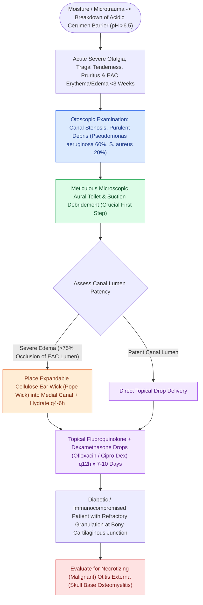

# Acute otitis externa is managed with topical antimicrobial-steroid drops and aural debridement

## Active Recall

> [!question]- Why are topical fluoroquinolone-steroid combination drops preferred over oral antibiotics for uncomplicated acute otitis externa?
> *Answer / Clinical Rationale*: Topical delivery achieves local antimicrobial concentrations 100 to 1,000 times higher than maximum systemic serum levels, rapidly eradicating *Pseudomonas* and *S. aureus* without driving systemic resistance. Furthermore, fluoroquinolones are non-ototoxic (safe in perforated eardrums), while topical dexamethasone rapidly reduces canal edema and inflammatory pain.

> [!question]- What anatomical feature of the cartilaginous external auditory canal permits anterior inflammatory spread into the parotid gland bed?
> *Answer / Clinical Rationale*: The **fissures of Santorini** (incisurae santorini) are naturally occurring vertical fibrous dehiscences in the anterior cartilaginous EAC that allow vascular and lymphatic communication with the deep lobe of the parotid gland and parapharyngeal space.

## Core Clinical & Mechanistic Principles

**Acute otitis externa (AOE)**, commonly termed "swimmer's ear", is a diffuse inflammatory condition of the external auditory canal (EAC) integument, predominantly triggered by bacterial breakdown of the protective cerumen lipid barrier. The physiologic EAC maintains an acidic pH (5.0–5.7) rich in lysozymes and fatty acids. Excess moisture, thermal humidity, and mechanical trauma (e.g., cotton swabs) disrupt this epithelial mantle, allowing bacterial proliferation. The primary pathogens are **Pseudomonas aeruginosa** (~60%) and **Staphylococcus aureus** (~15–20%), with fungal superinfections (**Aspergillus niger**, **Candida albicans**) occurring in warm climates or after prolonged topical antibiotics.

Clinically, AOE manifests with severe otalgia, exquisite **tragal tenderness**, pinna traction pain, pruritus, canal edema, and purulent otorrhea. Extension through the **fissures of Santorini** (lateral cartilaginous EAC dehiscences) can produce preauricular or parotid swelling mimicking primary parotitis. In high-risk hosts (elderly diabetics, immunocompromised), untreated AOE can breach the osteocartilaginous junction to become [[Malignant necrotizing otitis externa is an invasive pseudomonal skull base osteomyelitis in elderly diabetic patients|malignant necrotizing otitis externa]].

### Key Consultation Supplies
- Coaxial surgical headlight, loupes, or binocular operating microscope
- Metallic ear speculums (sizes 3, 4, 5 mm)
- Frazier suction tips (sizes 3 Fr, 5 Fr, 7 Fr) with control thumb-hole
- Cerumen curettes (Billeau / Buck / Lucae)
- Compressed polyvinyl alcohol ear wicks (Pope Oto-Wick)
- Hartmann / micro-alligator forceps
- Topical antimicrobial-steroid otic suspensions (ciprofloxacin-dexamethasone or ofloxacin 0.3%)
- Sterile culture swabs (for refractory, severe, or immunocompromised presentations)

> [!example]- **Operative Note Template: External auditory canal debridement and Pope ear wick placement**
> **PROCEDURE**: External auditory canal debridement and Pope [[Ear wick placement bridges severe canal edema to deliver topical antimicrobial drops to the medial external auditory canal|ear wick placement]]
> **PRE-PROCEDURAL DIAGNOSIS**: Severe acute otitis externa of the [right/left] ear with complete canal stenosis
> **POST-PROCEDURAL DIAGNOSIS**: Severe acute otitis externa of the [right/left] ear status-post debridement and ear wick stenting
> **SURGEON**: [Surgeon Name, MD]
> **ASSISTANT**: [Resident/Fellow Name, MD]
>
> **PROCEDURE IN DETAIL**:
> Informed consent was obtained. The patient was positioned comfortably under the binocular operating microscope. An ear speculum was gently engaged in the [right/left] external auditory meatus.
>
> The external auditory canal demonstrated circumferential 360-degree erythema and marked soft-tissue edema with near-complete luminal occlusion and thick desquamated epithelial purulence. Using a 5 French Frazier suction tip and micro-curette, purulent debris and macerated epithelium were gently debrided from the lateral and mid-canal. The tympanic membrane was partially visualized and noted to be intact without perforation.
>
> Given persistent luminal occlusion preventing liquid drop penetration, a dry compressed Pope Oto-Wick was grasped with micro-alligator forceps and smoothly advanced across the stenotic canal segment under direct microscopic vision. The wick was hydrated in situ with 5 drops of ciprofloxacin-dexamethasone otic suspension, expanding circumferentially to stent the canal lumen open. The patient was instructed on dry ear precautions and prescribed ciprofloxacin-dexamethasone drops to be applied directly onto the wick 3 times daily, with scheduled clinic return in 48–72 hours for wick removal and repeat aural toilet. The patient tolerated the procedure well.

## References
1. Rosenfeld, R.M., Schwartz, S.R., Cannon, C.R., et al. (2014). Clinical Practice Guideline: Acute Otitis Externa. *Otolaryngol Head Neck Surg*, 150(1_suppl):S1-S24.
2. Naples, J.G., Brant, J.A., Ruckenstein, M.J. (2020). Infections of the External Ear. In Flint, P.W., et al. (Eds.), *Cummings Otolaryngology Head and Neck Surgery* 7e (pp. 2093-2100). Philadelphia, PA: Elsevier.
3. Linstrom, C.J., Lucente, F.E. (2013). Diseases of the External Ear. In Johnson, J.J., Rosen, C.A. (Eds.), *Bailey’s Head and Neck Surgery-Otolaryngology* 5e (pp. 2333-2357). Baltimore, MD: Lippincott Williams & Wilkins.

## Connected Concepts & Graph Traversal
- **Critical Complication Rescue**: [[Malignant necrotizing otitis externa is an invasive pseudomonal skull base osteomyelitis in elderly diabetic patients|Malignant Otitis Externa]]
- **Procedural Stenting**: [[Ear wick placement bridges severe canal edema to deliver topical antimicrobial drops to the medial external auditory canal|Ear Wick Insertion Technique]]
- **Diagnostic Differential**: [[Traumatic tympanic membrane perforations heal spontaneously in the majority of cases without early surgery|Tympanic Membrane Trauma]]
- **Related Otologic Infection**: [[Acute perichondritis of the auricle requires antipseudomonal therapy to prevent cartilage necrosis|Auricular Perichondritis]]
- **Surgical Craft**: [[External auditory canal foreign bodies require atraumatic extraction under microscopic guidance to protect the tympanic membrane|Aural Debridement & Foreign Body]]
