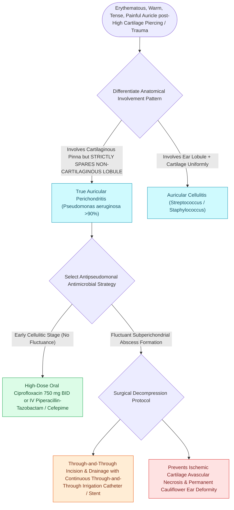

# Acute perichondritis of the auricle requires antipseudomonal therapy to prevent cartilage necrosis

## Active Recall

> [!question]- What physical examination sign reliably distinguishes acute auricular perichondritis from auricular cellulitis?
> *Answer / Clinical Rationale*: **Sparing of the ear lobule**. The lobule consists purely of fibrofatty tissue devoid of cartilage. Because perichondritis is an infection restricted to the perichondrial sheath, the lobule remains completely unaffected, whereas preauricular cellulitis and erysipelas involve the entire ear including the lobule.

> [!question]- What is the first-line antimicrobial choice for perichondritis following a high cartilage ear piercing, and why?
> *Answer / Clinical Rationale*: **Oral ciprofloxacin (750 mg BID)** or IV antipseudomonals (ceftazidime, pip-tazo). *Pseudomonas aeruginosa* causes >90% of piercing-related perichondritis due to bacterial colonization of piercing guns, contaminated water, or jewelry, and standard staphylococcal penicillins/cephalosporins offer zero pseudomonal coverage.

## Core Clinical & Mechanistic Principles

**Acute auricular perichondritis** is an aggressive bacterial infection of the perichondrial sheath of the pinna, frequently initiated by high ear piercings (transcartilaginous piercings of the helix or antihelix), blunt or penetrating auricular trauma, untreated [[Auricular hematoma evacuation and bolster compression prevents permanent cauliflower ear deformity|auricular hematomas]], or extension from severe [[Acute otitis externa is managed with topical antimicrobial-steroid drops and aural debridement|acute otitis externa]].

The predominant causative pathogen is **Pseudomonas aeruginosa** (~90% in piercing-related chondritis), followed by *Staphylococcus aureus* and *Streptococcus pyogenes*. The pathognomonic physical examination finding is intense erythema, warmth, severe pain, and fluctuance involving the cartilaginous pinna (helix, antihelix, tragus, concha) with **strict sparing of the non-cartilaginous ear lobule**. This lobule-sparing feature critically distinguishes perichondritis from generalized cutaneous cellulitis (which involves the lobule) and mimics [[Relapsing polychondritis causes autoimmune auricular and laryngotracheal chondritis with sparing of the non-cartilaginous lobule|relapsing polychondritis]] (an autoimmune inflammatory counterpart).

### Key Consultation Supplies
- Appropriate PPE including eye protection and sterile gloves
- Coaxial surgical headlight or loupes
- Povidone-iodine or chlorhexidine skin prep
- #15 blade scalpel and fine tenotomy micro-scissors
- 1% lidocaine with 1:100,000 epinephrine
- Micro-curette and 5 French Frazier suction tip
- Sterile culture swabs (aerobic, anaerobic, fungal)
- Dental cotton rolls, Xeroform gauze, or buttons for bolster compression
- 3-0 or 4-0 nylon / Prolene sutures on straight or cutting needles
- Oral or IV antipseudomonal antibiotics (ciprofloxacin, levofloxacin, ceftazidime)

## References
1. Linstrom, C.J., Lucente, F.E. (2013). Diseases of the External Ear. In Johnson, J.J., Rosen, C.A. (Eds.), *Bailey’s Head and Neck Surgery-Otolaryngology* 5e (pp. 2333-2357). Baltimore, MD: Lippincott Williams & Wilkins.
2. Naples, J.G., Brant, J.A., Ruckenstein, M.J. (2020). Infections of the External Ear. In Flint, P.W., et al. (Eds.), *Cummings Otolaryngology Head and Neck Surgery* 7e (pp. 2093-2100). Philadelphia, PA: Elsevier.
3. Rosenfeld, R.M., Schwartz, S.R., Cannon, C.R., et al. (2014). Clinical Practice Guideline: Acute Otitis Externa. *Otolaryngol Head Neck Surg*, 150(1_suppl):S1-S24.

## Connected Concepts & Graph Traversal
- **Precipitating Trauma**: [[Auricular hematoma evacuation and bolster compression prevents permanent cauliflower ear deformity|Auricular Hematoma]]
- **Infectious Source**: [[Acute otitis externa is managed with topical antimicrobial-steroid drops and aural debridement|Acute Otitis Externa]]
- **Invasive Skull Base Extension**: [[Malignant necrotizing otitis externa is an invasive pseudomonal skull base osteomyelitis in elderly diabetic patients|Malignant Otitis Externa]]
- **🔗 Autoimmune Mimic (Laryngology)**: [[Relapsing polychondritis causes autoimmune auricular and laryngotracheal chondritis with sparing of the non-cartilaginous lobule|Relapsing Polychondritis]]
- **Anatomical Foundation**: [[Inner ear barotrauma and decompression sickness produce acute cochleovestibular dysfunction through pressure-induced membrane rupture or inert gas bubble embolization requiring hyperbaric therapy|Inner Ear Barotrauma]]
