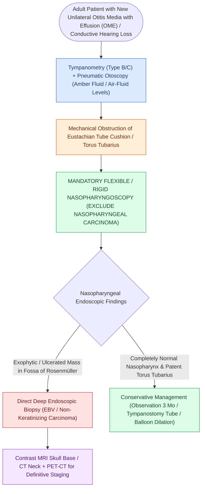

# Adult unilateral otitis media with effusion mandates nasopharyngoscopy to exclude nasopharyngeal carcinoma

## Active Recall

> [!question]- What anatomic site is inspected and why does tumor there cause effusion?
> *Answer / Clinical Rationale*: The **fossa of Rosenmuller** — adjacent tumor obstructs the eustachian tube orifice, producing a unilateral middle ear effusion.

> [!question]- Unilateral effusion plus new diplopia in an adult: next two steps?
> *Answer / Clinical Rationale*: Nasopharyngoscopy and skull base MRI the same day — VI palsy suggests petroclival/cavernous extension.

## Core Clinical & Mechanistic Principles
- A new unilateral effusion in an adult is **nasopharyngeal carcinoma until the fossa of Rosenmuller is inspected** — tumor obstructing the tubal orifice is the mechanism.
- Risk enrichment: southern Chinese and Southeast Asian ancestry, EBV exposure, salted-fish nitrosamines; but the scope is cheap and the miss is expensive in every patient.
- Other unilateral mimics after a normal nasopharynx: [[Spontaneous CSF otorrhea from tegmen dehiscence requires multilayer middle fossa or transmastoid repair|tegmen]] CSF 'effusion,' skull base neoplasm, and simple post-viral ETD — the diagnosis of exclusion.
- Serous effusion plus cranial neuropathy (V, VI) or neck node moves imaging to the same visit.

### Management & Critical Safety Checks
- Flexible nasopharyngoscopy at first presentation; biopsy any asymmetry of Rosenmuller. If normal and effusion persists, tube placement with follow-up.
- Clear, pulsing, or copious 'effusion' fluid after myringotomy is sent for beta-2 transferrin.

## Connected Concepts & Graph Traversal
- **🔗 The Primary Tumor (Head and Neck)**: [[Nasopharyngeal carcinoma is an EBV-driven malignancy treated primarily with radiation and concurrent chemotherapy|Nasopharyngeal Carcinoma]]
- **CSF Mimic**: [[Spontaneous CSF otorrhea from tegmen dehiscence requires multilayer middle fossa or transmastoid repair|Tegmen CSF Effusion Mimic]]
- **Tubal Physiology**: [[Eustachian tube dysfunction divides into dilatory and patulous forms with opposite treatment goals|Eustachian Tube Dysfunction]]
- **Diagnostic Immittance**: [[Tympanometry classifies middle ear compliance and pressure into Jerger Types A, As, Ad, B, and C|Jerger Type B Flat Curves]]
- **Surgical Myringotomy**: [[Uncomplicated acute otitis media in pediatric and adult patients is treated with first-line high-dose amoxicillin|Myringotomy & Middle Ear Effusion]]
