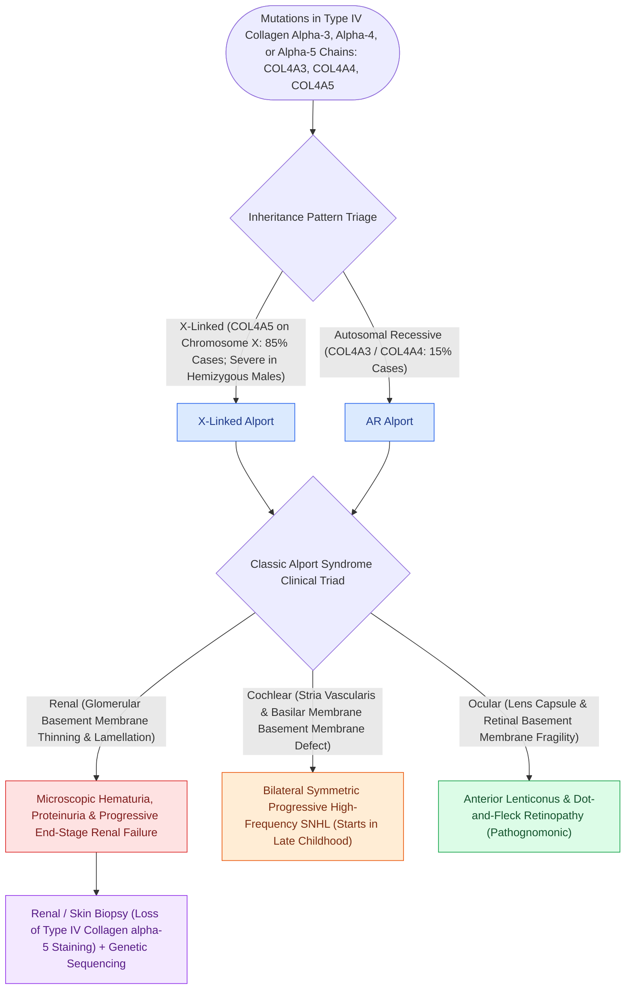

# Alport syndrome manifests with progressive sensorineural hearing loss, anterior lenticonus, and progressive glomerulonephritis

## Active Recall

> [!question]- What is the genetic inheritance, mutation locus, and structural basement membrane defect in Alport syndrome?
> *Answer / Clinical Rationale*: Approximately $85\%$ of cases are **X-linked dominant** caused by mutations in **COL4A5** (encoding the $\alpha 5$ chain of type IV collagen on chromosome Xq22.3), while $15\%$ are autosomal recessive (*COL4A3* / *COL4A4*). Defective assembly of the $\alpha 3\alpha 4\alpha 5(\text{IV})$ collagen network disrupts basement membranes in the **renal glomerulus**, **cochlear stria vascularis and basilar membrane**, and the **ocular lens capsule**.

> [!question]- What is the typical age of onset, audiometric configuration, and progression of hearing loss in affected males?
> *Answer / Clinical Rationale*: Hearing is **normal at birth**. Progressive bilateral sensorineural hearing loss typically develops in **late childhood or early adolescence (ages 8–12)**, initially affecting **mid-to-high frequencies ($2,000\text{–}8,000\text{ Hz}$)** before progressing to a severe flat loss across all frequencies in early adulthood. SNHL mirrors the severity of renal decline.

> [!question]- What pathognomonic ophthalmologic and renal findings define Alport syndrome?
> *Answer / Clinical Rationale*: **Anterior lenticonus** (conical protrusion of the anterior lens pole into the anterior chamber, pathognomonic for Alport) and macular "fleck retinopathy". Renal disease begins with persistent microscopic hematuria in infancy, progressing through proteinuria to **end-stage renal disease (ESRD)** requiring hemodialysis or renal transplantation by age 20–30 in untreated males.

## Core Clinical & Mechanistic Principles
Alport syndrome occurs in $1\text{ in }10,000\text{ to }50,000$ individuals, representing a systemic type IV collagenopathy:

### Auditory Rehabilitation & Clinical Management
- **Early Audiometric Screening**:
  - Annual audiograms starting at age 5 for all children with microscopic hematuria or positive family history of Alport syndrome.
- **Hearing Aid Amplification**:
  - Highly responsive to digital hearing aid [[Hearing aid selection is driven by audiometric configuration and verified with real-ear measurement|amplification]].
  - Cochlear implantation is indicated if hearing declines to severe-to-profound thresholds, achieving excellent speech discrimination outcomes.
- **Nephrology Co-Management**:
  - Early initiation of ACE inhibitors / ARBs reduces intraglomerular pressure and significantly delays the progression to end-stage renal disease.

## Connected Concepts & Graph Traversal
- **Basilar Membrane & Cochlear Mechanics**: [[Outer hair cell electromotility driven by prestin amplifies cochlear micromechanics|Basilar Membrane Transduction Mechanics]]
- **🔗 Syndromic SNHL Overview (Pediatrics)**: [[Syndromic pediatric sensorineural hearing loss encompasses Pendred, Usher, Waardenburg, and Jervell and Lange-Nielsen syndromes|Syndromic SNHL Overview]]
- **🔗 Renal-Hearing Syndromic Differential (Pediatrics)**: [[Branchio-oto-renal syndrome pairs branchial fistulas, preauricular pits, structural renal dysplasia, and mixed hearing loss|Branchio-Oto-Renal (BOR) Comparison]]
- **Cochlear Implantation**: [[Cochlear implant candidacy criteria include severe to profound bilateral sensorineural hearing loss|Cochlear Implantation in Progressive SNHL]]
- **Ocular-Auditory Differential**: [[Usher syndrome combines congenital sensorineural hearing loss with progressive retinitis pigmentosa and vestibular dysfunction|Usher Syndrome Visual-Hearing Differential]]
